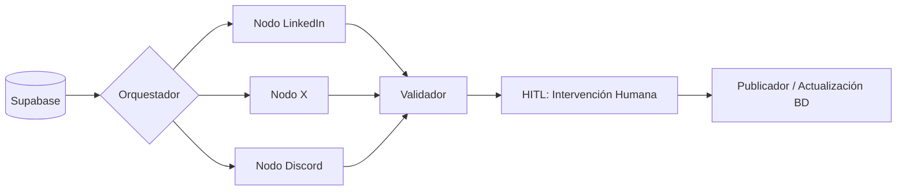

# 📋 Informe de Sprint Review — Sesión del 15 de octubre

## ℹ️ Información General

* **Fecha:** 15 de octubre.

* **Próxima sesión:** Lunes (meta: definir ideas de presentación y presentadores para el Demo Day).

* **Fase actual:** Integración de frontend/backend, depuración de base de datos, ajustes del orquestador y preparación para Demo Day.

* **Objetivo principal:** Revisar el estado de la unificación de la rama `main`, resolver los bloqueos de persistencia de datos en el flujo de mensajes, mostrar las pruebas del orquestador en redes sociales y establecer la estrategia del pitch final.

## 📌 Resumen Ejecutivo

La sesión se centró en la integración del sistema y la planificación del evento de cierre. Se logró la unificación de todas las ramas en el repositorio `main`, aunque el despliegue del frontend presentó pérdidas de variables de entorno y bloqueos de estado en la base de datos durante la transición de mensajes, los cuales ya están siendo abordados. El flujo del orquestador está estructurado y realizando publicaciones coherentes de prueba en plataformas como LinkedIn, aplicando filtros de relevancia mediante modelos de IA. Finalmente, se introdujo la dinámica de evaluación para el Demo Day, acordando utilizar una técnica de *storytelling* de 5 minutos y delegando la definición de presentadores (y sus respaldos) para la sesión del lunes.

## 💬 Temas Clave y Discusiones

### ⚙️ Integración de Frontend y Base de Datos

* **Unificación:** Se consolidaron todas las ramas en `main` utilizando auditorías asistidas por IA para evitar pérdida de datos o exposición de claves de seguridad.

* **Problemas de Despliegue:** Al cambiar de rama en Netlify, se perdieron las variables de conexión a la base de datos. Se está migrando el despliegue a Google Cloud para aprovechar los créditos y restaurar la conexión.

* **Bloqueos de Estado:** Los mensajes transferidos entre ingesta y *copywriting* desaparecían de la interfaz debido a bloqueos de memoria en la base de datos. Se resolvieron creando estados y variables específicas en las tablas para encapsular y retener el mensaje durante todo el flujo.

* **Tablero OCI:** Es el único módulo pendiente de integración en el frontend. Se solicitó apoyo del equipo para completarlo, requiriendo que quien ayude descargue el proyecto en local desde `main` y modifique exclusivamente la vista de OCI sin alterar otras variables.

### 🧠 Avances del Orquestador y Flujo de Publicación

* **Manejo de Nodos:** El orquestador extrae datos de la tabla de lotes/historial y decide la distribución a redes sociales basándose en la relevancia del mensaje.

* **Modelos de IA:** Se están implementando modelos de respaldo (ej. Llama 3.1 y Gemma) para gestionar automáticamente peticiones de menor impacto (puntaje menor a 35) o descartar spam.

* **Pruebas en vivo:** Las interacciones automáticas del bot en LinkedIn han demostrado ser muy coherentes y contextuales.

* **Ajuste de Marca:** Se acordó eliminar validaciones secundarias para dejar un solo perfil oficial ("club de hecho oficial") publicando, unificando la identidad de la marca.

### 🎬 Preparación para el Demo Day

* **Formato y Evaluación:** El pitch dura estrictamente 5 minutos. La calificación se divide en: 50% trabajo en equipo (métricas previas), 35% integración de la solución y 15% calidad del pitch.

* **Estrategia Recomendada:** Se sugiere fuertemente utilizar *storytelling*, presentando un problema inicial, mostrando la herramienta por ~3 minutos y concluyendo con el impacto generado.

* **Respaldos Técnicos:** Es obligatorio designar presentadores secundarios o "backups" organizados en lista, para evitar la descalificación en caso de fallos de internet o energía del presentador principal.

## 🤝 Acuerdos y Decisiones

* Organizar una sesión extraordinaria de trabajo en equipo (Front/Back) para ayudar a finalizar el tablero OCI.

* Centralizar la identidad del bot en un solo perfil validador oficial ("club de hecho oficial") para mantener la cohesión de marca.

* Cada miembro del equipo deberá llevar ideas de presentación estructuradas como historias para la reunión del lunes.

* Elegir a un presentador principal y al menos dos personas de respaldo técnico para el día del Demo Day.

## 🚀 Plan de Acción / Tareas Pendientes

| Tarea / Acción a realizar | Responsable | Contexto o detalles clave |
| --- | --- | --- |
| Completar integración del tablero OCI en el frontend | Andrés (y voluntarios) | Descargar `main` localmente e integrar solo OCI sin tocar variables de otros módulos.

 |
| Coordinar reunión técnica de apoyo para el frontend | Equipo | Para distribuir la carga de trabajo actual.

 |
| Limpiar perfiles de prueba y dejar un solo publicador oficial | Enoc | Uniformar la salida de información en redes sociales.

 |
| Elaborar propuestas de *storytelling* para el Pitch | Todos | Preparar ideas de casos de uso reales para la próxima sesión.

 |
| Definir lista de presentadores (Principal y Backups) | Equipo | Se decidirá el lunes para mitigar riesgos de conexión el día de la presentación.

 |
