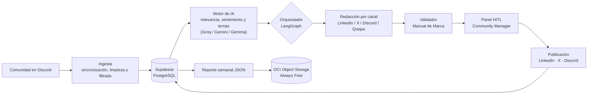
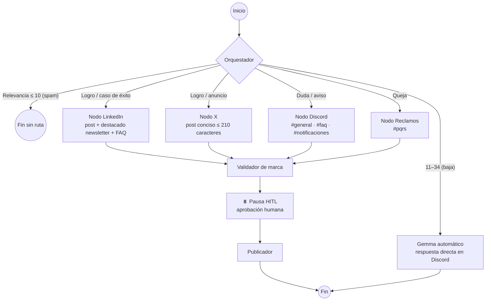

<p align="center">
  
</p>

# ☁️ CloudPulse — Motor Inteligente de Transformación y Distribución para Comunidades Digitales

> **Ningún mensaje sin respuesta. Ningún logro sin celebrar.**

**CloudPulse** es una solución de **CloudEDTech** que escucha la actividad orgánica de una comunidad en Discord, la analiza con IA (relevancia, sentimiento y temas) y la convierte en activos de marketing listos para publicar en **LinkedIn, X y Discord**, siempre con **revisión humana** (*Human-in-the-Loop*) antes de publicar. También atiende quejas y genera reportes semanales que se almacenan en **OCI Object Storage (Always Free)**.

Proyecto desarrollado por el **Equipo 27** para el **Hackathon ONE G10 — Oracle Next Education & Alura** (simulación No Country, Proyecto 3: *CommunityLab*).

---

## 📑 Contenido

- [El problema](#-el-problema)
- [La solución](#-la-solución)
- [Funcionalidades](#-funcionalidades)
- [Arquitectura](#️-arquitectura)
- [Stack tecnológico](#-stack-tecnológico)
- [Estructura del repositorio](#-estructura-del-repositorio)
- [Instalación y ejecución local](#-instalación-y-ejecución-local)
- [Pruebas](#-pruebas)
- [Despliegue en la nube](#️-despliegue-en-la-nube)
- [Documentación adicional](#-documentación-adicional)
- [Equipo](#-equipo)
- [Licencia](#-licencia)

---

## 🎯 El problema

Matías es *community manager* de una comunidad de estudiantes. Cada día llegan cientos de mensajes a varios canales de Discord: dudas, logros, quejas y spam. Leerlos uno por uno, decidir cuáles importan, redactar publicaciones para cada red, responder quejas y armar reportes le toma **10 pasos manuales**, y los mensajes más valiosos (un alumno atascado hace tres días, una contratación lograda gracias a un curso) se pierden en el historial.

## 💡 La solución

CloudPulse reduce el proceso a **3 pasos**: conectar la comunidad, dejar que la IA lea y clasifique, y que el community manager **apruebe** lo que se publica.

| Etapa | Qué hace |
|---|---|
| **1. Ingesta** | Sincroniza los mensajes de los canales de Discord, omite bots, los limpia, los ordena por fecha y los guarda. |
| **2. Análisis con IA** | Calcula relevancia (0–100), sentimiento, temas (hashtags) y segmento de cada mensaje, de forma individual o por lotes. |
| **3. Orquestación y redacción** | Un grafo de **LangGraph** decide a qué canales enviar cada mensaje y redacta el copy de cada red con la voz del Manual de Marca. |
| **4. Revisión humana (HITL)** | El community manager edita, aprueba o descarta antes de publicar. |
| **5. Publicación** | Envío real a LinkedIn, X y Discord (canales `#general`, `#faq`, `#notificaciones` y `#pqrs`). |
| **6. Informes** | Paquete semanal en JSON con métricas y activos, subido a **OCI Object Storage**. |

---

## ✨ Funcionalidades

<p align="center">
  
</p>

La interfaz web se organiza en cinco pestañas:

| Pestaña | Ruta | Qué hace |
|---|---|---|
| **Dashboard** | `/dashboard` | KPIs de la comunidad, gráficas de sentimiento y temas, historias destacadas y participación por canal. |
| **Ingesta de mensajes** | `/messages` | Sincronización con Discord, evaluación con IA (individual o por lotes) y filtros por estado: pendientes de evaluar, pendientes de publicar, proceso completo y descartados. |
| **Análisis** | `/analytics` | Métricas de sentimiento, emojis, hashtags, alineación de marca e *insights* sobre quejas. |
| **Redacción de contenidos** | `/content` | Mesa de trabajo multicanal: genera o regenera *copys* para LinkedIn, X y Discord, aprobación HITL, procesamiento masivo, anuncios oficiales y panel de quejas y soporte. |
| **Informes y almacenamiento** | `/oci-storage` | Generación del reporte semanal, carga al bucket de OCI Object Storage e historial de reportes (reintento y descarga). |

Se puede elegir entre tres modelos de IA: **Groq (Llama 3.3)**, **Google Gemma 4** y **Google Gemini Flash Lite**. Cada nodo del pipeline cuenta con un **modelo de respaldo** (*fallback*) por si el principal falla o se satura.

---

## 🏗️ Arquitectura

### Flujo de datos



### Grafo de orquestación (LangGraph)

El orquestador decide las rutas según la **relevancia** y el **tipo de mensaje** (bifurcación condicional):



---

## 🧰 Stack tecnológico

| Capa | Tecnologías |
|---|---|
| Frontend | React 19, TypeScript, Vite, Tailwind CSS 4, React Router, Recharts, Lucide |
| Backend / API | Python 3.10+, FastAPI, Uvicorn, Pydantic, SQLAlchemy, Alembic |
| IA y orquestación | LangChain, LangGraph, Groq, Google GenAI (Gemini / Gemma 4), LangSmith (trazabilidad, opcional) |
| Datos | Supabase (PostgreSQL), SQLite (respaldo local), psycopg |
| Integraciones | discord.py, Tweepy (X), API de LinkedIn, SDK de OCI |
| Almacenamiento | OCI Object Storage (capa Always Free) |
| Despliegue | Netlify (frontend), Render (API), Cloudflare Worker (proxy de Discord) |
| Calidad | pytest, oxlint |

---

## 📁 Estructura del repositorio

```
├── puente_motor_ia.py   # Servidor principal (FastAPI)
├── src/                 # Pipeline LangGraph: orquestador, nodos, validador y publicador
├── motor-ia/            # Evaluación con IA
├── frontend/            # Panel web (React + Vite)
├── backend/             # API administrativa (usuarios, roles y auditoría)
├── tests/               # Pruebas automatizadas
└── docs/                # Documentación técnica
```

---

## 🚀 Instalación y ejecución local

### Requisitos previos

- Python **3.10 o superior** y Node.js **24** (la versión que usa Netlify)
- Un proyecto de **Supabase** (PostgreSQL)
- Claves de API de **Groq** y **Google AI Studio (Gemini)**
- Bot y webhooks de **Discord**
- *(Opcional)* Credenciales de **X** y **LinkedIn** para publicar en esas redes
- *(Opcional)* Un bucket de **OCI Object Storage** (capa Always Free) para subir los reportes

### 1. Clonar el repositorio

```bash
git clone https://github.com/No-Country-simulation/G10-LATAM-equipo-27.git
cd G10-LATAM-equipo-27
```

### 2. Servidor principal (API + motor de IA)

```bash
python -m venv .venv
source .venv/bin/activate          # Windows (Git Bash): source .venv/Scripts/activate

pip install -r requirements.txt

cp .env.example .env               # Completa las claves reales
uvicorn puente_motor_ia:app --port 8002 --reload
```

La documentación interactiva de la API queda en `http://127.0.0.1:8002/docs`.

### 3. Frontend (panel web)

En otra terminal:

```bash
cd frontend
npm install
cp .env.example .env
```

Edita `frontend/.env` para que apunte al servidor principal:

```env
VITE_API_URL=http://127.0.0.1:8002
```

Levanta el servidor de desarrollo:

```bash
npm run dev                        # http://localhost:5173
```

---

## 🧪 Pruebas

```bash
pytest                                   # Backend (más de 100 pruebas)
cd frontend && npm run build && npm run lint   # Frontend
```

---

## ☁️ Despliegue en la nube

| Componente | Servicio | Notas |
|---|---|---|
| Frontend | **Netlify** | Configurado en [`netlify.toml`](netlify.toml): compila `frontend/` con `npm run build` y publica `dist/`. Todas las rutas redirigen a `index.html` (SPA). |
| API | **Render** | Comando de inicio: `uvicorn puente_motor_ia:app --host 0.0.0.0 --port $PORT`. Variables cargadas como *secrets*. Un servicio externo la consulta cada 10 minutos para que no entre en reposo. |
| Proxy de Discord | **Cloudflare Worker** | Evita el bloqueo de IP que Discord aplica a Render (error 1015). Se activa con `DISCORD_PROXY_URL`. |
| Base de datos | **Supabase** | PostgreSQL administrado. |
| Almacenamiento | **OCI Object Storage** | Bucket en la capa *Always Free*. |

**Pasos:**
1. **OCI:** crear el bucket en la capa Always Free y generar la API key del usuario (OCID de usuario y tenancy, fingerprint y llave privada).
2. **Supabase:** crear el proyecto y copiar la cadena de conexión.
3. **Render:** crear un *Web Service* desde este repositorio con el comando de inicio indicado y cargar todas las variables de entorno.
4. **Netlify:** crear el sitio desde este repositorio (toma `netlify.toml` automáticamente) y definir `VITE_API_URL` con la URL de Render.
5. *(Si Discord bloquea la IP de Render)* Desplegar el Cloudflare Worker y definir `DISCORD_PROXY_URL` en Render.

🔗 **Demo en línea:** *[agregar URL de Netlify]*

---

## 📚 Documentación adicional

- [`docs/leeme.md`](docs/leeme.md): detalle del pipeline LangGraph, ejecución por consola y demo en Streamlit.
- [`docs/contrato-pipeline.md`](docs/contrato-pipeline.md): contrato técnico del pipeline de copywriting.
- [`docs/informe_archivos.md`](docs/informe_archivos.md): descripción de cada archivo del pipeline.
- [`docs/constitution.md`](docs/constitution.md): principios de trabajo y arquitectura.
- [`specs/`](specs/): especificación, plan y tareas de cada funcionalidad (metodología SDD).
- [`CAMBIOS_INTEGRACION.md`](CAMBIOS_INTEGRACION.md): bitácora de integración del backend.
- [`MEJORAS_PENDIENTES.md`](MEJORAS_PENDIENTES.md): mejoras identificadas pendientes.

---

## 👥 Equipo

Equipo 27 — 12 integrantes de 5 países.

- Enoc Ramírez
- Patricia Madrid
- Fernando Frausto
- Eduardo Alonso
- Andrés Martínez
- Tania Orantes
- Cristian Astudillo
- Samuel Ramírez
- Eduardo García
- Miguel Sierra
- Francisco Valleverde

---

## 📄 Licencia

Distribuido bajo la licencia **MIT**. Consulta [`LICENSE`](LICENSE) para más detalles.

---

<p align="center"><b>CloudPulse</b> · una solución de <b>CloudEDTech</b> · Hackathon ONE G10 — Oracle Next Education & Alura</p>
