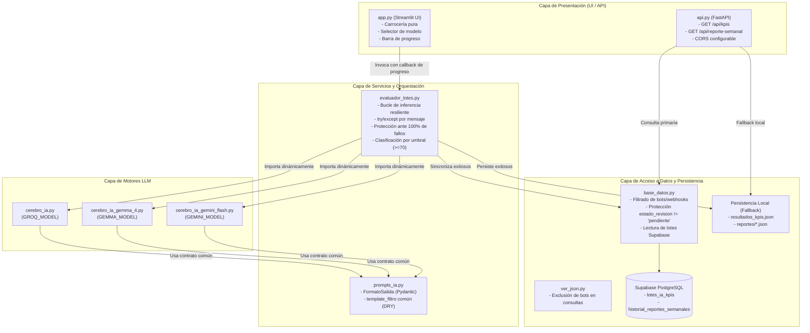

# Plan de Arquitectura: Robustez, Desacoplamiento y Resiliencia del Backend

## 1. Visión General y Objetivos
Este plan detalla el diseño técnico y arquitectónico para resolver los hallazgos de robustez, resiliencia y desacoplamiento del backend en CommunityLab. El diseño se fundamenta estrictamente en la **Constitución del proyecto**:
- **Regla 2 (Aislamiento de Interfaz):** Extracción de toda lógica de orquestación, inferencia de IA y persistencia fuera de `app.py` hacia un nuevo módulo de servicio backend (`evaluador_lotes.py`).
- **Regla 3 (Retrocompatibilidad):** Preservación inmutable de la estructura JSON consumida por el frontend (`{"aprobados": [...], "descartados": [...]}` con inyección de `copy_final`).
- **Regla 4 (Seguridad de Secretos):** Manejo aislado de credenciales y variables de entorno por modelo (`GEMMA_MODEL`, `GEMINI_MODEL`, `GROQ_MODEL`) con saneamiento de espacios.
- **Regla 5 (Control de Dependencias):** Registro inmediato de `pytest` y `httpx` en `requirements.txt`.
- **Regla 6 (Diseño Test-First):** Desarrollo guiado por pruebas unitarias automatizadas con mocks que aíslan la base de datos y los proveedores de LLM sin dependencias de red.

---

## 2. Diagrama de Arquitectura y Desacoplamiento



---

## 3. Especificación de Componentes e Interfaces

### 3.1 Unificación DRY de Esquema y Prompt (`prompts_ia.py`)
- Se extrae la definición de `FormatoSalida` (Pydantic BaseModel con validación de relevancia, sentimiento, temas_clave, segmento, razonamiento) y la plantilla `template_filtro` a `prompts_ia.py`.
- Los módulos `cerebro_ia.py`, `cerebro_ia_gemma_4.py` y `cerebro_ia_gemini_flash.py` importan `FormatoSalida` y `prompt_filtro` desde este único archivo.
- Cada módulo de modelo mantiene únicamente la responsabilidad de instanciar su cliente LLM específico y componer la cadena `cadena = prompt_filtro | llm_estructurado`.

### 3.2 Higiene e Independencia de Variables de Entorno por Motor
- `cerebro_ia_gemma_4.py`: Lee `os.getenv("GEMMA_MODEL", "").strip() or os.getenv("GOOGLE_MODEL", "").strip() or "gemma-4-31b-it"`.
- `cerebro_ia_gemini_flash.py`: Lee `os.getenv("GEMINI_MODEL", "").strip() or os.getenv("GOOGLE_MODEL", "").strip() or "gemini-3.5-flash-lite"`.
- Esto previene colisiones y tolera variables definidas como vacías o compuestas exclusivamente de espacios.

### 3.3 Filtrado de Bots y Webhooks en la Consulta (`base_datos.py` y `ver_json.py`)
- En `listar_interacciones` de `base_datos.py`, se incorpora una condición de exclusión:
  - Excluir mensajes donde `autor = 'Spidey Boy#0000'`.
  - Excluir patrones donde `autor ILIKE '%bot%'` o `autor LIKE '%#0000'`.
  - Excluir mensajes donde `tipo IN ('bot', 'webhook')`.
- En `ver_json.py`, asegurar que el filtrado se mantenga transparente para cualquier consumidor de la extracción cruda.

### 3.4 Protección de Estados HITL en Supabase (`base_datos.py`)
- En la función `guardar_lote_ia_supabase`, la instrucción de actualización ante conflicto por `id_mensaje` se condiciona:
  ```sql
  ON CONFLICT (id_mensaje) DO UPDATE SET ...
  WHERE lotes_ia_kpis.estado_revision = 'pendiente';
  ```
- Si un mensaje ya fue aprobado o rechazado manualmente por el equipo de Copywriting (`estado_revision != 'pendiente'`), la actualización se omite, garantizando la integridad del trabajo humano.

### 3.5 Módulo Backend `evaluador_lotes.py` y Resiliencia
- Se define la función:
  ```python
  def evaluar_lote(
      mensajes: list,
      nombre_modulo_cerebro: str,
      nombre_cerebro_legible: str,
      limite: int = None,
      callback_progreso: callable = None
  ) -> dict:
  ```
- **Control de excepciones individual:** Cada llamada a `cadena.invoke(...)` está protegida por un bloque `try...except Exception as e`. Ante fallo, se almacena en una lista de errores `fallidos.append(...)` y el ciclo continúa con el mensaje siguiente.
- **Clasificación:** Si `kpis["relevancia"] >= 70`, el mensaje va a `aprobados`; de lo contrario, a `descartados`.
- **Protección ante 100% de fallos:**
  - Si `len(exitosos) == 0` y `len(mensajes_procesados) > 0`: No se toca ni sobrescribe `resultados_kpis.json`. Se retorna estado de error con el detalle de fallos.
  - Si `len(exitosos) > 0`: Se estructura `paquete_maestro = {"aprobados": ..., "descartados": ...}`, se guarda en `resultados_kpis.json` y se sincroniza con `guardar_lote_ia_supabase`.
- **Retorno estructurado:** Regresa un diccionario con métricas: `{exito: bool, total_evaluados: int, exitosos: int, fallidos: int, guardados_supabase: int, errores: list}`.

### 3.6 Desacoplamiento de `app.py`
- `app.py` elimina las líneas de bucle `for`, imports directos de cadenas y escritura manual de archivos.
- Al hacer clic en "Ejecutar Análisis", simplemente invoca:
  ```python
  resultado = evaluar_lote(
      mensajes=mensajes,
      nombre_modulo_cerebro=modulo_cerebro_nombre,
      nombre_cerebro_legible=cerebro_elegido,
      limite=limite_mensajes,
      callback_progreso=lambda paso, total: barra_progreso.progress(paso / total)
  )
  ```
- Presenta en pantalla los mensajes de éxito, advertencias de fallos parciales o el error de fallo total sin conocer detalles internos de inferencia.

### 3.7 Endpoints Desacoplados y Consistentes en `api.py`
- **GET `/api/kpis`:**
  - Intenta consultar Supabase vía `obtener_lote_kpis_supabase()` en `base_datos.py`.
  - Si la base responde, arma `{"aprobados": [...], "descartados": [...]}` e inyecta `copy_final`.
  - Si la base falla o no hay URL, lee `resultados_kpis.json`.
  - Si el archivo no existe o está vacío, devuelve SIEMPRE `{"aprobados": [], "descartados": []}` (HTTP 200).
- **GET `/api/reporte-semanal`:**
  - Intenta consultar la tabla `historial_reportes_semanales` en Supabase.
  - Fallback al archivo más reciente en `reportes/`.
  - Si no existe ninguno, devuelve HTTP 404 con `{"error": "No se encontró ningún reporte semanal generado"}`.
- **CORS:** Configurable leyendo `os.getenv("ALLOWED_ORIGINS", "*").split(",")`.

---

## 4. Estrategia de Pruebas Unitarias (TDD con Mocks)

Siguiendo la Regla 6 de la Constitución, se implementará una suite exhaustiva bajo la carpeta `tests/` con ejecución en milisegundos y cero dependencias externas:
1. `tests/test_modelos_ia.py`: Valida `prompts_ia.py`, esquema Pydantic y resolución de `GEMMA_MODEL`/`GEMINI_MODEL` con variables vacías o con espacios.
2. `tests/test_base_datos_filtros.py`: Mockea `psycopg2.connect` para validar la exclusión SQL/Python de bots en `listar_interacciones` y la cláusula condicional de `estado_revision = 'pendiente'`.
3. `tests/test_evaluador_lotes.py`: Mockea cadenas de LangChain simulando:
   - Flujo 100% exitoso.
   - Flujo con fallo parcial (un mensaje genera `Exception("Rate limit 429")`, los demás pasan y se guardan).
   - Flujo con 100% de fallos (todos fallan, se verifica con mock de `open()` que `resultados_kpis.json` NO fue sobreescrito).
4. `tests/test_api.py`: Utiliza `fastapi.testclient.TestClient` para validar `/api/kpis` y `/api/reporte-semanal` con mocks de Supabase y de filesystem (asegurando contrato canónico inmutable y códigos HTTP 200/404).

---

## 5. Higiene del Repositorio
- Eliminación física de `update_app.py`.
- Inclusión formal de `resultados_kpis.json` en `.gitignore`.
- Verificación y actualización de `requirements.txt` con `pytest` y `httpx`.
