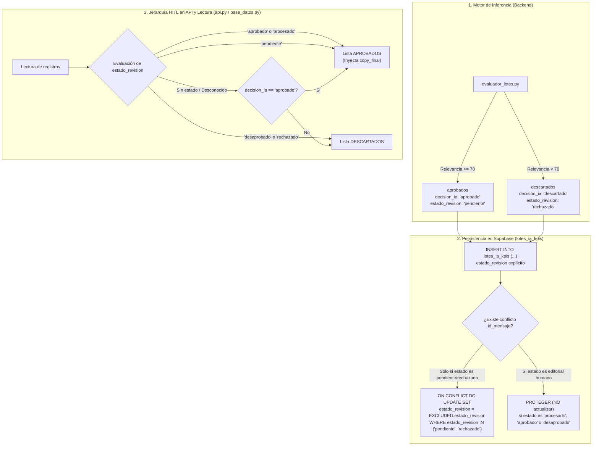

# Plan de Arquitectura: Ciclo de Vida de Estados de Revisión HITL en Supabase

## 1. Visión General y Objetivos
Este plan detalla el diseño técnico para sincronizar y consolidar el ciclo de vida de los estados de revisión en el flujo Human-in-the-Loop (HITL) de CommunityLab.
El principio arquitectónico central es la **soberanía y prevalencia de la decisión humana**: las intervenciones del equipo editorial de Copywriting (Enoc) tienen prioridad absoluta sobre las inferencias de los modelos de IA, tanto en la base de datos como en los contratos de la API REST.

---

## 2. Flujo de Datos y Jerarquía HITL



---

## 3. Especificación de Componentes e Interfaces

### 3.1 Paridad en `evaluador_lotes.py`
- Al iterar y clasificar mensajes:
  - Mensajes con `relevancia >= 70`:
    ```python
    dato["estado_revision"] = "pendiente"
    aprobados.append(dato)
    ```
  - Mensajes con `relevancia < 70`:
    ```python
    dato["estado_revision"] = "rechazado"
    descartados.append(dato)
    ```
- El archivo `resultados_kpis.json` persistirá esta clave de forma consistente e idéntica a Supabase.

### 3.2 Persistencia y Protección Condicional en `base_datos.py`
- **`guardar_lote_ia_supabase`**:
  - Parámetros explícitos en `INSERT INTO lotes_ia_kpis`:
    - Para `aprobados`: `decision_ia = 'aprobado'`, `estado_revision = 'pendiente'`.
    - Para `descartados`: `decision_ia = 'descartado'`, `estado_revision = 'rechazado'`.
  - Sentencia `ON CONFLICT (id_mensaje) DO UPDATE SET`:
    - Se agrega `estado_revision = EXCLUDED.estado_revision`.
    - Cláusula de protección:
      ```sql
      WHERE lotes_ia_kpis.estado_revision IN ('pendiente', 'rechazado');
      ```
  - Si un registro ya posee `'procesado'`, `'aprobado'` o `'desaprobado'`, PostgreSQL no ejecuta el update, blindando el trabajo editorial humano.

### 3.3 Jerarquía HITL en `base_datos.py` y `api.py`
- Implementar función o bloque normalizado:
  ```python
  def resolver_clasificacion_hitl(fila: dict) -> tuple[str, bool]:
      estado = str(fila.get("estado_revision") or "").strip().lower()
      decision_ia = str(fila.get("decision_ia") or fila.get("decision") or "").strip().lower()
      
      if estado in ("aprobado", "procesado"):
          return "aprobado", True
      elif estado in ("desaprobado", "rechazado"):
          return "descartado", False
      elif estado == "pendiente":
          return "aprobado", True
      else:
          # Fallback para retrocompatibilidad
          return ("aprobado", True) if decision_ia == "aprobado" else ("descartado", False)
  ```
- **`obtener_lote_kpis_supabase`** (`base_datos.py`):
  - Utiliza esta lógica para clasificar cada fila en `aprobados` o `descartados`.
  - Para los clasificados en `aprobados`, inyecta `copy_final` si no está presente.
- **`_formatear_lote_kpis`** (`api.py`):
  - Aplica la misma jerarquía cuando procesa listas de filas planas o diccionarios, garantizando que un mensaje rechazado por un humano jamás figure en `aprobados`.

---

## 4. Estrategia de Pruebas Unitarias (TDD con Mocks)

Siguiendo la Regla 6 de la Constitución (Diseño Test-First):
1. **Creación de suite `tests/test_estados_revision_hitl.py`**:
   - `test_guardar_lote_ia_asigna_estados_explicitos`: Valida que `aprobados` inserte `'pendiente'` y `descartados` inserte `'rechazado'`.
   - `test_guardar_lote_ia_on_conflict_protege_estados_humanos`: Valida que la sentencia SQL incluya `estado_revision = EXCLUDED.estado_revision` y `WHERE lotes_ia_kpis.estado_revision IN ('pendiente', 'rechazado')`.
   - `test_jerarquia_hitl_prevalencia_humana_base_datos`: Valida que un ítem con `decision_ia = 'descartado'` pero `estado_revision = 'aprobado'` se entregue en la lista de aprobados, y que un ítem con `decision_ia = 'aprobado'` pero `estado_revision = 'desaprobado'` se entregue en descartados.
   - `test_jerarquia_hitl_en_api_formatear_kpis`: Valida la jerarquía en los contratos devueltos por `api.py`.
   - `test_evaluador_lotes_inyecta_estado_revision`: Valida que `evaluador_lotes.py` guarde `estado_revision` en los diccionarios locales.
2. **Sincronización de tests preexistentes**:
   - Ajustar `tests/test_base_datos_filtros.py` para reflejar la cláusula `IN ('pendiente', 'rechazado')` en vez del antiguo `= 'pendiente'`.
