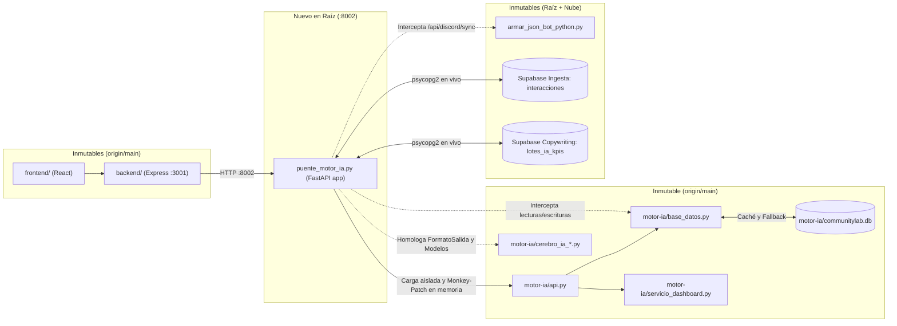

# Plan Técnico 005: Unificación Beta mediante Puente Adaptador (`puente_motor_ia.py`)

## 1. Resumen Arquitectónico

El objetivo de este plan es materializar la Especificación 005 cumpliendo la restricción de **inmutabilidad absoluta** sobre todos los archivos de `origin/main` (`frontend/`, `backend/`, `motor-ia/`, `netlify.toml`) y sobre todos los archivos existentes de nuestra raíz (`base_datos.py`, `evaluador_lotes.py`, `prompts_ia.py`, `app.py`, `api.py`, `bot_lote.py`, `armar_json_bot_python.py`, `reporte_semanal.py`, `oci_uploader.py`).

Para lograrlo, se creará en la raíz un único módulo orquestador y adaptador en tiempo de ejecución: `puente_motor_ia.py`, acompañado de su suite de pruebas `tests/test_unificacion_motor_ia.py`.

---

## 2. Diseño Detallado de Componentes

### 2.1. Carga Aislada de Módulos de `motor-ia/` sin Colisión en `sys.modules` (RF-01, RF-05)
- En la raíz ya existen módulos llamados `base_datos.py`, `api.py`, `cerebro_ia.py`, `cerebro_ia_gemini_flash.py`, `cerebro_ia_gemma_4.py`, `procesamiento.py`, `limpieza.py`, `modelos.py` y `ver_json.py`.
- `motor-ia/` contiene archivos con esos mismos nombres que se importan entre sí de manera directa (`import base_datos`, `import servicio_dashboard`, `import procesamiento`, etc.).
- **Estrategia de aislamiento en `puente_motor_ia.py`:**
  1. Antes de cargar los módulos de `motor-ia/`, `puente_motor_ia.py` captura y respalda cualquier módulo homónimo de la raíz que ya esté cargado en `sys.modules` (y carga explícitamente referencias a los módulos de la raíz que necesitará, como `armar_json_bot_python` y `base_datos` de raíz).
  2. Mediante `importlib.util.spec_from_file_location` y un contexto controlado del directorio `motor-ia/`, carga los módulos de `motor-ia/` bajo un namespace dedicado (ej. `motor_ia_pkg.<modulo>`) y los vincula internamente para que las referencias cruzadas entre `motor-ia/api.py`, `motor-ia/servicio_dashboard.py`, `motor-ia/procesamiento.py` y `motor-ia/base_datos.py` apunten siempre a las instancias de `motor-ia/`.
  3. Restaura inmediatamente en `sys.modules` los módulos de la raíz para que `pytest` o cualquier importación posterior en el proceso nunca sufra colisiones entre `base_datos` / `api` de la raíz y los de `motor-ia/`.

### 2.2. Puente de Lectura y Sincronización de Interacciones (`interacciones` + `lotes_ia_kpis`) (RF-02)
- `puente_motor_ia.py` envuelve en memoria las funciones de `motor-ia/base_datos.py` (y sus referencias directas importadas en `motor-ia/api.py` y `motor-ia/servicio_dashboard.py`):
  - `listar_interacciones`, `obtener_interaccion`, `contar_interacciones`, `actualizar_curaduria`, `actualizar_etapa_flujo` y `guardar_evaluacion`.
- **Flujo de sincronización (`sincronizar_supabase_a_sqlite`):**
  1. Verifica la presencia de `DATABASE_URL` y/o `SUPABASE_DB_URL` en `os.environ`.
  2. Si `DATABASE_URL` está definida, consulta `interacciones` en PostgreSQL aplicando el filtro antibots canónico (`LOWER(autor) != 'spidey boy#0000'`, `LOWER(autor) NOT LIKE '%bot%'`, `autor NOT LIKE '%#0000'`, `COALESCE(LOWER(tipo), '') NOT IN ('bot', 'webhook')`). Si `enviado_en` es `NULL`, usa `creado_en` como fallback.
  3. Si `SUPABASE_DB_URL` (o `DATABASE_URL` como fallback) está definida, consulta `lotes_ia_kpis` (`id`, `id_mensaje`, `autor`, `canal`, `texto_original`, `relevancia`, `sentimiento`, `temas_clave`, `segmento`, `razonamiento`, `decision_ia`, `estado_revision`, `analizado_en`).
  4. Cruza en memoria por `str(interacciones.id) == str(lotes_ia_kpis.id_mensaje)`. Además, si existen registros en `lotes_ia_kpis` cuyo `id_mensaje` no esté aún en `interacciones` (o cuando solo `SUPABASE_DB_URL` esté configurada), sintetiza la interacción base a partir de `lotes_ia_kpis` para no perder ninguna evaluación del equipo.
  5. **Mapeo determinista exacto:**
     - **Si tiene evaluación en `lotes_ia_kpis`:**
       - `estado`: `'analizado'`
       - `sentiment_score`: `0.85` si `sentimiento` en `('Positivo', 'Negativo')`, `0.75` si `sentimiento == 'Neutral'`, `None` en otro caso.
       - `tema`: función determinista `_inferir_tema(temas_clave, canal, texto)` que clasifica en una de las 7 categorías cerradas de `servicio_dashboard.py`: `'EMPLEO'`, `'EDUCACION'`, `'IA'`, `'DESARROLLO'`, `'PLATAFORMA'`, `'COMUNIDAD'`, `'OTRO'`.
       - `estado_curaduria`: `'curated'` si `estado_revision` en `('aprobado', 'procesado')`; `'discarded'` si `estado_revision` en `('rechazado', 'desaprobado')`; `'pending'` si `estado_revision == 'pendiente'`.
       - `etapa_flujo`: `'en_aprobacion'` si `estado_revision == 'aprobado'`; `'en_redaccion'` si `estado_revision == 'procesado'`; `'en_analisis'` si `estado_revision` en `('pendiente', 'rechazado', 'desaprobado')`.
     - **Si NO tiene evaluación en `lotes_ia_kpis`:**
       - `estado = 'pendiente'`, `relevancia = None`, `sentimiento = None`, `sentiment_score = None`, `tema = None`, `estado_curaduria = 'pending'`, `etapa_flujo = 'ingesta'`.
  6. Sincroniza cada registro en la tabla `interacciones` de `motor-ia/communitylab.db` (respetando mutaciones locales previas si el usuario ya modificó `estado_curaduria` o `etapa_flujo` en la sesión local) y delega el filtrado final (`canal`, `sentimiento`, `relevancia`, `estado_curaduria`, `etapa_flujo`, `busqueda`, `limite`) a la consulta SQLite enriquecida.
  7. En las mutaciones (`actualizar_curaduria`, `actualizar_etapa_flujo`, `guardar_evaluacion`), actualiza primero `motor-ia/communitylab.db` y, si `SUPABASE_DB_URL` está configurada, propaga de forma segura el cambio de `estado_revision` hacia `lotes_ia_kpis` en Supabase.

### 2.3. Puente de Contenidos Curados para `/api/content` (RF-03)
- Durante la sincronización desde `lotes_ia_kpis` (cuando `listar_contenidos`, `obtener_contenido` o `contar_contenidos` son invocados):
  1. Por cada registro evaluado en `lotes_ia_kpis` (especialmente aquellos aprobados por IA o en bandeja de curación), sintetiza un registro compatible con la tabla `contenidos_generados` de `motor-ia/base_datos.py`:
     - `id`: `id` numérico de `lotes_ia_kpis` (o hash entero determinista de `id_mensaje` si no hubiera `id` numérico).
     - `interaccion_id`: `str(id_mensaje)`.
     - `formato`: `'post'` / `'discord'` y `plataforma`: `'discord'` (o inferido de canal/segmento entre `'discord'`, `'linkedin'`, `'x'`).
     - `titulo`: derivado de `temas_clave`, `canal` y `autor`.
     - `contenido`: `copy_final` si existe en el registro/payload; en su defecto, síntesis estructurada de `texto_original` y `razonamiento`.
     - `llamada_accion`: `'Comparte tu experiencia con la comunidad.'`.
     - `hashtags`: lista de strings (`list[str]`) derivada de `temas_clave`.
     - `tono`: `'profesional'`.
     - `estado`: `'aprobado'` si `estado_revision == 'aprobado'`; `'rechazado'` si `estado_revision` en `('rechazado', 'desaprobado')`; `'pendiente_revision'` si `estado_revision` en `('pendiente', 'procesado')`.
     - `creado_en` y `actualizado_en`: `analizado_en`.
     - `tipo_contenido`: `'publicacion'`.
     - `observaciones_revision`: `razonamiento`.
     - `version`: `1`, `estado_publicacion`: `'no_publicado'`, `publicado_en`: `None`, `source_channel_id`: `canal`, `source_message_id`: `str(id_mensaje)`, `attachments`: `[]`.
  2. Inserta o actualiza en `contenidos_generados` de `motor-ia/communitylab.db` sin sobrescribir estados ya mutados localmente por el usuario (`actualizar_estado_contenido` / `actualizar_contenido`).
  3. Envuelve `actualizar_estado_contenido` para que, además de actualizar SQLite local, propague el cambio a `lotes_ia_kpis.estado_revision` en Supabase cuando haya conexión.

### 2.4. Homologación en Memoria de Cerebros IA y Bot de Discord (RF-04)
- **Cerebros IA (`cerebro_ia_gemini_flash` y `cerebro_ia_gemma_4`):**
  - `puente_motor_ia.py` reemplaza en los módulos cargados de `motor-ia` la clase `FormatoSalida` por el modelo completo de `motor-ia/cerebro_ia.py` (que incluye `sentiment_score: float` y `tema: Literal["EMPLEO", "EDUCACION", "IA", "DESARROLLO", "PLATAFORMA", "COMUNIDAD", "OTRO"]`).
  - Reemplaza en memoria `obtener_cadena_evaluacion` de ambos módulos para que lean `os.environ.get("GEMINI_MODEL", "").strip() or os.environ.get("GOOGLE_MODEL", "").strip() or "gemini-3.5-flash-lite"` y `os.environ.get("GEMMA_MODEL", "").strip() or os.environ.get("GOOGLE_MODEL", "").strip() or "gemma-4-31b-it"` respectivamente, garantizando además que cualquier evaluación devuelta por la cadena incluya valores válidos de `sentiment_score` y `tema`.
- **Sincronización de Discord (`/api/discord/sync`):**
  - `puente_motor_ia.py` intercepta `recolectar_mensajes` en el módulo `armar_json_bot_python` cargado por `motor-ia/api.py` para que invoque la lógica con autodetección de canales (`detectar_canales`) de nuestro `armar_json_bot_python.py` de la raíz, guarde en `interacciones` de Supabase y sincronice inmediatamente los mensajes en `motor-ia/base_datos.py`.

### 2.5. Exposición del Servidor FastAPI en el Puerto 8002
- `puente_motor_ia.py` expone la variable `app` (la instancia `FastAPI` de `motor-ia/api.py` ya conectada a los wrappers en memoria) y un bloque `if __name__ == "__main__": uvicorn.run(app, host="0.0.0.0", port=int(os.getenv("PORT", "8002")))`.

---

## 3. Estrategia de Verificación y TDD (RF-05)

1. Se creará `tests/test_unificacion_motor_ia.py` antes de implementar `puente_motor_ia.py` (Fase Red).
2. Los tests usarán `unittest.mock` (`patch`, `MagicMock`) para simular las conexiones `psycopg2.connect` hacia `DATABASE_URL` y `SUPABASE_DB_URL` y una base de datos SQLite temporal (`tmp_path`), verificando:
   - Carga aislada de `puente_motor_ia` sin contaminar `base_datos` ni `api` de la raíz.
   - Filtrado de bots y cruce de `interacciones` + `lotes_ia_kpis` con mapeos exactos (`sentiment_score`, las 7 categorías de `tema`, `estado_curaduria`, `etapa_flujo`, interacciones no evaluadas, fallback `enviado_en` -> `creado_en`).
   - Fallback transparente a SQLite local cuando no hay variables de entorno o falla `psycopg2.connect`.
   - Sincronización de `contenidos_generados` y respuesta de `/api/content`, `/api/community/messages`, `/api/community/dashboard` y `/api/community/analytics`.
   - Homologación en memoria de `FormatoSalida` y variables `GEMINI_MODEL` / `GEMMA_MODEL` con `.strip()`.
   - Verificación automática de inmutabilidad (`git diff origin/main -- frontend backend motor-ia netlify.toml` vacío).
3. Se ejecutará `pytest` completo para comprobar que los 48 tests existentes más los nuevos tests en `tests/test_unificacion_motor_ia.py` pasan al 100% en verde.
