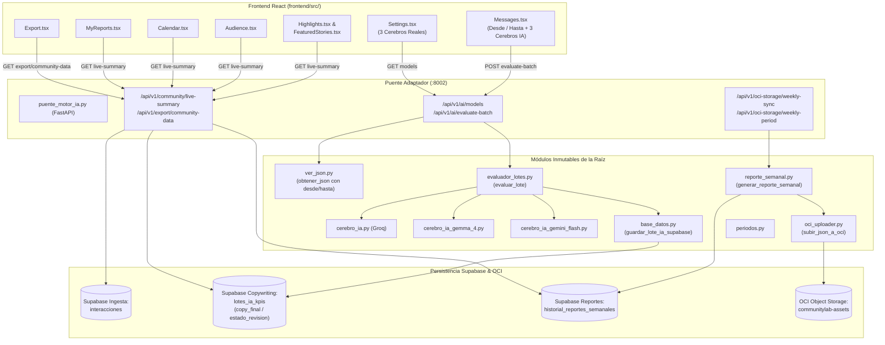

# Plan Técnico 006: Integración Funcional Total (Frontend React + 3 Cerebros IA + Filtro de Fechas + OCI Tania + Copywriting Enoc)

## 1. Resumen Arquitectónico

El presente plan define la implementación técnica para conectar de manera integral y reactiva el Frontend de React (`frontend/`) con la infraestructura real de datos e inteligencia artificial en la rama `unificacion-beta`.

El diseño técnico garantiza el principio de **inmutabilidad absoluta**:
- **Cero cambios** en los 12 archivos `.py` preexistentes de la raíz (`api.py`, `app.py`, `armar_json_bot_python.py`, `base_datos.py`, `bot_lote.py`, `cerebro_ia.py`, `cerebro_ia_gemini_flash.py`, `cerebro_ia_gemma_4.py`, `evaluador_lotes.py`, `limpieza.py`, `modelos.py`, `oci_uploader.py`, `periodos.py`, `procesamiento.py`, `prompts_ia.py`, `reporte_semanal.py`, `ver_json.py`).
- **Cero cambios** en los archivos de `motor-ia/` y `backend/`.
- Todo el backend extendido se centraliza en `puente_motor_ia.py`, orquestando dinámicamente las funciones de la raíz e interactuando con Supabase (`interacciones`, `lotes_ia_kpis` e `historial_reportes_semanales`).
- El Frontend en `frontend/src/` reemplaza las dependencias de datos fijos (`mockCommunityData.ts`) por consumo en vivo con resiliencia y fallback automático ante fallos de conexión.



---

## 2. Arquitectura de Endpoints en `puente_motor_ia.py`

### 2.1. Gestión de Modelos de IA y Evaluación por Lote con Fechas (RF-01)

#### `GET /api/v1/ai/models`
- **Propósito:** Informar al Frontend los 3 modelos de IA configurados en la raíz del proyecto.
- **Implementación:**
  - Resuelve dinámicamente los modelos usando `obtener_modelo_gemini()` y `obtener_modelo_gemma()` ya presentes en `puente_motor_ia.py`, así como `os.getenv("GROQ_MODEL", "llama-3.3-70b-versatile")`.
  - Verifica disponibilidad de credenciales (`GROQ_API_KEY`, `GEMINI_API_KEY` o `GOOGLE_API_KEY`).
- **Contrato de Salida:**
  ```json
  [
    {
      "id": "groq-llama",
      "provider": "Groq",
      "name": "Groq (Llama 3.3)",
      "model": "llama-3.3-70b-versatile",
      "module": "cerebro_ia",
      "available": true
    },
    {
      "id": "google-gemma",
      "provider": "Google",
      "name": "Google Gemma 4",
      "model": "gemma-4-31b-it",
      "module": "cerebro_ia_gemma_4",
      "available": true
    },
    {
      "id": "google-gemini",
      "provider": "Google",
      "name": "Google Gemini Flash Lite",
      "model": "gemini-2.5-flash-lite",
      "module": "cerebro_ia_gemini_flash",
      "available": true
    }
  ]
  ```

#### `POST /api/v1/ai/evaluate-batch`
- **Propósito:** Evaluar un lote de mensajes acotados por fechas (`desde` / `hasta`) usando el cerebro de IA seleccionado, persistiendo en `lotes_ia_kpis` de Supabase y sincronizando la caché en memoria y SQLite.
- **Contrato de Entrada:**
  ```json
  {
    "proveedor": "Groq (Llama 3.3)",
    "desde": "2026-10-01",
    "hasta": "2026-10-15",
    "solo_pendientes": true,
    "limite": 100
  }
  ```
- **Flujo de Ejecución:**
  1. Homologa el parámetro `proveedor` para identificar el módulo exacto de la raíz (`cerebro_ia`, `cerebro_ia_gemma_4` o `cerebro_ia_gemini_flash`).
  2. Llama a `_ver_json_raiz.obtener_json(desde=desde, hasta=hasta, limite=limite)` para obtener los mensajes reales del rango solicitado.
  3. Si `solo_pendientes` es `True`, filtra excluyendo los mensajes que ya cuenten con evaluación en `lotes_ia_kpis`.
  4. Invoca `_evaluador_lotes_raiz.evaluar_lote(mensajes=mensajes, nombre_modulo_cerebro=modulo, nombre_cerebro_legible=nombre_legible, limite=limite)`.
  5. Asegura la persistencia en Supabase mediante `_base_datos_raiz.guardar_lote_ia_supabase(paquete_maestro)`.
  6. Dispara `sincronizar_supabase_a_sqlite()` para que los nuevos KPIs queden inmediatamente disponibles en `/api/community/messages`, `/api/content` y `/api/v1/community/live-summary`.
- **Contrato de Salida:**
  ```json
  {
    "exito": true,
    "proveedor": "Groq (Llama 3.3)",
    "total_mensajes": 25,
    "evaluados": 25,
    "aprobados": 18,
    "descartados": 7,
    "guardados_supabase": 25,
    "errores": []
  }
  ```

---

### 2.2. Conexión de OCI Storage y Reportes Semanales (RF-02)

#### `GET /api/v1/oci-storage/weekly-period`
- **Propósito:** Exponer el rango de fechas de la semana actual del proyecto según `periodos.py`.
- **Implementación:**
  - Invoca `periodos.semana_de(datetime.now(timezone.utc))` y calcula fecha de inicio (lunes) y fin (domingo) en formato ISO `AAAA-MM-DD`.
  - Construye la etiqueta semanal normalizada `AAAA-semana-NN` requerida por `reporte_semanal.py`.
- **Contrato de Salida:**
  ```json
  {
    "semana_nombre": "2026-semana-42",
    "start_date": "2026-10-12",
    "end_date": "2026-10-18",
    "status": "ready"
  }
  ```

#### `POST /api/v1/oci-storage/weekly-sync`
- **Propósito:** Generar el reporte semanal agregando KPIs reales y subirlo a OCI Object Storage mediante los módulos inmutables de Tania (`reporte_semanal.py` y `oci_uploader.py`).
- **Implementación:**
  - Obtiene el lote analizado desde Supabase (`_base_datos_raiz.obtener_lote_kpis_supabase()`) o desde `resultados_kpis.json` local como respaldo.
  - Invoca dinámicamente `reporte_semanal.generar_reporte_semanal(semana_nombre, paquete)`.
  - Retorna metadatos de subida a OCI (o estado local si OCI no estuviese configurado) y registra el resumen.
- **Contrato de Salida:**
  ```json
  {
    "exito": true,
    "semana": "2026-semana-42",
    "subido_oci": true,
    "bucket": "communitylab-assets",
    "ruta_oci": "activos/2026-semana-42/paquete-distribucion.json",
    "resumen": {
      "total_mensajes": 40,
      "total_aprobados": 28,
      "total_descartados": 12,
      "sentimiento": { "Positivo": 28, "Neutral": 8, "Negativo": 4 },
      "segmentos": { "Estudiante": 15, "Profesional": 20 }
    }
  }
  ```

---

### 2.3. Endpoints de Resumen Dinámico en Vivo y Exportación (RF-03)

#### `GET /api/v1/community/live-summary`
- **Propósito:** Proporcionar en un solo payload reactivo todos los datos requeridos por las pantallas analíticas y de contenido del Frontend (`Highlights`, `Audience`, `Calendar`, `MyReports`, `FeaturedStories`).
- **Lógica de Agregación en Vivo:**
  1. **Highlights (`highlights` y `highlights_summary`):**
     - Filtra mensajes con `relevancia >= 70`.
     - Incluye `copy_final` curado por Enoc (si existe), `estado_revision`, `sentiment`, `sentiment_score`, `tema`, `canal`, `autor`, `fecha`.
     - `highlights_summary`: `{ detected: total_destacados, high_relevance: total_relevancia_gte_85, ready_for_content: total_con_copy_o_aprobados }`.
  2. **Audience (`audience`):**
     - `total_members`: autores únicos no bots en `interacciones`.
     - `active_members`: autores con actividad en el periodo reciente.
     - `growth`: porcentaje estimado de crecimiento.
     - `participation_rate`: proporción calculada de autores activos sobre total.
     - `segments`: distribución por volumen de actividad (`Muy activos`, `Activos`, `Ocasionales`, `Baja actividad`).
     - `ai_segments`: distribución calculada a partir del campo `segmento` de `lotes_ia_kpis`.
  3. **Calendar (`calendar`):**
     - Agrupación por día a partir de `fecha_envio` / `enviado_en` (`date`, `day`, `messages`, `sentiment` promedio, conteo de `highlights`).
  4. **Reports (`reports`):**
     - Listado de reportes generados a partir de `historial_reportes_semanales` en Supabase o archivos existentes en la carpeta `reportes/`.
- **Contrato de Salida:** Compatible con las interfaces TypeScript esperadas por las vistas del Frontend.

#### `GET /api/v1/export/community-data`
- **Propósito:** Proveer la estructura unificada de exportación para descarga JSON en `Export.tsx`.
- **Implementación:**
  - Combina los metadatos de la plataforma, el `live-summary`, la lista completa de interacciones filtradas y las piezas de copywriting aprobadas.

---

## 3. Integración en el Frontend React (`frontend/src/`)

### 3.1. `Messages.tsx` y `Settings.tsx` (RF-01)
- **`Messages.tsx`:**
  - Añadir panel superior con:
    - Selector `Desde` (`<input type="date">`).
    - Selector `Hasta` (`<input type="date">`).
    - Selector desplegable de IA alimentado desde `GET /api/v1/ai/models` (`"Groq (Llama 3.3)"`, `"Google Gemma 4"`, `"Google Gemini Flash Lite"`).
    - Botón "Evaluar Lote con IA" conectado a `POST /api/v1/ai/evaluate-batch` con estado de carga (`loading spinner`), feedback de éxito y refresco automático de la lista de mensajes.
  - Modificar el filtro de etapas de flujo:
    - Permitir la visualización de mensajes tanto en etapa `'ingesta'` / `'en_ingesta'` como en etapa `'en_analisis'`.
- **`Settings.tsx`:**
  - Conectar el bloque de configuración de IA a `GET /api/v1/ai/models`.
  - Reemplazar las opciones fijas (`qwen`, `mistral`, `gemini`) por los 3 cerebros reales del proyecto con sus modelos activos.

### 3.2. `Highlights.tsx`, `FeaturedStories.tsx`, `Audience.tsx`, `Calendar.tsx`, `MyReports.tsx`, `Export.tsx` (RF-03, RF-04)
- **Patrón de Consumo Reactivo con Fallback:**
  - Cada componente efectúa una llamada `fetch` al endpoint correspondiente (`/api/v1/community/live-summary` o `/api/v1/export/community-data`).
  - Si la llamada es exitosa y retorna datos, actualiza el estado local del componente.
  - Si la llamada falla (error de red o backend detenido), atrapa el error (`catch`) y mantiene los datos de respaldo desde `mockCommunityData.ts`, asegurando cero pantallas en blanco.
- **`Highlights.tsx` y `FeaturedStories.tsx`:**
  - Renderizan el campo `copy_final` de Enoc si está disponible, o el texto original en su defecto.
- **`Export.tsx`:**
  - Realiza la descarga directa del JSON generado en vivo por `GET /api/v1/export/community-data`.

---

## 4. Estrategia de Pruebas Automatizadas (TDD) e Inmutabilidad (RF-05)

### 4.1. Fase Red: `tests/test_unificacion_motor_ia.py`
Se amplía la suite de pruebas unitarias y de integración con mocks en `tests/test_unificacion_motor_ia.py` para cubrir:
1. `GET /api/v1/ai/models`: Responde 200 con la lista de los 3 cerebros y modelos limpios.
2. `POST /api/v1/ai/evaluate-batch`: Valida delegación a `ver_json.obtener_json`, `evaluador_lotes.evaluar_lote` y persistencia en Supabase.
3. `POST /api/v1/oci-storage/weekly-sync` y `GET /api/v1/oci-storage/weekly-period`: Valida delegación a `reporte_semanal.py` y `oci_uploader.py`.
4. `GET /api/v1/community/live-summary` y `GET /api/v1/export/community-data`: Valida cálculo correcto de highlights, audiencia, calendario y reportes.
5. Inmutabilidad: Verificación de que ninguno de los archivos de raíz preexistentes ni de `motor-ia/` o `backend/` ha sufrido cambios.

### 4.2. Fase Green: Implementación en `puente_motor_ia.py` y `frontend/src/`
- Se implementan los endpoints y lógica en `puente_motor_ia.py` hasta que el 100% de la suite de pruebas pase en verde.
- Se conectan los componentes del Frontend en `frontend/src/`.
- Se valida la compilación TypeScript y sintaxis de React.
