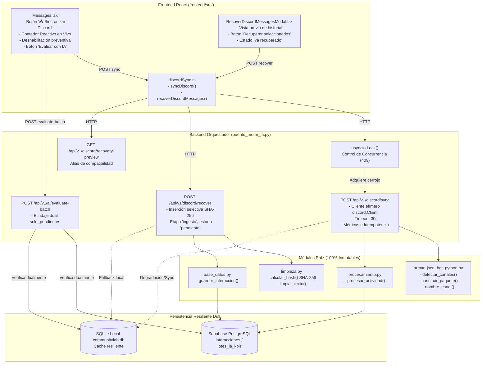

# Plan de Arquitectura e Implementación Técnica: Spec 007
## Sincronización de Discord desde la UI y Flujo Integral de Extremo a Extremo

---

## 1. Resumen Ejecutivo y Metas Técnicas

El propósito de la **Especificación 007** es dotar a la plataforma CommunityLab de capacidades de ingesta autónoma y recuperación histórica de mensajes de Discord directamente desde la interfaz web en React (`frontend/`), eliminando la dependencia de ejecuciones manuales por consola (`bot_lote.py`). 

Adicionalmente, se consolida la paridad reactiva con Streamlit (`app.py`), implementando en `Messages.tsx` un contador dinámico en tiempo real (`📊 X mensajes disponibles para evaluar (Y pendientes)`) con deshabilitación preventiva ante conteos en cero o errores cronológicos, y un blindaje dual en el backend para la exclusión de mensajes ya evaluados contra Supabase y SQLite local.

Todo el desarrollo respeta rigurosamente el **Aislamiento Constitucional (Reglas 2 y 3)**: los **17 archivos `.py` preexistentes en la raíz**, así como los módulos en `backend/` y `motor-ia/`, permanecerán **100% inalterados**. Toda la adaptación de backend se encapsula en `puente_motor_ia.py` y las mejoras de frontend en `frontend/src/`.

---

## 2. Arquitectura General del Sistema



---

## 3. Especificación Técnica de Componentes

### 3.1 Backend en `puente_motor_ia.py`

#### A. Control de Concurrencia con `asyncio.Lock`
Para impedir condiciones de carrera y colisiones de sesiones de Discord en el event loop de FastAPI:
- Se declara una instancia global: `_discord_sync_lock = asyncio.Lock()`.
- En `POST /api/v1/discord/sync`, se verifica si el cerrojo está bloqueado (`_discord_sync_lock.locked()`). Si está ocupado, se retorna de inmediato HTTP `409 Conflict`:
  ```json
  {
    "exito": false,
    "mensaje": "Sincronización en curso",
    "detail": "Sincronización en curso"
  }
  ```
- Si está libre, se adquiere el cerrojo dentro de un bloque `async with _discord_sync_lock:` asegurando su liberación al finalizar o ante cualquier excepción.

#### B. Ciclo de Vida del Cliente Efímero de Discord (`POST /api/v1/discord/sync`)
- **Autenticación Segura:** Se obtiene el token desde `os.getenv("DISCORD_BOT_TOKEN")` o `os.getenv("DISCORD_TOKEN")`. Si falta o está vacío, se retorna HTTP `502 Bad Gateway` con mensaje controlado: `{"exito": false, "mensaje": "Fallo de autenticación con Discord: token ausente o inválido"}`.
- **Cliente Efímero:** Se instancia `discord.Client(intents=intents)` local a la petición.
- **Ejecución Asíncrona sin Bloqueo:**
  Se crea una tarea asíncrona (`asyncio.create_task`) que invoca `client.start(token)`.
  Se sincroniza con el evento `on_ready` mediante un `asyncio.Event` o wait directo.
  Toda la operación de conexión y lectura se engloba dentro de `asyncio.wait_for(..., timeout=30.0)` para garantizar que ninguna petición se cuelgue.
  En la cláusula `finally`, se ejecuta obligatoriamente `await client.close()`.
- **Extracción Idempotente Reutilizando Módulos Raíz:**
  1. Identificación del gremio (`DISCORD_GUILD_ID` opcional) y detección de canales mediante `armar_json_bot_python.detectar_canales(client.guilds, id_servidor)`. Si no se detectan canales legibles, se retorna HTTP `200` con `total_recibidas: 0, guardadas_nuevas: 0` y mensaje `"No se encontraron canales de texto autorizados o accesibles"`.
  2. Iteración por cada canal autorizado extrayendo el historial (`canal.history(limit=limite_por_canal)`).
  3. Descarte de bots y webhooks, y formateo de nombres con `nombre_canal(canal)`.
  4. Generación del paquete con `armar_json_bot_python.construir_paquete(mensajes)`.
  5. Ingesta mediante `procesamiento.procesar_actividad(paquete)`: saneamiento de texto, cálculo de hashes SHA-256 e inserción en Supabase con `base_datos.guardar_interaccion`.
  6. Sincronización resiliente hacia SQLite local invocando `_sincronizar_supabase_a_sqlite()`.
- **Respuesta Estructurada:**
  - Si `guardadas_nuevas > 0`: HTTP `200`, `mensaje: "Sincronización exitosa: X mensajes nuevos guardados"`.
  - Si `guardadas_nuevas == 0` y `total_recibidas > 0`: HTTP `200`, `mensaje: "Todos los mensajes están al día"`.
  - Atributos estándar: `exito: true`, `total_recibidas`, `guardadas_nuevas`, `repetidas_omitidas`, `vacias_omitidas`, `periodo_referencia`.

#### C. Endpoint de Recuperación Selectiva (`POST /api/v1/discord/recover`)
- **Validación de Entrada:** Requiere un esquema exacto:
  ```json
  {
    "mensajes": [
      {
        "canal_id": "string",
        "message_id": "string",
        "autor": "string",
        "texto": "string",
        "fecha": "string"
      }
    ]
  }
  ```
- **Lógica de Ingesta:**
  - Para cada mensaje: limpia el texto (`limpieza.limpiar_texto`), calcula el hash SHA-256 (`limpieza.calcular_hash`), determina la semana/periodo (`periodos.periodo_de`) e invoca `base_datos.guardar_interaccion(...)`.
  - Garantiza que el mensaje quede registrado con etapa `'ingesta'` y estado `'pendiente'`.
  - Degrada a SQLite local en caso de desconexión remota.
- **Respuesta:**
  ```json
  {
    "exito": true,
    "guardados_nuevos": 1,
    "repetidos_omitidos": 0,
    "mensaje": "Se recuperaron 1 mensajes nuevos (0 ya existían)"
  }
  ```

#### D. Alias de Compatibilidad para Previsualización de Recuperación
- Se expone la misma lógica en ambas rutas de FastAPI:
  - `@app.get("/api/v1/content-workflow/discord/recovery-preview")`
  - `@app.get("/api/v1/discord/recovery-preview")`

#### E. Blindaje Dual de `solo_pendientes` en `POST /api/v1/ai/evaluate-batch`
- Creación de la función `_obtener_ids_evaluados_dual() -> set[int]`:
  1. Consulta `lotes_ia_kpis` en Supabase (a través de `obtener_datos_supabase()` o cursor directo a `SUPABASE_DB_URL`).
  2. Consulta la base de datos local SQLite (`motor_bd.RUTA_BD`):
     - `SELECT id FROM interacciones WHERE estado = 'analizado' OR relevancia IS NOT NULL`
     - Y si existiera la tabla `lotes_ia_kpis` en SQLite: `SELECT id_mensaje FROM lotes_ia_kpis`.
  3. Consolida la unión de ambos conjuntos de IDs en un único `set[int]`.
- En `evaluate_batch_v1`: cuando `solo_pendientes = True`, filtra los mensajes excluyendo cualquier interacción cuyo `id` esté en dicho conjunto consolidado.

---

### 3.2 Frontend en `frontend/src/`

#### A. Cliente API Tipado: `frontend/src/api/discordSync.ts`
- Define los contratos TypeScript:
  - `DiscordSyncParams`: `{ limite_por_canal?: number }`.
  - `DiscordSyncResponse`: `{ exito: boolean; total_recibidas: number; guardadas_nuevas: number; repetidas_omitidas: number; vacias_omitidas: number; periodo_referencia: string; mensaje: string; detail?: string }`.
  - `DiscordRecoverItem`: `{ canal_id: string; message_id: string; autor: string; texto: string; fecha: string }`.
  - `DiscordRecoverPayload`: `{ mensajes: DiscordRecoverItem[] }`.
  - `DiscordRecoverResponse`: `{ exito: boolean; guardados_nuevos: number; repetidos_omitidos: number; mensaje: string }`.
- Exporta:
  - `syncDiscord(params?: DiscordSyncParams): Promise<DiscordSyncResponse>`
  - `recoverDiscordMessages(payload: DiscordRecoverPayload): Promise<DiscordRecoverResponse>`

#### B. Componente `Messages.tsx`
- **Botón "📥 Sincronizar Discord":**
  - Ubicado en la barra superior de acciones junto al panel de sincronización/evaluación.
  - Estado `isSyncingDiscord` (boolean).
  - Spinner de carga con `RefreshCw` o `Download` animado.
  - Al pulsar: deshabilita el botón, despacha `syncDiscord()`.
  - Manejo de HTTP 409: Alerta al usuario "Sincronización en curso".
  - Manejo de HTTP 200: Despliega banner temporal con las métricas recibidas y recarga `loadMessages()`.
- **Contador Dinámico Reactivo (Paridad con Streamlit):**
  - Se calcula reactivamente a través de un `useMemo` dependiente de:
    - Lista de mensajes cargados (`apiData.messages`).
    - Fechas `dateFrom` y `dateTo`.
    - Casilla `onlyPending`.
  - Computa:
    1. Mensajes dentro del rango temporal.
    2. Subtotal de mensajes pendientes de evaluar (`analysis.relevance === 0` o `analysis.workflow_stage === 'ingesta'`).
    3. Cantidad evaluable final según `onlyPending`.
    4. Validez de fechas (`fecha_desde <= fecha_hasta`).
  - Renderiza:
    - Etiqueta en vivo: `📊 X mensajes disponibles para evaluar (Y pendientes)`.
    - Alerta informativa en caso de 0 mensajes evaluables o fechas inconsistentes ("La fecha Desde no puede ser posterior a Hasta").
    - Deshabilitación preventiva del botón "Evaluar mensajes con IA" cuando la cantidad evaluable es `0` o hay error de fechas.

#### C. Componentes `RecoverDiscordMessagesModal.tsx` y `Approvals.tsx`
- Se reemplaza el botón estático `disabled` en el modal:
  - Vinculado a `handleRecoverSelected()`.
  - Estado `isRecovering` (boolean).
  - Al presionar: construye el payload con los mensajes seleccionados y llama a `recoverDiscordMessages`.
  - Al recibir éxito: actualiza la lista local de mensajes en el modal marcando los recuperados como `recuperado: true` ("Ya recuperado"), limpia la selección y ejecuta un callback `onRecovered?.()` para que `Messages.tsx` y `Approvals.tsx` refresquen sus bandejas de entrada.

---

## 4. Inmutabilidad Estricta de Archivos Raíz

En cumplimiento absoluto de las Reglas 2 y 3 de la Constitución (`docs/constitution.md`), **NINGUNO** de los siguientes 17 archivos de la raíz será modificado:
1. `api.py`
2. `app.py`
3. `armar_json_bot_python.py`
4. `base_datos.py`
5. `bot_lote.py`
6. `cerebro_ia.py`
7. `cerebro_ia_gemini_flash.py`
8. `cerebro_ia_gemma_4.py`
9. `evaluador_lotes.py`
10. `limpieza.py`
11. `modelos.py`
12. `oci_uploader.py`
13. `periodos.py`
14. `procesamiento.py`
15. `prompts_ia.py`
16. `reporte_semanal.py`
17. `ver_json.py`

Tampoco se tocarán archivos en `motor-ia/` ni en `backend/`. Todos los cambios se limitan a:
- `puente_motor_ia.py`
- `frontend/src/api/discordSync.ts` (nuevo)
- `frontend/src/pages/Messages.tsx`
- `frontend/src/components/RecoverDiscordMessagesModal.tsx`
- `frontend/src/pages/Approvals.tsx`
- `tests/test_unificacion_motor_ia.py`

---

## 5. Estrategia de Pruebas Test-First (TDD)

Se diseñará y ejecutará primero la suite de pruebas en `tests/test_unificacion_motor_ia.py` (Fase Red):
1. `test_discord_sync_endpoint_exitoso`: Valida llamada `POST /api/v1/discord/sync` con cliente Discord simulado, inserción de mensajes nuevos y estructura de respuesta HTTP 200.
2. `test_discord_sync_concurrencia_lock_409`: Comprueba que una segunda llamada concurrente mientras el lock está tomado retorne inmediatamente HTTP 409 con detalle `"Sincronización en curso"`.
3. `test_discord_sync_token_invalido_o_ausente_502`: Simula fallo de autenticación (`discord.errors.LoginFailure` o token ausente) y valida retorno controlado de HTTP 502 Bad Gateway.
4. `test_discord_sync_idempotente_todos_al_dia`: Comprueba que cuando no hay mensajes nuevos retorne HTTP 200 con `guardadas_nuevas: 0` y mensaje `"Todos los mensajes están al día"`.
5. `test_discord_sync_sin_canales_autorizados`: Valida retorno HTTP 200 cuando no se detectan canales autorizados.
6. `test_discord_recover_endpoint_exitoso`: Valida inserción de mensajes históricos vía `POST /api/v1/discord/recover` con etapa `'ingesta'` y estado `'pendiente'`.
7. `test_discord_recovery_preview_alias`: Comprueba que las rutas `/api/v1/content-workflow/discord/recovery-preview` y `/api/v1/discord/recovery-preview` respondan idénticamente.
8. `test_evaluate_batch_solo_pendientes_blindaje_dual`: Valida que `POST /api/v1/ai/evaluate-batch` con `solo_pendientes=True` excluya mensajes evaluados tanto en Supabase como en SQLite local.
