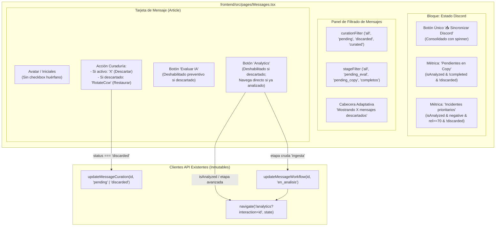

# Plan de Arquitectura e Implementación Técnica: Spec 008
## Auditoría y Consistencia Funcional de la Pestaña de Mensajes

---

## 1. Resumen Ejecutivo y Metas Técnicas

El propósito de la **Especificación 008** es garantizar la consistencia visual y la operatividad total al 100% de la pestaña de Mensajes (`frontend/src/pages/Messages.tsx`). La auditoría técnica identificó controles duplicados, botones muertos, casillas de selección desconectadas, un bloqueo en el filtrado de mensajes descartados, falta de un mecanismo para revertir descartes accidentales, errores bloqueantes en la navegación hacia Analytics en mensajes avanzados e incoherencias en las métricas del bloque de Estado de Discord.

Este plan describe la arquitectura y estrategia de implementación para solucionar de raíz cada uno de estos hallazgos, restringiendo la totalidad de los cambios al archivo `frontend/src/pages/Messages.tsx` y garantizando el estricto cumplimiento constitucional: **cero modificaciones a los 17 archivos preexistentes de la raíz**, a la carpeta `backend/` y al directorio `motor-ia/`.

---

## 2. Arquitectura de Componentes y Flujo de Interacción

---

## 3. Especificación Técnica de Cambios en `frontend/src/pages/Messages.tsx`

### 3.1 Limpieza y Consolidación de Controles (RF-01, RF-02)
1. **Desduplicación del botón de sincronización (RF-01):**
   - En la sección del panel de filtrado (alrededor de la línea 1108), suprimir el `<button>` que invoca a `handleSyncDiscord`.
   - Mantener intacto y como punto de acceso único el botón ubicado en el encabezado de "Estado Discord" (línea 880), el cual cuenta con estado de carga `isSyncingDiscord` y animación giratoria (`animate-spin`).
2. **Remoción del botón muerto 'Añadir interacción' (RF-02):**
   - Eliminar el bloque `<button disabled title="Disponible cuando se integre...">` (alrededor de la línea 1122), limpiando la barra de acciones.
3. **Retiro de checkboxes desconectados (RF-02):**
   - En el renderizado de cada tarjeta dentro de `filteredMessages.map` (alrededor de la línea 1373), eliminar el `<input type="checkbox" ... />`.
   - Ajustar el espaciado para que el contenedor de iniciales (`message.initials`) y los detalles del autor mantengan una alineación estética y sin desfases.

### 3.2 Lógica de Filtrado Reactivo y Cabecera Adaptativa (RF-03)
1. **Reestructuración de la condición en `filteredMessages`:**
   - La exclusión incondicional previa (`if ((curationStatus[message.id] ?? 'pending') === 'discarded') return false`) debe transformarse en una condición contextual:
     - Si `curationFilter === 'discarded'`: permitir el paso de aquellos mensajes cuyo estado sea `discarded`.
     - Si `curationFilter !== 'discarded'`: rechazar cualquier mensaje cuyo estado sea `discarded`.
2. **Coexistencia lógica con `stageFilter`:**
   - Cuando `curationFilter === 'discarded'`:
     - Si `stageFilter === 'all'`, se incluyen todos los descartados sin restricción de etapa.
     - Si `stageFilter` tiene un valor específico (como `'pending_eval'`, `'pending_copy'`, `'completos'`), se evalúa la coincidencia de etapa (`AND`), permitiendo auditar descartados por cada fase editorial.
3. **Cabecera adaptativa de cola:**
   - En el bloque de cabecera de la cola de mensajes (donde se muestra el número de mensajes coincidentes), evaluar si `curationFilter === 'discarded'`.
   - De ser afirmativo, proyectar el texto dinámico: `"Mostrando ${filteredMessages.length} mensaje${filteredMessages.length === 1 ? '' : 's'} descartado${filteredMessages.length === 1 ? '' : 's'}"`.

### 3.3 Acción Bidireccional de Curaduría y Restauración (RF-04)
1. **Renderizado condicional en la cuadrícula de acciones (`grid-cols-2`):**
   - Importar el icono `RotateCcw` desde `lucide-react`.
   - Si `status !== 'discarded'`: renderizar el botón habitual de descarte con icono `<X size={15} />` que llama a `markCuration(message, 'discarded')`.
   - Si `status === 'discarded'`: renderizar el botón de restauración:
     - Icono: `<RotateCcw size={15} />`.
     - Clases CSS: `flex h-9 items-center justify-center rounded-lg transition text-emerald-600 hover:bg-emerald-50 hover:text-emerald-700`.
     - Atributo `title`: `"Restaurar mensaje a pendientes"`.
     - Manejador `onClick`: invocar `markCuration(message, 'pending')`.
2. **Gestión transaccional y Rollback en `markCuration`:**
   - Mantener el control de concurrencia `savingCurationId === message.id`.
   - Capturar el estado anterior para aplicar rollback en caso de que `updateMessageCuration` lance una excepción.
   - En caso de error, emitir el mensaje descriptivo a través del estado `curationError`.

### 3.4 Deshabilitación Preventiva y Navegación Resiliente a Analytics (RF-05)
1. **Deshabilitación preventiva en tarjetas descartadas:**
   - Para el botón "Analytics": si `status === 'discarded'`, aplicar `disabled={true}`, estilos de opacidad (`disabled:opacity-50 disabled:cursor-not-allowed`) y `title="Restaura el mensaje para ver su análisis"`.
   - Para el botón "Evaluar IA": si `status === 'discarded'`, aplicar `disabled={true}`, estilos de opacidad (`disabled:opacity-50 disabled:cursor-not-allowed`) y `title="Restaura el mensaje para evaluarlo con IA"`.
2. **Navegación sin excepciones en `handleAnalyze`:**
   - Si el mensaje ya ha sido analizado o se encuentra en etapas como `'en_analisis'`, `'en_redaccion'`, `'en_aprobacion'` o `'completado'`:
     - Omitir la llamada a `updateMessageWorkflow`.
     - Ejecutar directamente `navigate('/analytics?interaction=' + message.interactionId, { state: ... })`.
   - Si el mensaje está en `'ingesta'` o `'en_ingesta'`:
     - Invocar `updateMessageWorkflow(message.interactionId, 'en_analisis')`.
     - Ejecutar la navegación con el estado tipado.
   - Si el mensaje está descartado: la deshabilitación preventiva en el botón impide el clic; no obstante, una guarda defensiva retornará de inmediato sin levantar alertas de error innecesarias.

### 3.5 Reconciliación de Métricas en Estado Discord (RF-06)
1. **Definición de "Pendientes en Copy":**
   - Filtrar `messageItems` contabilizando los que cumplan simultáneamente:
     - `message.isAnalyzed === true`.
     - `workflowStage !== 'en_redaccion'`, `workflowStage !== 'en_aprobacion'`, y `curationStatus !== 'curated'`.
     - `(curationStatus[message.id] ?? 'pending') !== 'discarded'`.
     - No ser mensaje emitido por `'cloudedtech community bot'`.
2. **Definición de "Incidentes prioritarios":**
   - Filtrar `messageItems` contabilizando los que cumplan simultáneamente:
     - `message.isAnalyzed === true`.
     - `message.sentiment === 'negative'`.
     - `message.relevance >= 70`.
     - `(curationStatus[message.id] ?? 'pending') !== 'discarded'`.
     - No ser mensaje emitido por `'cloudedtech community bot'`.
3. **Exclusión universal de bots:**
   - Asegurar que todas las métricas agregadas en pantalla apliquen la comprobación defensiva `!message.author.toLowerCase().includes('cloudedtech community bot')`.

---

## 4. Aislamiento Constitucional e Inmutabilidad (RF-07)

Se garantiza formalmente la inmutabilidad de los siguientes 17 archivos de la raíz del repositorio:
1. `api.py`
2. `app.py`
3. `armar_json_bot_python.py`
4. `base_datos.py`
5. `bot_lote.py`
6. `cerebro_ia.py`
7. `cerebro_ia_gemini_flash.py`
8. `cerebro_ia_gemma_4.py`
9. `evaluador_lotes.py`
10. `limpieza.py`
11. `modelos.py`
12. `oci_uploader.py`
13. `periodos.py`
14. `procesamiento.py`
15. `prompts_ia.py`
16. `reporte_semanal.py`
17. `ver_json.py`

Asimismo, no se modificará ningún archivo dentro de las carpetas `backend/` ni `motor-ia/`. Toda la intervención recae en `frontend/src/pages/Messages.tsx`.

---

## 5. Estrategia de Verificación y Testing (RF-08)

1. **Verificación de Backend (Regresión cero):**
   - Ejecución de `pytest tests/ -v`.
   - Comprobación de que las 77 pruebas preexistentes continúan pasando al 100% en verde.
2. **Verificación de Frontend (Tipado y Build):**
   - Ejecución de `npm run build` en el directorio `frontend/`.
   - Comprobación de código de salida 0 sin advertencias de tipos, imports rotos o sintaxis JSX inválida.
3. **Verificación Visual e Interactiva:**
   - Inspección de controles: verificación de ausencia del botón de sincronización duplicado, ausencia de "Añadir interacción" y de los checkboxes huérfanos.
   - Prueba del filtro "Descartados": confirmación de que lista mensajes descartados y muestra el encabezado adaptativo.
   - Prueba de restauración con `RotateCcw`: validación de reversión a estado pendiente.
   - Prueba de navegación a Analytics: verificación de navegación limpia sin excepciones para mensajes en cualquier etapa de análisis.
