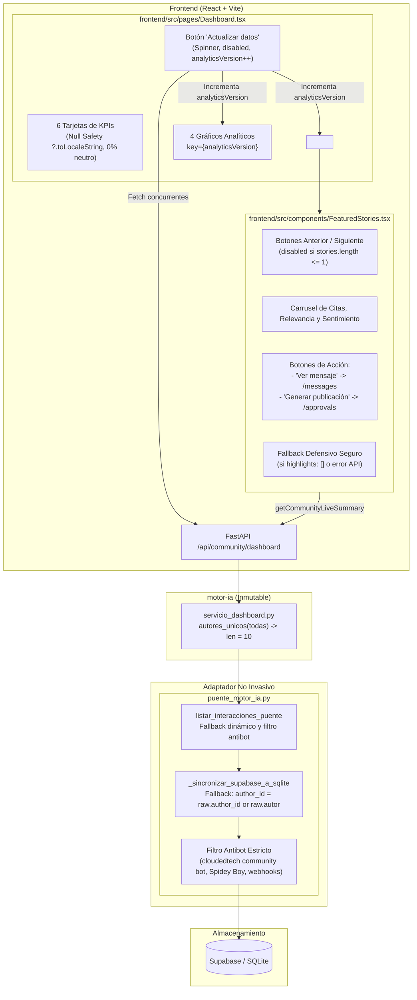

# Plan de Arquitectura e Implementación Técnica: Spec 009
## Auditoría y Consistencia Funcional de la Pestaña de Dashboard

---

## 1. Resumen Ejecutivo y Metas Técnicas

El propósito de la **Especificación 009** es asegurar la consistencia operativa, integridad visual, robustez ante fallos (Null Safety) y operatividad interactiva al 100% de la pestaña de Dashboard (`frontend/src/pages/Dashboard.tsx`). La auditoría técnica identificó las siguientes oportunidades de mejora:
1. La existencia de un bloque estático provisional con texto de marcador de posición (*placeholder*) en la sección "Historias destacadas".
2. La falta de sincronización del componente de historias con el botón general "Actualizar datos".
3. Botones desconectados dentro de `FeaturedStories.tsx` ("Ver mensaje" y "Generar publicación") y falta de deshabilitación preventiva si solo hay una o ninguna historia.
4. Una discrepancia de esquemas de datos en el backend donde la métrica de audiencia total (`total_audience`) marcaba 0 debido a que los autores residían en la columna `autor` mientras `author_id` permanecía nulo o vacío.
5. Necesidad de formateo defensivo con coalescencia nula en las 6 tarjetas de KPIs para prevenir caídas de React (*pantallas blancas*) y presentación explícita de variaciones neutras (`0% esta semana` / `0 puntos esta semana`).

Este plan describe la arquitectura y estrategia de implementación bajo diseño **Test-First (TDD: Fase Red -> Green)**, manteniendo la **estricta inmutabilidad constitucional**: cero modificaciones a los 17 archivos preexistentes de la raíz, al directorio `backend/` ni a `motor-ia/`.

---

## 2. Arquitectura de Componentes y Flujo de Interacción

---

## 3. Especificación Técnica de Cambios

### 3.1 Backend y Diseño Test-First (TDD) (RF-03, RF-06)
1. **Fase Red (TDD en `tests/test_unificacion_motor_ia.py`):**
   - Incorporar una prueba automatizada específica (`test_dashboard_total_audience_reconciliacion_y_fallback_autor`) que:
     - Simule interacciones en Supabase con `autor` válido pero `author_id` nulo o vacío (`None` / `""`), además de mensajes emitidos por bots (`"cloudedtech community bot"`, `"Spidey Boy#0000"`).
     - Invoque el endpoint `GET /api/community/dashboard` utilizando `TestClient(puente_motor_ia.motor_api.app)`.
     - Valide que `total_audience` sea estrictamente igual a 10 (los 10 miembros humanos únicos reales de la comunidad).
     - Valide que ninguna cuenta bot sea computada dentro de la audiencia.
     - Confirme que el fallback opere correctamente tanto en SQLite como en las interacciones retornadas en memoria.
2. **Fase Green (Adaptación en `puente_motor_ia.py`):**
   - En la función `_sincronizar_supabase_a_sqlite`:
     - Al preparar la tupla de inserción/reemplazo en SQLite para la columna `author_id` (alrededor de la línea 349), asegurar:
       `str(raw.get("author_id") or raw.get("autor") or "")`.
   - En la función `listar_interacciones_puente`:
     - Asegurar que en cada elemento retornado se garantice que si `not it.get("author_id") and it.get("autor")`, se asigne `it["author_id"] = str(it["autor"])`.
     - Preservar el filtro `_es_cuenta_bot(it)` para que los bots queden absolutamente descartados antes del cálculo de `servicio_dashboard.autores_unicos`.

### 3.2 Frontend en `Dashboard.tsx` (RF-01, RF-02, RF-04)
1. **Reemplazo del Placeholder Provisional (RF-01, RF-02):**
   - Importar `FeaturedStories` desde `../components/FeaturedStories`.
   - Eliminar el bloque `<section>` con el texto provisional `"Esta sección se conectará con los mensajes destacados..."` (líneas 200-208).
   - Renderizar en su lugar `<FeaturedStories key={analyticsVersion} />`.
   - Al asociar `key={analyticsVersion}`, cuando el usuario pulsa "Actualizar datos", `FeaturedStories` se remonta limpiamente y ejecuta su propio `useEffect` de forma asíncrona, sincronizándose con las tarjetas y gráficos sin bloquear la UI ni el botón.
2. **Formateo Defensivo y Null Safety en las 6 Tarjetas de KPIs (RF-04):**
   - Envolver cada acceso a valores numéricos con coalescencia nula defensiva:
     - `messages_processed?.toLocaleString("es-CO") ?? "0"`
     - `total_audience?.toLocaleString("es-CO") ?? "0"`
     - `positive_sentiment != null ? `${dashboardData.positive_sentiment}%` : "0%"`
     - `topics_detected?.toLocaleString("es-CO") ?? "0"`
     - `content_generated?.toLocaleString("es-CO") ?? "0"`
     - `pending_approvals?.toLocaleString("es-CO") ?? "0"`
   - Manejo explícito de variaciones neutras y nulas:
     - Si el valor de variación es `null` o `undefined`: `"Sin comparación"`.
     - Si el valor de variación es estrictamente `0` o `0.0`: `"0% esta semana"` (en mensajes y audiencia) o `"0 puntos esta semana"` (en sentimiento).
     - Si el valor de variación es mayor a `0`: anteponer signo `+`.
     - Si el valor de variación es menor a `0`: formatear el valor negativo.

### 3.3 Frontend en `FeaturedStories.tsx` (RF-01)
1. **Deshabilitación Preventiva de Navegación:**
   - Si la lista de historias cargadas contiene una o ninguna historia (`stories.length <= 1`), añadir `disabled={stories.length <= 1}` y clases `disabled:opacity-50 disabled:cursor-not-allowed` a los botones `handlePrevious` y `handleNext`.
2. **Acciones Interactivas de Enlace:**
   - Importar `useNavigate` desde `react-router-dom`.
   - En el botón "Ver mensaje": implementar `onClick={() => navigate('/messages', { state: { selectedInteractionId: currentStory.id } })}`.
   - En el botón "Generar publicación": implementar `onClick={() => navigate('/approvals')}`.
3. **Resiliencia ante Fallos de API:**
   - Mantener el fallback seguro existente garantizando que si `highlights` viene vacío o la API falla, se conserve el estado predeterminado sin provocar errores de renderizado.

---

## 4. Aislamiento Constitucional e Inmutabilidad (RF-05)

Se certifica formalmente la inmutabilidad de los siguientes 17 archivos de la raíz del proyecto:
1. `api.py`
2. `app.py`
3. `armar_json_bot_python.py`
4. `base_datos.py`
5. `bot_lote.py`
6. `cerebro_ia.py`
7. `cerebro_ia_gemini_flash.py`
8. `cerebro_ia_gemma_4.py`
9. `evaluador_lotes.py`
10. `limpieza.py`
11. `modelos.py`
12. `oci_uploader.py`
13. `periodos.py`
14. `procesamiento.py`
15. `prompts_ia.py`
16. `reporte_semanal.py`
17. `ver_json.py`

Asimismo, no se modificará ningún archivo dentro de las carpetas `backend/` ni `motor-ia/`.
Toda la intervención queda circunscrita a:
- `puente_motor_ia.py`
- `frontend/src/pages/Dashboard.tsx`
- `frontend/src/components/FeaturedStories.tsx`
- `tests/test_unificacion_motor_ia.py`

---

## 5. Estrategia de Verificación y Testing (RF-06)

1. **Ciclo TDD y Suite de Backend:**
   - Ejecutar la nueva prueba de reconciliación de audiencia para confirmar su fallo inicial (Red).
   - Aplicar el ajuste en `puente_motor_ia.py` y verificar que la prueba pase a verde (Green).
   - Ejecutar la suite completa `pytest tests/ -v` asegurando 78/78 pruebas en verde.
2. **Verificación de Frontend (Tipado y Build):**
   - Ejecutar `npm run build` en el directorio `frontend/`.
   - Confirmar código de salida 0 con cero errores de TypeScript y empaquetado de producción exitoso.
3. **Verificación Visual e Interactiva:**
   - Confirmar que el contenedor provisional con texto estático haya desaparecido.
   - Probar los botones Anterior, Siguiente y dots en el carrusel de historias destacadas.
   - Probar que "Ver mensaje" conduzca a `/messages` y "Generar publicación" a `/approvals`.
   - Probar el botón "Actualizar datos", verificando el spinner en `RefreshCw`, el texto "Actualizando...", la deshabilitación transitoria y el refresco sincronizado de todos los bloques.
   - Verificar que "Total de audiencia" reporte los 10 miembros únicos formateados con separador de miles.
