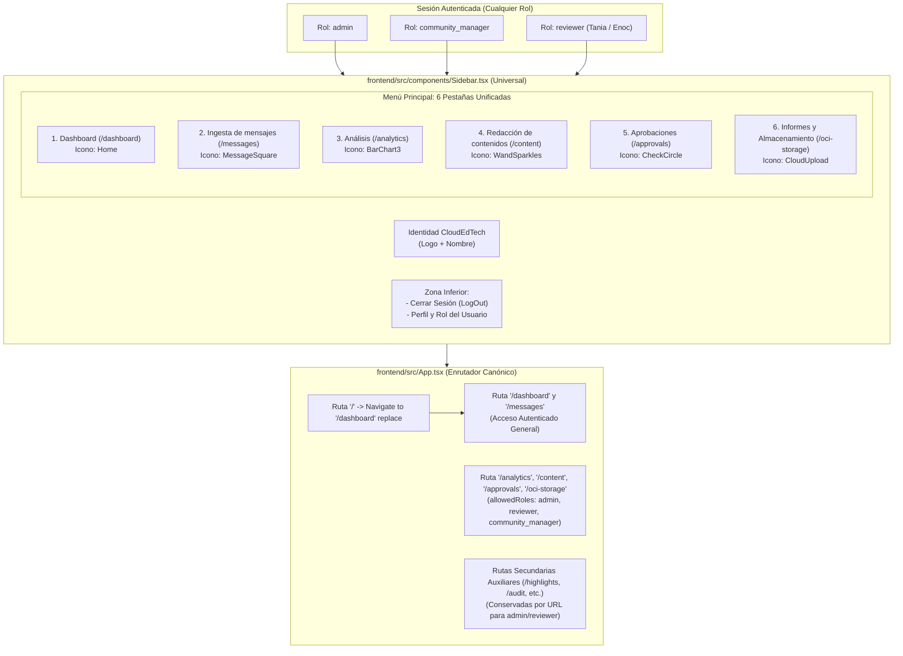

# Plan de Arquitectura e Implementación Técnica: Spec 010
## Unificación de Pestañas de Navegación y Flujo de Equipo

---

## 1. Resumen Ejecutivo y Metas Técnicas

El propósito de la **Especificación 010** es unificar la experiencia de navegación en el frontend de la plataforma, consolidando de manera homogénea y universal las **6 pestañas esenciales** que conforman el flujo operativo real del equipo CloudEdTech:
1. **Dashboard** (`/dashboard`)
2. **Ingesta de mensajes** (`/messages`)
3. **Análisis** (`/analytics`)
4. **Redacción de contenidos** (`/content`)
5. **Aprobaciones** (`/approvals`)
6. **Informes y Almacenamiento** (`/oci-storage`)

La auditoría técnica demostró que:
- Existía una bifurcación en `frontend/src/components/Sidebar.tsx` donde únicamente el rol `community_manager` veía un menú limpio, mientras que cuentas `admin` o `reviewer` (ej. `admin@cloudedtech.com`) eran inundadas con 15 pestañas desordenadas y anglicismos confusos (`Content Studio`, `OCI Storage`).
- En `frontend/src/App.tsx`, la ruta `/oci-storage` excluía al rol `reviewer`, lo que impedía a Tania u otros revisores operar el módulo de informes.
- Al acceder a la raíz `/`, no se redirigía canónicamente a `/dashboard`, dejando el elemento "Dashboard" sin su indicador visual activo (`bg-orange-500`).
- Dado que `frontend/tsconfig.app.json` impone `"noUnusedLocals": true`, el retiro de las pestañas secundarias exige una depuración rigurosa de iconos no utilizados para prevenir fallos bloqueantes de TypeScript (`TS6133`).

Este plan establece los cambios exactos a realizar en `Sidebar.tsx` y `App.tsx`, preservando inmutablemente los 17 archivos `.py` de la raíz, `backend/` y `motor-ia/`.

---

## 2. Arquitectura de Navegación y Flujo de Roles



---

## 3. Especificación Técnica de Cambios

### 3.1 Refactorización y Saneamiento en `frontend/src/components/Sidebar.tsx` (RF-01, RF-02, RF-03)

1. **Saneamiento Estricto de Iconos (`lucide-react`) y Prevención de `TS6133`:**
   - **Iconos a eliminar (9):** `CalendarDays`, `Download`, `FileClock`, `FileText`, `Hash`, `Settings`, `ShieldCheck`, `Star`, `Users`.
   - **Iconos activos a conservar (8):**
     - `BarChart3` (para Análisis)
     - `CheckCircle` (para Aprobaciones)
     - `CloudUpload` (para Informes y Almacenamiento)
     - `Home` (para Dashboard)
     - `LogOut` (para Cerrar sesión)
     - `MessageSquare` (para Ingesta de mensajes)
     - `WandSparkles` (para Redacción de contenidos)
     - `X` (para Cerrar menú móvil)
2. **Eliminación de Variables y Bifurcaciones Obsoletas:**
   - Eliminar la variable `const isCommunityManager = user?.role === 'community_manager'` (líneas 72-74).
   - Eliminar toda la condición ternaria `isCommunityManager ? (...) : (...)` que bifurcaba el menú.
   - Eliminar por completo el bloque condicional de Administración `{user?.role === 'admin' && (<p>Administración</p>...)}` (líneas 332-363).
3. **Renderizado Directo y Universal de las 6 Pestañas:**
   Dentro del contenedor `<nav className="min-h-0 flex-1 overflow-y-auto px-4 py-5">`, bajo el encabezado `"Principal"`, renderizar directamente:
   ```tsx
   <div className="space-y-2">
       <SidebarItem
           to="/dashboard"
           icon={<Home size={18} />}
           label="Dashboard"
           onNavigate={handleNavigate}
       />

       <SidebarItem
           to="/messages"
           icon={<MessageSquare size={18} />}
           label="Ingesta de mensajes"
           onNavigate={handleNavigate}
       />

       <SidebarItem
           to="/analytics"
           icon={<BarChart3 size={18} />}
           label="Análisis"
           onNavigate={handleNavigate}
       />

       <SidebarItem
           to="/content"
           icon={<WandSparkles size={18} />}
           label="Redacción de contenidos"
           onNavigate={handleNavigate}
       />

       <SidebarItem
           to="/approvals"
           icon={<CheckCircle size={18} />}
           label="Aprobaciones"
           onNavigate={handleNavigate}
       />

       <SidebarItem
           to="/oci-storage"
           icon={<CloudUpload size={18} />}
           label="Informes y Almacenamiento"
           onNavigate={handleNavigate}
       />
   </div>
   ```

### 3.2 Actualización de Enrutamiento y Permisos en `frontend/src/App.tsx` (RF-04, RF-05)

1. **Redirección Canónica de Raíz (`/`):**
   - Reemplazar `<Route path="/" element={<Dashboard />} />` por:
     `<Route path="/" element={<Navigate to="/dashboard" replace />} />`.
   - Con esto, al ingresar a la raíz de la aplicación, el usuario aterriza con la URL `/dashboard`, permitiendo que el componente `<NavLink to="/dashboard">` detecte la ruta activa y aplique `bg-orange-500 text-white`.
2. **Acceso Universal para las 6 Rutas del Flujo de Equipo:**
   - Consolidar la protección de rutas para que `/oci-storage` pertenezca al mismo bloque `RoleProtectedRoute` de `["admin", "reviewer", "community_manager"]` junto con `/analytics`, `/content` y `/approvals`:
     ```tsx
     <Route
       element={
         <RoleProtectedRoute
           allowedRoles={["admin", "reviewer", "community_manager"]}
         />
       }
     >
       <Route path="/analytics" element={<Analytics />} />
       <Route path="/content" element={<ContentStudio />} />
       <Route path="/approvals" element={<Approvals />} />
       <Route path="/oci-storage" element={<OCIStorage />} />
     </Route>
     ```
   - Eliminar el bloque redundante donde `/oci-storage` solo autorizaba a `admin` y `community_manager`.
3. **Preservación de Rutas Secundarias y Auxiliares:**
   - Mantener intactas las rutas `/highlights`, `/hashtags`, `/audience`, `/calendar`, `/export`, `/my-reports` bajo `["admin", "reviewer"]`.
   - Mantener intactas las rutas `/audit`, `/security`, `/settings` bajo `["admin"]`.
   - Mantener la ruta comodín `path="*"` redirigiendo a `/dashboard`.

---

## 4. Aislamiento Constitucional e Inmutabilidad (RF-06)

Se ratifica formalmente la inmutabilidad de los siguientes 17 archivos de la raíz del proyecto:
1. `api.py`
2. `app.py`
3. `armar_json_bot_python.py`
4. `base_datos.py`
5. `bot_lote.py`
6. `cerebro_ia.py`
7. `cerebro_ia_gemini_flash.py`
8. `cerebro_ia_gemma_4.py`
9. `evaluador_lotes.py`
10. `limpieza.py`
11. `modelos.py`
12. `oci_uploader.py`
13. `periodos.py`
14. `procesamiento.py`
15. `prompts_ia.py`
16. `reporte_semanal.py`
17. `ver_json.py`

Asimismo, no se tocará ningún archivo en `backend/` ni en `motor-ia/`.
Toda la intervención queda circunscrita a:
- `frontend/src/components/Sidebar.tsx`
- `frontend/src/App.tsx`

---

## 5. Estrategia de Verificación y Testing

1. **Compilación Estricta de Frontend (`npm run build`):**
   - Ejecutar `npm run build` en el directorio `frontend/`.
   - Certificar código de salida 0 con cero errores de TypeScript (`TS6133` u otros) y empaquetado de Vite exitoso.
2. **Verificación de Backend (Cero Regresiones):**
   - Ejecutar `pytest tests/ -v`.
   - Comprobar que el 100% de las pruebas automatizadas (77 o 78 tests) pasen en verde.
3. **Verificación Visual e Interactiva:**
   - Iniciar sesión con rol `admin` (`admin@cloudedtech.com`): comprobar que el menú lateral exhiba exactamente las 6 pestañas unificadas sin pestañas secundarias ni bloque de administración.
   - Iniciar sesión con rol `reviewer` (`reviewer@cloudedtech.com`): comprobar que el menú lateral muestre las 6 pestañas y que pueda ingresar a `/oci-storage` sin redirección de acceso denegado.
   - Navegar a `/` y verificar que la URL cambie a `/dashboard` y la pestaña "Dashboard" se pinte de naranja (`bg-orange-500`).
   - Validar que `/messages` muestre la etiqueta `"Ingesta de mensajes"`.
