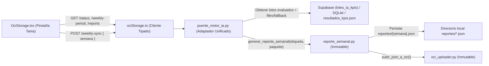

# Plan de Implementación Técnica — Spec 011: Integración Funcional de Informes y Almacenamiento OCI (Flujo de Tania)

## 1. Resumen Arquitectónico

La arquitectura de **Spec 011** conecta de extremo a extremo la pestaña **Informes y Almacenamiento** (`/oci-storage`) en React con los módulos de generación y distribución de reportes semanales creados originalmente por Tania ([`reporte_semanal.py`](file:///c:/Users/jeova/OneDrive/Documentos/Alura/Codigo%20unificado%20con%20imports/reporte_semanal.py) y [`oci_uploader.py`](file:///c:/Users/jeova/OneDrive/Documentos/Alura/Codigo%20unificado%20con%20imports/oci_uploader.py)), respetando las Reglas Constitucionales de inmutabilidad de archivos raíz y retrocompatibilidad de contratos API.

### Diagrama de Flujo de Datos

---

## 2. Diseño de Backend en `puente_motor_ia.py`

### 2.1 Enriquecimiento de `GET /api/v1/oci-storage/status` (RF-01)
- Verificar si existen credenciales de OCI activas siguiendo la misma regla de `oci_uploader.py`:
  - Comprobar `os.path.exists(os.path.expanduser(os.getenv("OCI_CONFIG_FILE", "~/.oci/config")))` o presencia de `os.getenv("OCI_USER_OCID")`.
- Retornar de forma aditiva y retrocompatible:
  - `status`: `"connected"` (conservado para no romper clientes ni tests previos).
  - `message`: Mensaje descriptivo según el modo (`"OCI Object Storage conectado y listo"` si hay credenciales, o `"OCI Object Storage listo en Modo Respaldo Local (Offline)"` si opera sin credenciales OCI locales).
  - `oci_configured`: `bool` (`True` si existen credenciales OCI configuradas, `False` en caso contrario).
  - `mode`: `"online"` si `oci_configured` es `True`, `"offline"` si es `False`.
  - `bucket`: `os.getenv("OCI_BUCKET_NAME", "communitylab-assets")`.
  - `region`: `os.getenv("OCI_REGION", "Colombia Central (Bogotá)")`.

### 2.2 Enriquecimiento de `GET /api/v1/oci-storage/weekly-period` (RF-03)
- Conservar intactas todas las llaves existentes (`semana_nombre`, `week_label`, `start_date`, `end_date`, `status: "ready"`).
- Añadir `iso_week_label`: calculado con `ahora.date().isocalendar()` en formato `f"{iso.year}-semana-{iso.week:02d}"` (idéntico a `etiqueta_semana` en `app.py` de Tania).

### 2.3 Actualización de `POST /api/v1/oci-storage/weekly-sync` (RF-03, RF-04)
- **Validación de Etiqueta (`AAAA-semana-NN`)**:
  - Si `payload` incluye `semana`, validarla invocando `reporte_semanal.validar_etiqueta(semana)`. Si lanza `ValueError`, capturar la excepción y lanzar `HTTPException(status_code=400, detail=str(e))`.
  - Si no se especifica `semana`, calcular la etiqueta por defecto como hasta ahora.
- **Construcción del Paquete con Correspondencia de Semanas y Fallback Seguro**:
  - Crear función auxiliar `_construir_paquete_para_semana(semana_objetivo: str) -> dict` en `puente_motor_ia.py`:
    1. Obtener el lote consolidado completo desde `_base_datos_raiz.obtener_lote_kpis_supabase()`, o como respaldo desde `resultados_kpis.json` o desde las interacciones analizadas en SQLite (`motor_bd.RUTA_BD`).
    2. Extraer el número de semana `NN` de `semana_objetivo` (`AAAA-semana-NN` -> `Semana_NN` y entero ` int(NN)`).
    3. Filtrar los elementos de `aprobados` y `descartados` que coincidan con:
       - `item.get("semana") == semana_objetivo` o `item.get("periodo_referencia") == semana_objetivo`, o
       - `item.get("semana") == f"Semana_{nn:02d}"` o `item.get("periodo_referencia") == f"Semana_{nn:02d}"`, o
       - La fecha en `item.get("fecha_envio")` / `item.get("enviado_en")` cuya semana ISO coincida con `(anio, nn)` o cuya `semana_de(fecha)` coincida con `nn`.
    4. **Fallback Seguro**: Si tras aplicar el filtro específico para `semana_objetivo` tanto `aprobados_filtrados` como `descartados_filtrados` quedan vacíos, utilizar el lote consolidado completo (`aprobados` y `descartados` generales), replicando el comportamiento de `app.py` para garantizar que siempre pueda generarse el reporte de cualquier etiqueta válida cuando existen mensajes evaluados.
- **Invocación de `reporte_semanal.generar_reporte_semanal`**:
  - Llamar a `reporte_semanal.generar_reporte_semanal(semana_nombre, paquete)`.
  - Si `generar_reporte_semanal` lanza `ValueError` (ej. cuando no existen mensajes analizados en ninguna fuente), capturar y lanzar `HTTPException(status_code=400, detail=str(e))`.
  - Persistir/actualizar también el archivo `reportes/{semana_res}.json` con el flag `metadata.oci_storage.subido` actualizado para que `GET /api/v1/oci-storage/reports` refleje el estado real de subida en disco.
- **Contrato de Respuesta**:
  - Devolver todas las llaves existentes (`exito`, `status`, `semana`, `subido_oci`, `bucket`, `ruta_oci`, `resumen`, `sync_id`, `message`) y añadir `"reporte": reporte`.

### 2.4 Nuevo Endpoint `GET /api/v1/oci-storage/reports` (RF-05)
- Registrar `@app.get("/api/v1/oci-storage/reports")` y `@app.get("/api/v1/oci-storage/reports/")`.
- **Escaneo Resiliente y Reconstrucción Automática**:
  1. Asegurar directorio `reportes/` (`os.makedirs("reportes", exist_ok=True)`).
  2. Escanear todos los archivos `reportes/*.json` mediante `os.listdir("reportes")`.
  3. Si aún no existe ningún archivo `.json` válido en `reportes/` (por ejemplo, tras un reinicio de contenedor efímero en Render), verificar si existen mensajes evaluados en Supabase (`_base_datos_raiz.obtener_lote_kpis_supabase()`) o `resultados_kpis.json`. Si existen mensajes evaluados, generar automáticamente el reporte semanal sugerido para que el historial nunca aparezca vacío cuando ya hay trabajo de IA realizado.
  4. Para cada archivo `.json` en `reportes/`, leer y parsear con `json.load` dentro de un bloque `try...except` que ignore de forma segura cualquier archivo corrupto o ilegible.
  5. Construir para cada reporte válido el diccionario normalizado:
     - `semana`: `meta.get("semana")` o nombre base del archivo sin `.json`.
     - `nombre_archivo`: `f"{semana}.json"`.
     - `tamano_bytes`: tamaño en bytes del archivo en disco (`os.path.getsize`) o longitud en bytes del JSON serializado.
     - `generado_en`: `meta.get("generado_en")`.
     - `bucket`: `oci_meta.get("bucket", os.getenv("OCI_BUCKET_NAME", "communitylab-assets"))`.
     - `ruta_oci`: `oci_meta.get("ruta", f"activos/{semana}/paquete-distribucion.json")`.
     - `subido_oci`: `bool(oci_meta.get("subido", False))`.
     - `resumen_metricas`: `reporte.get("resumen_metricas", {})`.
     - `reporte`: objeto `reporte` íntegro.
  6. Ordenar la lista de reportes de forma descendente por `(semana, generado_en)` (más reciente primero) y retornar `{"reports": reports_list, "total": len(reports_list)}`.

---

## 3. Diseño de Frontend (`ociStorage.ts` y `OciStorage.tsx`)

### 3.1 Cliente Tipado en `frontend/src/api/ociStorage.ts`
- Ampliar interfaces TypeScript:
  - `OCIStorageStatus`: `status`, `message`, `oci_configured?: boolean`, `mode?: "online" | "offline"`, `bucket?: string`, `region?: string`.
  - `WeeklyPeriod`: `semana_nombre?: string`, `week_label?: string`, `iso_week_label?: string`, `start_date: string`, `end_date: string`, `status: string`.
  - `OCIReportMetrics`: `total_mensajes: number`, `total_aprobados: number`, `total_descartados: number`, `sentimiento: Record<string, number>`, `temas_tendencia: Array<{ tema: string; menciones: number }>`, `segmentos: Record<string, number>`.
  - `OCIReportPayload`: `metadata`, `resumen_metricas`, `activos_copywriting`.
  - `OCIReportItem`: `semana`, `nombre_archivo`, `tamano_bytes`, `generado_en`, `bucket`, `ruta_oci`, `subido_oci`, `resumen_metricas`, `reporte`.
  - `OCIReportsListResponse`: `{ reports: OCIReportItem[]; total: number }`.
  - `WeeklySyncResponse`: todas las propiedades actuales + `semana`, `subido_oci`, `bucket`, `ruta_oci`, `resumen`, `reporte?: OCIReportPayload`.
- Funciones exportadas:
  - `getOCIStorageStatus(): Promise<OCIStorageStatus>`
  - `getWeeklyPeriod(): Promise<WeeklyPeriod>`
  - `startWeeklySync(semana?: string): Promise<WeeklySyncResponse>` (envía `body: JSON.stringify(semana ? { semana } : {})`)
  - `getOCIReports(): Promise<OCIReportsListResponse>` (`GET /api/v1/oci-storage/reports`)

### 3.2 Refactorización Integral de `frontend/src/pages/OciStorage.tsx`
1. **Cabecera de Estado OCI y 4 Contadores Deterministas (RF-01)**:
   - Reconocer `ociStatus?.status === "connected" || ociStatus?.status === "ready"` como operativo (eliminando el bloqueo eterno en *"Verificando..."*).
   - Mostrar insignia de estado clara:
     - Si `ociStatus?.oci_configured` es `true`: *"Conectado a OCI"* (verde esmeralda).
     - Si `ociStatus` respondió pero `oci_configured` es `false`: *"Modo Offline / Respaldo Local"* (ámbar/azul informativo).
   - Mostrar nombre del bucket (`ociStatus?.bucket ?? "communitylab-assets"`) y región (`ociStatus?.region ?? "Colombia Central (Bogotá)"`).
   - Calcular y renderizar los 4 contadores superiores con fórmula determinista:
     1. **Reportes Semanales**: `reports.length`
     2. **Mensajes Consolidados**: `activeReport?.resumen_metricas?.total_mensajes ?? reports[0]?.resumen_metricas?.total_mensajes ?? 0`
     3. **Activos Aprobados**: `activeReport?.resumen_metricas?.total_aprobados ?? reports[0]?.resumen_metricas?.total_aprobados ?? 0`
     4. **Sincronizados OCI / Respaldos**: `${ociCount} OCI / ${localCount} Local`
2. **Eliminación de los 4 Bloques Muertos (RF-02)**:
   - Remover por completo *"Servicios CloudEdTech"*, *"Gestión administrativa"*, *"Panel de Automatización de Envíos de Reportes (LangGraph Cron Dispatcher)"* y *"Carga y Respaldo Manual"*.
3. **Panel Operativo de Tania: "Reporte Semanal y Distribución (OCI)" (RF-03)**:
   - Input editable **"Etiqueta de la Semana"** (`semanaInput`), inicializado automáticamente con `weeklyPeriod.iso_week_label || weeklyPeriod.semana_nombre` (o semana ISO actual como fallback).
   - Validación en tiempo real del patrón `^\d{4}-semana-\d{2}$` con aviso visual si el formato no coincide.
   - Botón principal **"📦 Generar y Subir Reporte a OCI"**:
     - Se deshabilita mientras `isSyncing` es `true` o si la etiqueta es inválida.
     - Muestra spinner y texto *"Empaquetando y subiendo..."* durante la petición.
     - Al completar: actualiza el reporte activo en el visor (`selectedReport`), recarga el historial (`loadReports()`) y muestra el banner de resultado:
       - Éxito OCI (`subido_oci === true`): Banner esmeralda `🎉 Subido a {bucket}/{ruta_oci}`.
       - Modo Offline (`subido_oci === false`): Banner ámbar informativo `⚠️ Modo Offline: Credenciales OCI no configuradas en este entorno. Reporte generado y respaldado en reportes/{semana}.json`.
       - Error (HTTP 400 / excepción): Banner rojo mostrando el detalle del error.
4. **Visor Interactivo del Reporte Semanal y Descarga Directa (RF-04)**:
   - Panel desplegable/activo (`👁️ Visor del Reporte Semanal: {semana}`) que muestra el reporte recién generado o el reporte seleccionado desde la tabla de historial:
     - Tarjetas de resumen de métricas: **Total Mensajes**, **Aprobados (Copywriting)**, **Descartados**, **Sentimiento Predominante / Desglose**, **Top Temas en Tendencia** y **Segmentos**.
     - Metadatos técnicos: Ruta OCI (`activos/{semana}/paquete-distribucion.json`), Bucket, Fecha UTC de generación y Estado de sincronización.
     - Conmutador para mostrar/ocultar el bloque `<pre>` con el JSON completo formateado (`JSON.stringify(reporte, null, 2)`).
     - Botón **"⬇️ Descargar `{semana}.json`"** que genera un `Blob` (`application/json;charset=utf-8`) y dispara la descarga directa en el navegador.
5. **Tabla Real de "Historial de Informes Semanales" (RF-05)**:
   - Conectada a `getOCIReports()`.
   - Botones de filtro funcionales con estado `statusFilter` (`"all"` | `"oci"` | `"local"`):
     - **Todos (`reports.length`)**
     - **Subido a OCI (`ociCount`)**
     - **Respaldo Local / Offline (`localCount`)**
   - Cada fila muestra:
     - **Semana / Período**: Etiqueta `AAAA-semana-NN` y fecha `generado_en` formateada.
     - **Archivo JSON & Ruta OCI**: `{semana}.json` y ruta `activos/{semana}/paquete-distribucion.json`.
     - **Métricas & Tamaño**: `{total_mensajes} mensajes ({total_aprobados} aprobados)` y tamaño en KB/bytes.
     - **Estado de Distribución**: Badge esmeralda *"Subido a OCI"* o badge ámbar *"Respaldo Local (Offline)"*.
     - **Acciones Reales**:
       - Botón **"Ver JSON"**: Selecciona el reporte en el visor interactivo y desplaza suavemente la vista si es necesario.
       - Botón **"Descargar .json"**: Descarga inmediatamente `{fila.semana}.json`.
       - Botón **"Subir / Reintentar OCI"**: Ejecuta `handleSyncWeek(fila.semana)` con estado de carga individual por fila (`retryingWeek === fila.semana`).

---

## 4. Cumplimiento Constitucional y Gestión de Riesgos

- **Regla 1 (Rama `feature/`):** Todo el desarrollo se mantiene en la rama de trabajo sin hacer push directo a `main`.
- **Regla 2 y 6 (Inmutabilidad de Raíz y Diseño Test-First):** `app.py`, `reporte_semanal.py`, `oci_uploader.py` y los otros 14 archivos `.py` de la raíz no se tocan. Primero se escriben las pruebas en `tests/test_unificacion_motor_ia.py` (Fase Red) y luego se implementa en `puente_motor_ia.py` (Fase Green).
- **Regla 3 (Retrocompatibilidad):** Todos los campos originales de `/api/v1/oci-storage/status`, `/api/v1/oci-storage/weekly-period` y `/api/v1/oci-storage/weekly-sync` se preservan intactos.
- **Regla 4 (Seguridad de Secretos):** Ninguna credencial OCI ni API key en código duro; lectura exclusiva vía `os.getenv`.
- **Regla 5 (Dependencias):** No se requieren librerías externas adicionales en `requirements.txt` ni en `package.json`.
