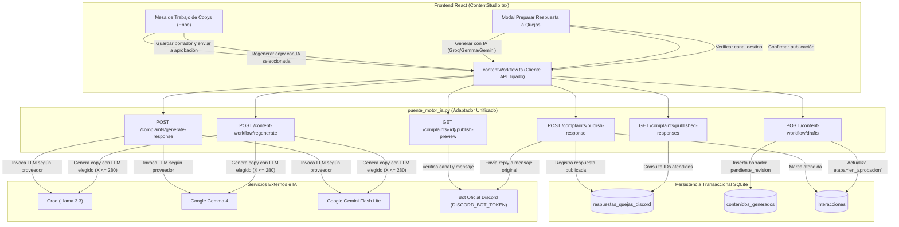

# Plan de Implementación Técnica — Spec 012: Redacción de Contenidos, Soporte a Quejas con Selector de IA y Publicación en Discord

## 1. Resumen Arquitectónico

La arquitectura de **Spec 012** conecta de extremo a extremo la pestaña **Redacción de Contenidos** ([`ContentStudio.tsx`](file:///c:/Users/jeova/OneDrive/Documentos/Alura/Codigo%20unificado%20con%20imports/frontend/src/pages/ContentStudio.tsx)) con el backend unificado en [`puente_motor_ia.py`](file:///c:/Users/jeova/OneDrive/Documentos/Alura/Codigo%20unificado%20con%20imports/puente_motor_ia.py), dotando al equipo de dos capacidades operativas clave:
1. **Soporte Crítico a Quejas de Discord**: Selector de IA multimodelo (Groq Llama 3.3, Google Gemma 4 y Google Gemini Flash Lite), generación de respuestas empáticas asistidas, verificación de canal y mensaje en Discord, publicación oficial mediante contestación (*reply*) con el bot de la comunidad y exclusión persistente de quejas ya atendidas.
2. **Mesa de Trabajo de Copywriting**: Erradicación de datos simulados ([`mockCommunityData`](file:///c:/Users/jeova/OneDrive/Documentos/Alura/Codigo%20unificado%20con%20imports/frontend/src/data/mockCommunityData.ts)), sincronización con el mensaje real seleccionado de Discord (`selectedWorkflowMessage`), selector de IA para regeneración multiformato (LinkedIn, X <= 280 caracteres, Discord) y persistencia independiente de borradores avanzando la interacción hacia la etapa de aprobación.

Todo el diseño se ciñe a las reglas constitucionales: inmutabilidad de los 17 archivos históricos preexistentes en la raíz, aislamiento de las carpetas `backend/` y `motor-ia/`, y cobertura de pruebas automatizadas Test-First (TDD).

### Diagrama de Arquitectura y Flujo de Datos



---

## 2. Diseño de Backend en `puente_motor_ia.py`

### 2.1 Esquema Transaccional y Persistencia SQLite (`respuestas_quejas_discord`) (RF-04)
En la función `_asegurar_esquema_sqlite()` de [`puente_motor_ia.py`](file:///c:/Users/jeova/OneDrive/Documentos/Alura/Codigo%20unificado%20con%20imports/puente_motor_ia.py), se asegurará la creación de la tabla persistente para registrar las quejas respondidas:

```sql
CREATE TABLE IF NOT EXISTS respuestas_quejas_discord (
    id INTEGER PRIMARY KEY AUTOINCREMENT,
    interaccion_id INTEGER NOT NULL UNIQUE,
    canal_id TEXT NOT NULL,
    discord_message_id TEXT NOT NULL,
    respuesta TEXT NOT NULL,
    publicado_en TEXT NOT NULL,
    autor_respuesta TEXT DEFAULT 'bot'
);
```

Asimismo, se agregará un índice sobre `interaccion_id` para optimizar las consultas de filtrado en el endpoint `GET /api/v1/content-workflow/complaints/published-responses`.

### 2.2 Endpoints de Soporte a Quejas y Publicación en Discord

#### 1. `POST /api/v1/content-workflow/complaints/generate-response` (RF-01)
- **Función Handler**: `generar_respuesta_queja_v1(payload: dict = Body(...))`
- **Flujo**:
  1. Extraer y validar `interaccion_id` (entero obligatorio). Si no existe en SQLite ni Supabase -> `HTTPException(404, "La interacción solicitada no existe.")`.
  2. Extraer `texto` de la interacción. Si está vacío o solo contiene espacios -> `HTTPException(422, "La interacción no contiene texto para responder.")`.
  3. Extraer `proveedor` del payload (por defecto `"Groq (Llama 3.3)"`).
  4. Normalizar proveedor mediante `_normalizar_proveedor_ia(proveedor)`. Si no es reconocido -> `HTTPException(400, "Proveedor de IA no reconocido: ...")`.
  5. Obtener la instancia del LLM correspondiente:
     - `cerebro_ia` -> Groq (`GROQ_API_KEY`).
     - `cerebro_ia_gemma_4` -> Gemma 4 (`GOOGLE_API_KEY`).
     - `cerebro_ia_gemini_flash` -> Gemini Flash (`GOOGLE_API_KEY`).
  6. Si la clave de API requerida no está configurada en el entorno, lanzar inmediatamente `HTTPException(502, f"El proveedor {nombre_legible} carece de credenciales configuradas en el servidor.")`. **Prohibido realizar sustitución silenciosa de modelo**.
  7. Invocar la cadena estructurada de respuesta a quejas ([`servicio_respuestas.template_respuesta`](file:///c:/Users/jeova/OneDrive/Documentos/Alura/Codigo%20unificado%20con%20imports/motor-ia/servicio_respuestas.py)) con `texto` y `canal`.
  8. Capturar excepciones de API externa (rate limits, cuota) y transformar en `HTTPException(502 / 503)` descriptivo.
  9. Retornar:
     ```json
     {
       "interaccion_id": interaccion["id"],
       "respuesta": resultado["respuesta"],
       "proveedor_usado": nombre_legible,
       "estado": "borrador",
       "requiere_revision": true
     }
     ```

#### 2. `GET /api/v1/content-workflow/complaints/{interaccion_id}/publish-preview` (RF-02)
- **Función Handler**: `vista_previa_publicacion_queja_v1(interaccion_id: int)`
- **Flujo**:
  1. Validar `interaccion_id` entero positivo.
  2. Consultar interacción en la base de datos (`obtener_interaccion_puente(interaccion_id)`). Si no existe -> `HTTPException(404, "La interacción solicitada no existe.")`.
  3. Comprobar presencia de token del bot (`DISCORD_BOT_TOKEN` o `DISCORD_TOKEN`). Si no está configurado, retornar HTTP 200 con:
     ```json
     {
       "interaccion_id": interaccion_id,
       "guild_id": "",
       "channel_id": str(interaccion.get("channel_id") or ""),
       "channel_name": str(interaccion.get("canal") or "desconocido").replace("#", ""),
       "source_message_id": str(interaccion.get("message_id") or ""),
       "author": str(interaccion.get("autor") or "Desconocido"),
       "original_content": str(interaccion.get("texto") or ""),
       "ready": false,
       "detail": "Bot de Discord no configurado en el servidor"
     }
     ```
  4. Si existe token, resolver `channel_id` (numérico directo o mapeo desde nombre de canal autorizado) y `source_message_id`.
  5. Si el mensaje original no existe en Discord (verificado mediante API REST de Discord o cliente efímero `discord.NotFound`), responder con `HTTPException(404, "El mensaje original ya no existe en Discord")`.
  6. Si los metadatos y acceso son válidos, retornar:
     ```json
     {
       "interaccion_id": interaccion_id,
       "guild_id": os.getenv("DISCORD_GUILD_ID", ""),
       "channel_id": channel_id,
       "channel_name": channel_name,
       "source_message_id": source_message_id,
       "author": interaccion.get("autor") or "Desconocido",
       "original_content": interaccion.get("texto") or "",
       "ready": true
     }
     ```

#### 3. `POST /api/v1/content-workflow/complaints/publish-response` (RF-03)
- **Función Handler**: `publicar_respuesta_queja_v1(payload: dict = Body(...))`
- **Flujo**:
  1. Validar `confirmado == True`, `interaccion_id` válido, y que `respuesta` tenga entre 1 y 2000 caracteres. Si excede o está vacía -> `HTTPException(400, "La respuesta debe contener entre 1 y 2000 caracteres.")`.
  2. Obtener datos de la interacción y canal destino.
  3. Verificar credenciales del bot de Discord (`DISCORD_BOT_TOKEN` o `DISCORD_TOKEN`). Si faltan -> `HTTPException(502, "Fallo de autenticación con Discord: token ausente o inválido")`.
  4. Ejecutar el envío mediante el bot oficial utilizando `discord.Client` efímero o API REST autenticada como contestación directa (*reply*) al mensaje `source_message_id`:
     - `reference = discord.MessageReference(message_id=int(source_message_id), channel_id=int(channel_id), fail_if_not_exists=True)`
     - `allowed_mentions = discord.AllowedMentions.none()`
  5. Capturar `discord.NotFound` -> `HTTPException(404, "El mensaje original ya no existe en Discord.")`.
  6. Capturar `discord.Forbidden` o errores de permisos -> `HTTPException(502, "Permisos insuficientes del bot en el canal de Discord.")`.
  7. Al confirmar el envío exitoso, registrar en SQLite en la tabla `respuestas_quejas_discord`:
     - `interaccion_id`, `canal_id`, `discord_message_id`, `respuesta`, `publicado_en = a_utc_iso(now)`, `autor_respuesta = 'bot'`.
  8. Actualizar la interacción en SQLite/Supabase (`etapa_flujo='atendido'`).
  9. Retornar:
     ```json
     {
       "estado": "publicado",
       "interaccion_id": interaccion_id,
       "discord_message_id": str(enviado_id),
       "channel_id": str(channel_id)
     }
     ```

#### 4. `GET /api/v1/content-workflow/complaints/published-responses` (RF-04)
- **Función Handler**: `listar_respuestas_quejas_publicadas_v1()`
- **Flujo**:
  1. Conectar a SQLite (`motor_bd.RUTA_BD`).
  2. Ejecutar `SELECT interaccion_id FROM respuestas_quejas_discord ORDER BY id ASC`.
  3. Retornar `{"interaction_ids": [row[0] for row in rows]}`.

---

### 2.3 Endpoints de Copywriting y Flujo de Contenidos

#### 1. `POST /api/v1/content-workflow/regenerate` (RF-06)
- **Función Handler**: `regenerar_contenido_v1(payload: dict = Body(...))`
- **Flujo**:
  1. Validar `texto` (no vacío), `canal`, `formato` (`"linkedin"`, `"x"`, `"discord"`), `tono` (por defecto `"profesional"`).
  2. Extraer `proveedor` del payload (por defecto `"Groq (Llama 3.3)"`).
  3. Normalizar proveedor y obtener el LLM correspondiente.
  4. Invocar la cadena de generación con la plantilla especializada de CloudEdTech ([`motor-ia/servicio_contenido.py`](file:///c:/Users/jeova/OneDrive/Documentos/Alura/Codigo%20unificado%20con%20imports/motor-ia/servicio_contenido.py)).
  5. **Garantía Estricta para X (`len(contenido) <= 280`)**:
     - Si `formato == 'x'` y `len(contenido) > 280`:
       - Aplicar recorte inteligente en el backend buscando la última frontera de palabra (`rfind(' ')`) antes del carácter 277 y añadir elipses o cierre limpio, asegurando que `len(contenido_final) <= 280`.
  6. Retornar:
     ```json
     {
       "formato": formato,
       "titulo": resultado.get("titulo", ""),
       "contenido": contenido_garantizado,
       "llamada_accion": resultado.get("llamada_accion", ""),
       "hashtags": resultado.get("hashtags", [])
     }
     ```

#### 2. `POST /api/v1/content-workflow/drafts` (RF-07)
- **Función Handler**: `crear_borrador_contenido_v1(payload: dict = Body(...))`
- **Flujo**:
  1. Validar campos requeridos: `plataforma` (`"linkedin"`, `"x"`, `"discord"`), `titulo`, `contenido` (no vacío).
  2. Insertar en `contenidos_generados` en SQLite/Supabase:
     - `interaccion_id`, `formato = plataforma`, `titulo`, `contenido`, `llamada_accion`, `hashtags`, `tono`, `plataforma`, `tipo_contenido = 'publicacion'`, `estado = 'pendiente_revision'`.
  3. Si se recibe `interaccion_id`, actualizar la etapa de la interacción en la base de datos a `en_aprobacion` (`actualizar_etapa_flujo_puente(interaccion_id, 'en_aprobacion')`).
  4. Responder con código HTTP 200 (o 201):
     ```json
     {
       "id": lastrowid,
       "estado": "pendiente_revision",
       "message": "Borrador guardado exitosamente para aprobación"
     }
     ```

---

## 3. Diseño de Frontend en `frontend/src/`

### 3.1 Actualización del Cliente API en `frontend/src/api/contentWorkflow.ts`
- Actualizar `RegenerateContentRequest`:
  ```typescript
  export interface RegenerateContentRequest {
    texto: string
    canal: string
    formato: ContentPlatform
    tono?: string
    proveedor?: string
  }
  ```
- Actualizar `generateComplaintResponse`:
  ```typescript
  export async function generateComplaintResponse(
    interaccionId: number,
    proveedor?: string,
  ): Promise<{ respuesta: string; proveedor_usado?: string }> {
    return (await apiRequest(
      '/api/v1/content-workflow/complaints/generate-response',
      {
        method: 'POST',
        body: JSON.stringify({
          interaccion_id: interaccionId,
          ...(proveedor ? { proveedor } : {}),
        }),
      },
    )) as { respuesta: string; proveedor_usado?: string }
  }
  ```
- Actualizar `ComplaintPublishPreview` para incluir `detail?: string`.

### 3.2 Refactorización de `frontend/src/pages/ContentStudio.tsx`

1. **Selector de IA en Modal de Quejas (RF-01)**:
   - Crear estado `const [selectedComplaintModel, setSelectedComplaintModel] = useState<string>('Groq (Llama 3.3)')`.
   - Incluir control selector en el modal antes del botón "Generar con IA".
   - Deshabilitar el selector y el botón cuando `complaintGenerating || complaintPublishing`.
   - Enviar `selectedComplaintModel` en `generateComplaintResponse(interactionId, selectedComplaintModel)`.

2. **Selector de IA en Mesa de Trabajo de Copys (RF-06)**:
   - Crear estado `const [selectedCopyModel, setSelectedCopyModel] = useState<string>('Groq (Llama 3.3)')`.
   - Incluir control selector en la cabecera de la sección "Contenido generado".
   - Deshabilitar el selector mientras cualquier tarjeta esté regenerando (`regeneratingRef.current.size > 0`).
   - Pasar `selectedCopyModel` a `regenerateContent({ ..., proveedor: selectedCopyModel })`.

3. **Erradicación de Mocks y Conexión Real (RF-05)**:
   - Eliminar `import { mockCommunityData } from '../data/mockCommunityData'` y `generatedContent = mockCommunityData.content_studio[0]`.
   - Inicializar los borradores a partir de `selectedWorkflowMessage` cuando se cargue la bandeja o cambie la selección.
   - Mostrar estado vacío claro cuando no haya mensajes en `en_redaccion`.

4. **Desbloqueo Seguro de Publicación en Discord (RF-02, RF-03)**:
   - Mantener deshabilitado el botón "Enviar respuesta a Discord" si `!complaintDestination?.ready` o `!complaintResponse.trim()`.
   - Si `complaintDestination?.ready === false`, mostrar el mensaje explicativo (`complaintDestination.detail` o aviso de bot no configurado).
   - Si `complaintDestination?.ready === true`, mostrar tarjeta verde y activar el botón de publicación.
   - Tras publicar exitosamente, agregar el `activeComplaint` al set de quejas atendidas para que desaparezca de inmediato de la lista sin recarga.

5. **Flujo Multiformato Independiente (RF-07)**:
   - Preservar `selectedWorkflowId` en el editor tras guardar un formato, permitiendo que el redactor complete los demás formatos (LinkedIn, X, Discord) sin que el mensaje se cierre prematuramente.

---

## 4. Inviolabilidad Constitucional y Garantía de Calidad

- **Inmutabilidad Absoluta**: Ningún archivo histórico de la raíz ([`armar_json_bot_python.py`](file:///c:/Users/jeova/OneDrive/Documentos/Alura/Codigo%20unificado%20con%20imports/armar_json_bot_python.py), [`anuncios_discord.py`](file:///c:/Users/jeova/OneDrive/Documentos/Alura/Codigo%20unificado%20con%20imports/anuncios_discord.py), [`base_datos.py`](file:///c:/Users/jeova/OneDrive/Documentos/Alura/Codigo%20unificado%20con%20imports/base_datos.py), etc.), ni carpetas `backend/` o `motor-ia/` será tocado.
- **Ciclo TDD**: Pruebas automáticas añadidas en [`tests/test_unificacion_motor_ia.py`](file:///c:/Users/jeova/OneDrive/Documentos/Alura/Codigo%20unificado%20con%20imports/tests/test_unificacion_motor_ia.py) antes de implementar handlers, verificando el paso por Fase Red y luego Fase Green.
- **Compilación Limpia**: Verificación de TypeScript con `npm run build` en `frontend/` y ejecución del 100% de la suite con `pytest tests/ -v`.
