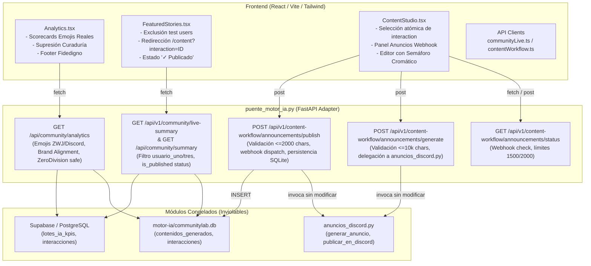

# Plan de Implementación Técnica: Spec 013 - Análisis Integral, Historias Destacadas del Dashboard y Webhook de Anuncios en Redacción

## 1. Arquitectura General y Límites del Sistema

El objetivo de esta especificación es consolidar y enriquecer tres módulos esenciales de la plataforma CloudEdTech respetando de manera estricta la **Constitución del Proyecto** y el principio de **Inviolabilidad de Archivos Legados**:
- **Cero modificaciones** a los 17 archivos preexistentes en la raíz (`anuncios_discord.py`, `base_datos.py`, `modelos.py`, `evaluador_lotes.py`, `app.py`, etc.), así como a los directorios `backend/` y `motor-ia/`.
- Toda la extensión de lógica backend residirá exclusivamente en `puente_motor_ia.py`.
- Toda la integración frontend residirá en `frontend/src/` (páginas, componentes y clientes de API).
- Toda la verificación automatizada se estructurará mediante la metodología Test-Driven Development (TDD) en `tests/test_unificacion_motor_ia.py`.



---

## 2. Diseño Técnico del Backend (`puente_motor_ia.py`)

### 2.1 Enriquecimiento de `GET /api/community/analytics` (RF-02, RF-03)
1. **Sustitución controlada de la ruta existente**:
   - `motor-ia/api.py` registra una versión inicial de `@app.get("/api/community/analytics")`. En `puente_motor_ia.py`, se filtra la ruta preexistente en `app.router.routes` y se registra la versión enriquecida y blindada.
2. **Extracción y telemetría de emojis**:
   - Soporte Unicode completo incluyendo secuencias Zero Width Joiner (ZWJ, e.g. `\u200d`) y selectores de variación/tonos.
   - Reconocimiento de emojis de Discord con expresiones regulares:
     - Emojis estándar: `<:[a-zA-Z0-9_]+:[0-9]+>`
     - Emojis animados: `<a:[a-zA-Z0-9_]+:[0-9]+>`
   - Mapeo semántico predeterminado:
     - `🚀` $\rightarrow$ "Lanzamiento / Progreso"
     - `✨` $\rightarrow$ "Inspiración / Logro"
     - `🎉` $\rightarrow$ "Celebración"
     - `💡` $\rightarrow$ "Idea / Innovación"
     - `👋` $\rightarrow$ "Bienvenida / Saludo"
     - `❤️` / `🔥` $\rightarrow$ "Entusiasmo / Pasión"
     - `🐛` / `⚠️` $\rightarrow$ "Alerta / Reporte"
   - Fallback contextual automático según sentimiento:
     - Positivo $\rightarrow$ "Optimismo / Aprobación"
     - Neutral $\rightarrow$ "Informativo / Participación"
     - Negativo $\rightarrow$ "Inquietud / Reporte"
   - Asignación determinista de `trend = "0%"` cuando se carece de histórico previo o se evalúa el primer lote.
3. **Cálculo de Alineación de Marca y Blindaje contra División por Cero**:
   - `brand_alignment_percentage = (mensajes_positivos_o_neutrales_en_temas_clave / total_mensajes_evaluados) * 100`.
   - Si `total_mensajes_evaluados == 0`: retornar deterministamente `100.0` (o `0.0` con `analizados: 0`), blindando completamente la operación contra `ZeroDivisionError` y garantizando que el frontend jamás reciba `NaN` ni `null`.

### 2.2 Depuración del Dashboard: `live-summary` y Alias `summary` (RF-04, RF-05)
1. **Ruta canónica y alias**:
   - `@app.get("/api/v1/community/live-summary")` (ruta canónica).
   - `@app.get("/api/community/summary")` (alias idéntico para compatibilidad total con consumidores heredados).
2. **Filtrado de usuarios sintéticos / pruebas tempranas**:
   - Criterio de exclusión en la lista de `highlights`:
     - Autores que coincidan o contengan `usuario_uno` o `usuario_tres` (case-insensitive).
     - Autores con prefijos `usuario_` o `test_`.
     - IDs residuales de seed `31` y `34`.
   - Garantizar que el 100% de historias provengan de miembros reales de Discord (como `danitower`, `carlos_g`, `mariana_dev`).
3. **Trazabilidad de publicación en historias destacadas**:
   - Consultar en SQLite `contenidos_generados` y `respuestas_quejas_discord` por el ID del mensaje.
   - Si existen registros con `estado == 'publicado'` o `estado_publicacion == 'publicado'`:
     - `is_published: true`
     - `published_platforms: ["discord"]` (o lista con las plataformas detectadas, e.g. `["discord", "linkedin"]`).
   - Si no ha sido publicado:
     - `is_published: false`
     - `published_platforms: []`

### 2.3 Módulo de Anuncios Oficiales con Webhook (RF-06, RF-07, RF-08)
1. **`GET /api/v1/content-workflow/announcements/status`**:
   - Verifica `os.environ.get("DISCORD_WEBHOOK_ANUNCIOS")`.
   - Retorna:
     ```json
     {
       "configured": true/false,
       "channel_hint": "anuncios",
       "max_characters_recommended": 1500,
       "max_characters_limit": 2000,
       "warning": null | "Variable de entorno DISCORD_WEBHOOK_ANUNCIOS no configurada"
     }
     ```
2. **`POST /api/v1/content-workflow/announcements/generate`**:
   - Esquema Pydantic: `SolicitudGenerarAnuncio(borrador: str)`
   - Validación: rechazar si el borrador está vacío (`HTTP 400`) o si `len(borrador) > 10000` (`HTTP 400`).
   - Invoca `anuncios_discord.generar_anuncio(borrador)` sin tocar `anuncios_discord.py`.
   - Si falla por falta de API key o caída de LLM: retornar `HTTP 502 Bad Gateway` con detalle explicativo.
   - Retorna JSON con `anuncio_generado`, `caracteres`, `borrador_original`, `modelo_usado`.
3. **`POST /api/v1/content-workflow/announcements/publish`**:
   - Esquema Pydantic: `SolicitudPublicarAnuncio(contenido: str, confirmado: bool)`
   - Validación:
     - Si `not confirmado`: `HTTP 400 Bad Request` ("Debe confirmar la publicación").
     - Si texto vacío o `len(contenido) > 2000`: `HTTP 400 Bad Request` ("Excede los 2000 caracteres de Discord").
     - Si webhook no configurado: `HTTP 503 Service Unavailable`.
   - Invoca `anuncios_discord.publicar_en_discord(contenido)`.
   - Tras éxito HTTP 204 de Discord:
     - Persiste en SQLite `contenidos_generados`:
       - `formato = 'discord'`
       - `tipo_contenido = 'anuncio_oficial'`
       - `contenido = contenido`
       - `estado = 'publicado'`
       - `estado_publicacion = 'publicado'`
       - `canal_publicacion = 'discord'`
       - `creado_en = now_iso`
       - `publicado_en = now_iso`
     - Retorna JSON con `estado: 'publicado'`, `id_contenido`, `fecha_publicacion`, `caracteres`.

---

## 3. Diseño Técnico del Frontend (`frontend/src/`)

### 3.1 Pestaña de Análisis (`frontend/src/pages/Analytics.tsx`) (RF-01, RF-02, RF-03)
- **Eliminación de código obsoleto**:
  - Remover la sección `Bandeja de mensajes en Analisis` (`analysisQueue`, estados de carga y listas huérfanas).
  - Remover la sección `Revisión de mensajes y curaduría` y las llamadas a `updateMessageCuration` y `updateMessageWorkflow`.
- **Scorecards de Emojis Dinámicos**:
  - Reemplazar el arreglo hardcodeado `[]` por la lista `data.emojis` obtenida de `/api/community/analytics`.
  - Mapear las tarjetas con colores de sentimiento:
    - Positivo: borde/fondo esmeralda (`border-emerald-200 bg-emerald-50 text-emerald-700`).
    - Neutral: borde/fondo azul/gris (`border-blue-200 bg-blue-50 text-blue-700`).
    - Negativo: borde/fondo rosa/rojo (`border-rose-200 bg-rose-50 text-rose-700`).
  - Renderizar glifo del emoji, frecuencia absoluta (`value`), etiqueta (`label`), descripción y variación porcentual (`trend`).
  - Estado vacío resiliente cuando `emojis.length === 0`: renderizar tarjeta informativa "No se detectaron patrones de emojis en las conversaciones recientes".
- **Pie Informativo Fidedigno**:
  - Reemplazar el texto que mencionaba curadurías/aprobaciones obsoletas por la descripción oficial de CloudEdTech:
    > *"CloudEdTech analiza continuamente el pulso de la comunidad de Discord mediante IA: distribución de sentimiento, detección de temas clave, tendencias de hashtags y telemetría de interacción. Las interacciones con alta relevancia ($\ge 70\%$) se canalizan directamente a la mesa de Redacción de Contenidos para su adaptación y distribución multicanal."*

### 3.2 Historias Destacadas del Dashboard (`frontend/src/components/FeaturedStories.tsx`) (RF-04, RF-05)
- **Supresión de botón redundante**:
  - Retirar el botón `"Ver mensaje"` (que navegaba ciegamente a `/messages`).
- **Navegación contextual a Redacción**:
  - El botón `"Generar publicación"` invoca:
    ```typescript
    const storyId = currentStory.id_mensaje || currentStory.id;
    navigate(`/content?interaction=${storyId}`, { state: { interactionId: storyId } });
    ```
- **Carrusel Vacío Resiliente**:
  - Si `stories.length === 0` o `currentStory.id === 0`:
    - Deshabilitar el botón "Generar publicación".
    - Mostrar texto `"Sin historias disponibles"`.
- **Trazabilidad de publicación**:
  - Si `currentStory.is_published === true`:
    - Renderizar badge: `"✓ Publicado en " + (currentStory.published_platforms?.join(", ") || "Discord")`.
    - Cambiar texto del botón a `"Volver a publicar"` (o `"Publicar en otra plataforma"`).

### 3.3 Mesa de Redacción de Contenidos (`frontend/src/pages/ContentStudio.tsx`) (RF-05, RF-06, RF-07, RF-08)
- **Selección contextual automática por URL/State**:
  - Utilizar `useSearchParams` y `useLocation`.
  - Leer el parámetro `interaction` (o `location.state?.interactionId`).
  - Al cargar los mensajes o al recibir el ID, si coincide con alguno de la bandeja, asignarlo inmediatamente como `selectedWorkflowId`.
  - Realizar scroll automático/foco hacia la tarjeta de "Mensaje original de Discord".
- **Sección de Anuncios Oficiales (Discord Webhook)**:
  - Ubicación: Inmediatamente antes de la "Bandeja de mensajes en Redacción".
  - Componente integrado:
    1. **Cabecera**: Título, badge de estado del canal (`#anuncios`), y banner de advertencia si `webhookStatus.configured === false`.
    2. **Entrada de borrador**:
       - TextArea de borrador manual.
       - Botón "Cargar archivo .txt / .md" con `<input type="file" accept=".txt,.md" />`, leyendo el contenido vía `FileReader`.
       - Contador de caracteres de borrador (con advertencia si supera 10,000 caracteres).
       - Botón "Generar anuncio con IA" (deshabilitado si borrador vacío o $>10,000$ caracteres o durante loading).
    3. **Editor del Anuncio Final con Semáforo Cromático**:
       - TextArea del texto procesado por IA.
       - Contador de caracteres con semáforo:
         * Verde: $\le 1500$ caracteres ("Longitud óptima de marca").
         * Ámbar: $1501 - 2000$ caracteres ("Longitud extendida de Discord").
         * Rojo: $> 2000$ caracteres ("Límite de Discord excedido - Reducir texto").
       - Botón "Publicar anuncio en Discord":
         * Deshabilitado si: texto vacío, $> 2000$ caracteres, `configured === false`, o publicación en progreso.
         * Al pulsar: Modal de confirmación con preview y advertencia de despacho oficial.
         * Al confirmar: llamada a `publishAnnouncement`, feedback con toast/banner verde y reseteo/opción de nuevo anuncio.

### 3.4 Clientes y Tipos de API (`frontend/src/api/`)
- **`frontend/src/api/communityLive.ts`**:
  - Enriquecer `CommunityHighlight` con:
    ```typescript
    id_mensaje?: number;
    is_published?: boolean;
    published_platforms?: string[];
    ```
  - Tipado para `EmojiScorecard`:
    ```typescript
    export interface EmojiScorecard {
      emoji: string;
      value: number;
      sentiment: 'positive' | 'neutral' | 'negative';
      label: string;
      description: string;
      trend: string;
    }
    ```
  - Actualizar `CommunityAnalyticsResponse` para incluir `emojis: EmojiScorecard[]`, `brand_alignment_percentage: number`, `analizados: number`.
- **`frontend/src/api/contentWorkflow.ts`** (o `communityLive.ts`):
  - `getAnnouncementWebhookStatus(): Promise<AnnouncementStatusResponse>`
  - `generateAnnouncement(borrador: string): Promise<AnnouncementGenerateResponse>`
  - `publishAnnouncement(contenido: string, confirmado: boolean): Promise<AnnouncementPublishResponse>`

---

## 4. Estrategia de Pruebas y Aseguramiento TDD

Siguiendo el principio de **Diseño Test-First (TDD)** de la Constitución (Regla 6):

### 4.1 Fase RED (Tarea 1)
- Crear nuevas pruebas unitarias y de integración en `tests/test_unificacion_motor_ia.py`:
  1. `test_analytics_endpoint_emojis_and_zero_division`:
     - Valida extracción de emojis Unicode (ZWJ) y emojis de Discord `<:name:id>` y `<a:name:id>`.
     - Valida catálogo semántico y fallback.
     - Valida que con corpus vacío `brand_alignment_percentage` retorne 100.0% (o 0.0%) sin `ZeroDivisionError`.
  2. `test_summary_canonical_and_alias_filter_test_users`:
     - Valida `GET /api/v1/community/live-summary` y `GET /api/community/summary`.
     - Comprueba que interacciones con autores `usuario_uno`, `usuario_tres`, prefijo `usuario_` o IDs 31 y 34 sean filtradas de `highlights`.
     - Comprueba que las historias incluyan `is_published` y `published_platforms`.
  3. `test_announcement_workflow_status_generate_publish`:
     - Valida `GET /api/v1/content-workflow/announcements/status`.
     - Valida `POST /api/v1/content-workflow/announcements/generate` con límite de 10,000 caracteres (400 si excede, delegación a mock de LLM si válido).
     - Valida `POST /api/v1/content-workflow/announcements/publish` con validación de 2000 caracteres, mock de webhook y verificación de inserción en tabla SQLite `contenidos_generados`.

### 4.2 Fase GREEN (Tarea 2)
- Implementar los controladores en `puente_motor_ia.py` hasta que todos los nuevos tests pasen al 100%.

### 4.3 Verificación de Frontend y Regresión (Tareas 3 a 6)
- Ejecución de `npm run build` en `frontend/` para asegurar 0 errores de TypeScript y empaquetado Vite limpio.
- Ejecución completa de `pytest tests/` garantizando que los 100 tests anteriores más los nuevos tests de Spec 013 pasen sin fallos.
- Verificación de inmutabilidad git (`git diff`) sobre los 17 archivos protegidos.

---

## 5. Matriz de Trazabilidad Requerimientos vs Componentes

| Requerimiento Funcional | Archivos Implicados | Componente / Función Principal |
| :--- | :--- | :--- |
| **RF-01** (Supresión Curaduría en Análisis) | `frontend/src/pages/Analytics.tsx` | Eliminación de `analysisQueue` y sección de curaduría. |
| **RF-02** (Scorecards Emojis Reales ZWJ/Discord) | `puente_motor_ia.py`, `Analytics.tsx`, `communityLive.ts` | Extractor de emojis con regex ZWJ/Discord, scorecards dinámicos. |
| **RF-03** (Métricas y ZeroDivision Safety) | `puente_motor_ia.py`, `Analytics.tsx` | Blindaje de `brand_alignment_percentage` y nuevo footer oficial. |
| **RF-04** (Alias y Filtro Autores Dashboard) | `puente_motor_ia.py`, `FeaturedStories.tsx` | Rutas canónicas/alias, exclusión `usuario_uno`/`tres`, carrusel vacío resiliente. |
| **RF-05** (Navegación Contextual y Trazabilidad) | `FeaturedStories.tsx`, `ContentStudio.tsx`, `puente_motor_ia.py` | Query param `interaction`, foco automático, indicador `is_published`. |
| **RF-06** (Panel Anuncios Webhook y SQLite) | `puente_motor_ia.py`, `ContentStudio.tsx`, `contentWorkflow.ts` | Endpoint de status, persistencia SQLite `contenidos_generados`. |
| **RF-07** (Generación Anuncios IA <=10k) | `puente_motor_ia.py`, `ContentStudio.tsx` | Validación 10,000 caracteres, delegación en `anuncios_discord.py`. |
| **RF-08** (Editor Semáforo y Publicación <=2k) | `puente_motor_ia.py`, `ContentStudio.tsx` | Semáforo verde/ámbar/rojo, modal confirmación, webhook dispatch. |
| **RF-09** (Inviolabilidad y TDD) | `tests/test_unificacion_motor_ia.py` | Suite de tests automatizados, 0 diff en archivos protegidos. |
