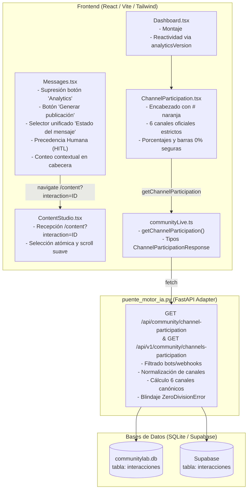

# Plan de Implementación Técnica: Spec 014 - Optimización de Filtros, Redirección a Publicación y Participación por Canal en Dashboard

## 1. Arquitectura General y Límites del Sistema

El objetivo de este plan es diseñar e implementar las soluciones técnicas para la **Spec 014**, respetando rigurosamente los principios de **Inviolabilidad Constitucional** y **Aislamiento No Invasivo**:
- **Cero modificaciones** a los 17 archivos preexistentes en la raíz (`api.py`, `base_datos.py`, `modelos.py`, `evaluador_lotes.py`, `anuncios_discord.py`, etc.), así como a los directorios `backend/` y `motor-ia/`.
- Toda la lógica de cálculo de distribución por canal y endpoints HTTP residirá exclusivamente en el adaptador `puente_motor_ia.py`.
- Todas las mejoras de interfaz de usuario se desarrollarán en `frontend/src/` (páginas `Messages.tsx`, `Dashboard.tsx`, nuevo componente `ChannelParticipation.tsx` y cliente tipado `communityLive.ts`).
- La verificación automatizada se ejecutará bajo la metodología Test-Driven Development (TDD) en `tests/test_unificacion_motor_ia.py`.



---

## 2. Diseño Técnico del Backend (`puente_motor_ia.py`)

### 2.1 Endpoint `GET /api/community/channel-participation` y Alias `GET /api/v1/community/channels-participation` (RF-03, RF-06)
1. **Rutas expuestas**:
   - `@app.get("/api/community/channel-participation")`
   - `@app.get("/api/community/channel-participation/")`
   - `@app.get("/api/v1/community/channels-participation")`
   - `@app.get("/api/v1/community/channels-participation/")`
2. **Definición de canales canónicos oficiales y orden estricto**:
   ```python
   CANALES_OFICIALES_DISCORD = [
       {"channel": "#general", "name": "general"},
       {"channel": "#faq", "name": "faq"},
       {"channel": "#pqrs", "name": "pqrs"},
       {"channel": "#notificaciones", "name": "notificaciones"},
       {"channel": "#chat-egresados", "name": "chat-egresados"},
       {"channel": "#oportunidades-laborales", "name": "oportunidades-laborales"},
   ]
   ```
3. **Mapeo y normalización de canales**:
   - Normalizar el canal de cada registro: `canal_norm = str(it.get("canal") or it.get("channel") or "").strip().lstrip("#").lower()`.
   - Sinónimos y variantes:
     - `'preguntas'`, `'dudas'` $\rightarrow$ mapean a `'faq'`.
     - `'anuncios'` $\rightarrow$ mapea a `'notificaciones'`.
   - Exclusión de bots y webhooks mediante `es_mensaje_bot_o_webhook(it)` y comprobación de autor (excluyendo autores con `#0000` o `'bot'` en el nombre).
4. **Cálculo de Denominador Canónico y Porcentajes**:
   - Se totalizan únicamente los mensajes válidos pertenecientes a los 6 canales oficiales:
     `total_messages = sum(conteos[c["name"]] for c in CANALES_OFICIALES_DISCORD)`.
   - **Caso `total_messages == 0`**:
     - Cada canal retorna `count: 0` y `percentage: 0.0`.
     - Se previene categóricamente cualquier excepción `ZeroDivisionError`.
   - **Caso `total_messages > 0`**:
     - Para cada canal: `porcentaje = round((conteos[name] / total_messages) * 100, 1)`.
     - Para garantizar que la sumatoria de porcentajes sea exactamente 100.0%, si existe una discrepancia decimal residual ($\pm 0.1\%$) derivada del redondeo individual, se ajusta la diferencia sobre el canal con mayor volumen de mensajes.
5. **Estructura de respuesta**:
   ```json
   {
     "total_messages": 55,
     "channels": [
       { "channel": "#general", "name": "general", "count": 22, "percentage": 40.0 },
       { "channel": "#faq", "name": "faq", "count": 14, "percentage": 25.5 },
       { "channel": "#pqrs", "name": "pqrs", "count": 0, "percentage": 0.0 },
       { "channel": "#notificaciones", "name": "notificaciones", "count": 0, "percentage": 0.0 },
       { "channel": "#chat-egresados", "name": "chat-egresados", "count": 11, "percentage": 20.0 },
       { "channel": "#oportunidades-laborales", "name": "oportunidades-laborales", "count": 8, "percentage": 14.5 }
     ]
   }
   ```

---

## 3. Diseño Técnico del Frontend (`frontend/src/`)

### 3.1 Cliente de API: `frontend/src/api/communityLive.ts` (RF-03, RF-05)
- Declarar las interfaces TypeScript:
  ```typescript
  export interface ChannelParticipationItem {
    channel: string
    name: string
    count: number
    percentage: number
  }

  export interface ChannelParticipationResponse {
    total_messages: number
    channels: ChannelParticipationItem[]
  }
  ```
- Implementar la función `getChannelParticipation()`:
  - Invoca `${API_BASE_URL}/api/community/channel-participation`.
  - En caso de error de red o backend caído, retorna un objeto resiliente de fallback con `total_messages: 0` y los 6 canales oficiales con `count: 0` y `percentage: 0.0`.

### 3.2 Componente Modular: `frontend/src/components/ChannelParticipation.tsx` (RF-04, RF-05)
- **Estructura del Componente**:
  - Contenedor con borde y esquinas redondeadas: `rounded-2xl border border-slate-200 bg-white p-5 shadow-sm`.
  - Encabezado con glifo `#` en acento naranja:
    ```tsx
    <div className="mb-4">
      <h3 className="flex items-center gap-1.5 text-base font-bold text-slate-900">
        <span className="font-extrabold text-orange-500">#</span>
        Participación por canal
      </h3>
      <p className="mt-0.5 text-xs text-slate-500">
        Distribución de mensajes registrados en los seis canales de Discord
      </p>
    </div>
    ```
  - Lista de los 6 canales oficiales en orden canónico.
  - Cada fila:
    - Fila superior de texto: nombre del canal a la izquierda (`font-semibold text-xs text-slate-700`) y métricas a la derecha (`{item.percentage.toFixed(1)}% · {item.count}` en `text-xs text-slate-500 font-medium`).
    - Barra horizontal de progreso:
      ```tsx
      <div className="h-2 w-full overflow-hidden rounded-full bg-slate-100">
        <div
          className="h-full rounded-full bg-orange-500 transition-all duration-500 ease-out"
          style={{ width: `${item.count > 0 ? item.percentage : 0}%` }}
        />
      </div>
      ```
  - Estado de carga y manejo de errores silencioso con fallback.

### 3.3 Integración en Dashboard: `frontend/src/pages/Dashboard.tsx` (RF-04, RF-05)
- Importar `ChannelParticipation` desde `../components/ChannelParticipation`.
- Montar en el layout principal del Dashboard con reactividad a `analyticsVersion`:
  ```tsx
  <div className="mt-8">
    <ChannelParticipation key={`channels-${analyticsVersion}`} />
  </div>
  ```
- Al hacer clic en el botón *"Actualizar datos"*, el incremento de `analyticsVersion` remonta el componente y refresca la telemetría en vivo sin recargar la página.

### 3.4 Pestaña de Ingesta: `frontend/src/pages/Messages.tsx` (RF-01, RF-02)
1. **Acciones en Tarjetas de Mensaje**:
   - Suprimir el botón *"Analytics"*.
   - Si `!message.isAnalyzed`: mostrar botón *"Evaluar IA"* (ejecuta `handleEvaluateSingleMessage`).
   - Si `message.isAnalyzed`: mostrar botón *"Generar publicación"*:
     - Si `status === 'discarded'`: botón `disabled={true}` con tooltip `title="Restaura el mensaje para generar publicación"`.
     - Si `status !== 'discarded'`: botón activo que ejecuta:
       ```typescript
       navigate(`/content?interaction=${message.interactionId}`, {
         state: { interactionId: message.interactionId },
       })
       ```
     - Si `message.relevance < 70` pero no está descartado (por ejemplo, porque fue restaurado), el botón permanece habilitado para permitir la redacción forzada de Enoc.
2. **Depuración del Panel de Filtrado**:
   - Eliminar el select `stageFilter` ubicado junto a `sentimentFilter`.
   - Modificar el select ubicado bajo *"Estado del mensaje"* (`curationFilter`) con las 5 opciones exactas en orden:
     1. `Todos los estados` (`all`)
     2. `Pendientes de evaluar` (`pending_eval`)
     3. `Pendientes de copy` (`pending_copy`)
     4. `Proceso completo` (`completos`)
     5. `Descartado` (`descartados`)
3. **Lógica de Filtrado con Precedencia Humana (HITL)**:
   - Extraer `currentCuration = curationStatus[message.id] ?? 'pending'`.
   - Determinar `isDiscarded`:
     ```typescript
     const isDiscarded =
       currentCuration === 'discarded' ||
       (message.isAnalyzed &&
         message.relevance < 70 &&
         currentCuration !== 'curated' &&
         currentCuration !== 'pending')
     ```
   - Determinar `isCompleted`:
     ```typescript
     const isCompleted =
       !isDiscarded &&
       (currentCuration === 'curated' ||
         message.workflowStage === 'en_aprobacion' ||
         message.workflowStage === 'en_redaccion')
     ```
   - Determinar `isPendingEval`:
     ```typescript
     const isPendingEval =
       !isDiscarded &&
       (!message.isAnalyzed ||
         message.workflowStage === 'ingesta' ||
         message.workflowStage === 'en_ingesta')
     ```
   - Determinar `isPendingCopy`:
     ```typescript
     const isPendingCopy = !isDiscarded && !isCompleted && !isPendingEval
     ```
   - Filtrar según el valor del selector:
     - `'all'`: no filtra por estado (pasan todos).
     - `'pending_eval'`: `if (!isPendingEval) return false`.
     - `'pending_copy'`: `if (!isPendingCopy) return false`.
     - `'completos'`: `if (!isCompleted) return false`.
     - `'descartados'`: `if (!isDiscarded) return false`.
4. **Cabecera Contextual de Conteo**:
   - Adaptar el rótulo en la cabecera:
     ```tsx
     {curationFilter === 'descartados'
       ? 'mensajes descartados'
       : curationFilter === 'pending_eval'
       ? 'mensajes pendientes de evaluar'
       : curationFilter === 'pending_copy'
       ? 'mensajes en la cola de copy'
       : curationFilter === 'completos'
       ? 'mensajes con proceso completo'
       : 'mensajes en total (Todos los mensajes)'}
     ```
   - Mantener el indicador de fechas `(en rango: X a Y)` cuando existan fechas activas.

---

## 4. Estrategia de Pruebas Automatizadas (TDD) y Verificación

### 4.1 Suite en `tests/test_unificacion_motor_ia.py`
Se incorporarán tests específicos en el archivo de integración unificada:
1. `test_participacion_canales_discord_calculo_y_orden`:
   - Verifica que `GET /api/community/channel-participation` retorne HTTP 200 con la estructura esperada.
   - Comprueba que los 6 canales aparezcan en el orden canónico estricto (`#general`, `#faq`, `#pqrs`, `#notificaciones`, `#chat-egresados`, `#oportunidades-laborales`).
   - Comprueba que la suma de porcentajes sea exactamente 100.0%.
2. `test_participacion_canales_discord_corpus_vacio`:
   - Simula corpus vacío y valida que la API retorne `0.0` y `0` sin lanzar `ZeroDivisionError`.
3. `test_participacion_canales_exclusion_bots_y_alias`:
   - Verifica que los mensajes de bots/webhooks sean excluidos de los conteos.
   - Verifica que el alias `/api/v1/community/channels-participation` retorne exactamente los mismos datos.

### 4.2 Verificación Global y Regresión
- Ejecución completa de `pytest tests/ -v`: los 112 tests existentes más los nuevos deben estar al 100% en verde.
- Ejecución de `npm run build` en `frontend/`: 0 errores de compilación TypeScript.
- Comprobación git de inmutabilidad sobre los 17 archivos protegidos de la raíz, `backend/` y `motor-ia/`.
