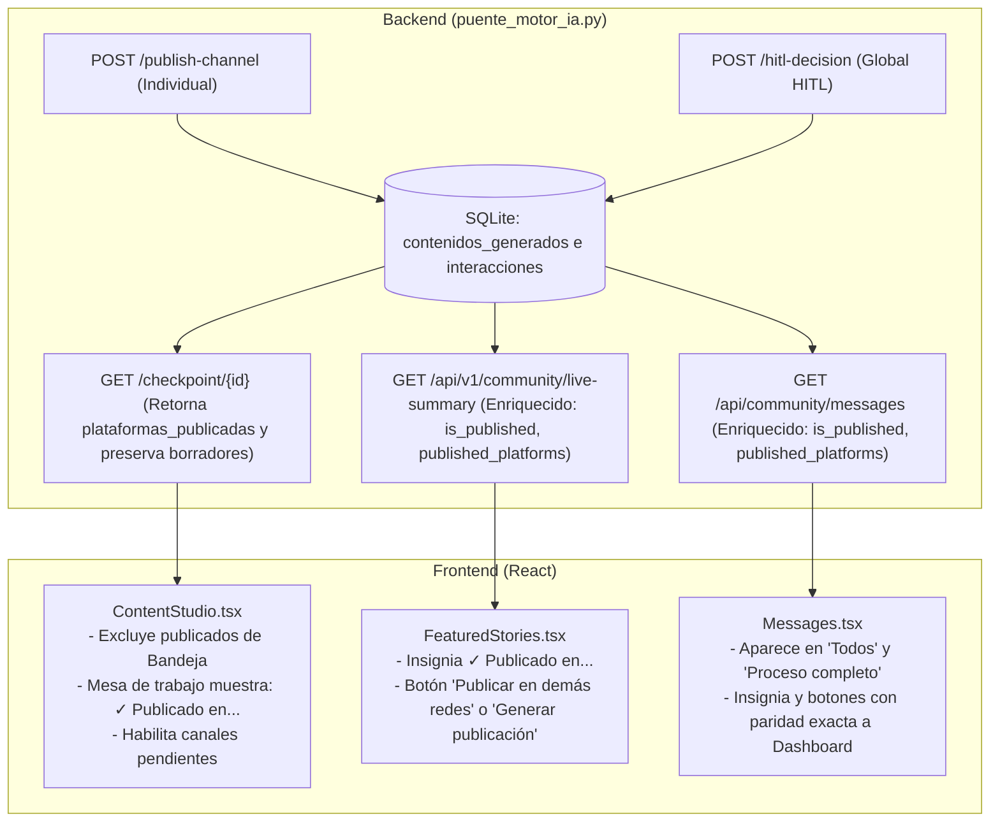

# Plan Técnico — Spec 016: Trazabilidad Multicanal de Publicaciones en Redacción, Historias Destacadas e Ingesta de Mensajes

## 1. Arquitectura y Enfoque de Solución

La solución garantiza la trazabilidad unificada y bidireccional del estado de publicación de cada mensaje comunitario a través de las 3 redes sociales oficiales (`Discord`, `LinkedIn`, `X`), sincronizando de forma reactiva las 3 vistas clave de la aplicación (`ContentStudio.tsx`, `FeaturedStories.tsx` y `Messages.tsx`).

---

## 2. Modificaciones en Backend (`puente_motor_ia.py`)

1. **Persistencia en Publicación Individual (`api_mototradis_publish_channel`):**
   - Cuando el canal despachado (`discord`, `linkedin`, `x`) retorne `ok: True` y `estado_canal: "enviado"`:
     - Persistir o actualizar en `contenidos_generados` para `interaccion_id` y `plataforma = canal`: `estado = 'publicado'`, `estado_publicacion = 'publicado'`, `publicado_en = a_utc_iso(datetime.now(timezone.utc))`.
     - Actualizar en `interacciones`: `etapa_flujo = 'publicado'`, `estado_curaduria = 'curated'`.
     - Invalidar la memoria caché con `invalidar_cache_supabase()`.

2. **Blindaje en Aprobación Global HITL (`api_mototradis_hitl_decision`):**
   - Asegurar que todos los canales con `estado_canal == 'enviado'` queden persistidos con `INSERT ... ON CONFLICT DO UPDATE` en `contenidos_generados` (`estado = 'publicado'`, `estado_publicacion = 'publicado'`).
   - Actualizar `interacciones` con `etapa_flujo = 'publicado'`, `estado_curaduria = 'curated'` e `invalidar_cache_supabase()`.

3. **Checkpoint Enriquecido (`api_mototradis_checkpoint`):**
   - Consultar en `contenidos_generados` las plataformas publicadas para ese `id_mensaje` (`WHERE interaccion_id = ? AND estado_publicacion = 'publicado'`).
   - **NO vaciar `borradores_ui` ni `copys_generados`** aunque ya esté publicado.
   - Retornar el campo `plataformas_publicadas: list[str]` (ej. `["discord"]` o `["discord", "linkedin"]`), `is_published: bool` y el catálogo de modelos utilizados.

4. **Sustitución y Enriquecimiento de `GET /api/community/messages`:**
   - Mediante la técnica de sustitución de rutas de FastAPI en `puente_motor_ia.py` (idéntica a `/api/community/analytics`), reemplazar `/api/community/messages` para que consulte `contenidos_generados` en SQLite (excluyendo anuncios oficiales donde `interaccion_id IS NULL` o `tipo_contenido == 'anuncio_oficial'`).
   - Inyectar en `analysis` de cada mensaje:
     * `is_published: bool` (true si tiene al menos 1 red publicada).
     * `published_platforms: list[str]` con nombres canónicos legibles (`Discord`, `LinkedIn`, `X`).
     * Si `is_published == True`: forzar `analysis.workflow_stage = 'publicado'` y `analysis.curation_status = 'curated'`.

5. **Alineación de Nombres en `GET /api/v1/community/live-summary` y `/api/community/summary`:**
   - Normalizar la lista `published_platforms` a nombres legibles con mayúscula inicial (`Discord`, `LinkedIn`, `X`) para garantizar total coherencia en todo el ecosistema.

---

## 3. Modificaciones en Frontend

1. **Redacción de Contenidos (`frontend/src/pages/ContentStudio.tsx`):**
   - **Bandeja de mensajes en Redacción (`workflowMessages`):**
     * Filtrar para excluir cualquier mensaje que ya haya sido publicado en cualquiera de las 3 redes sociales (`!item.isPublished && (!item.publishedPlatforms || item.publishedPlatforms.length === 0)`).
   - **Mesa de Trabajo (`selectedWorkflowMessage` / `selectedMessageId`):**
     * Si el mensaje en la mesa de trabajo proviene de una navegación directa `/content?interaction={id}` (desde Dashboard o Ingesta), cargarlo en la mesa de trabajo aunque no esté en la bandeja de pendientes.
     * En la tarjeta de `Mensaje original de Discord` y en el encabezado de `Mesa de Trabajo Multicanal`, si el mensaje ya tiene publicaciones: mostrar una insignia estilizada `✓ Publicado en: {redes}`.
     * En cada tarjeta individual (`LinkedIn`, `X`, `Discord`): verificar si el canal específico está en `pipelineData.plataformas_publicadas`:
       - Si está publicado: marcar la tarjeta como `✓ Publicado en {Red}` (deshabilitando el botón de republicar ese canal específico).
       - Si NO está publicado: mantener habilitados los botones para regenerar con IA, editar el copy y publicar en esa red social.
   - **Publicación reactiva:**
     * Al publicar exitosamente un canal (individual o HITL), actualizar de inmediato el estado local: remover el mensaje de la bandeja de pendientes, marcar el canal como publicado en la mesa de trabajo y refrescar el checkpoint.

2. **Dashboard — Historias Destacadas (`frontend/src/components/FeaturedStories.tsx`):**
   - **Si `!currentStory.is_published`:**
     * Ocultar insignias de publicación.
     * Mostrar únicamente el botón `"Generar publicación"`, que redirige a `/content?interaction={targetId}`.
   - **Si `currentStory.is_published`:**
     * Mostrar insignia: `✓ Publicado en: {currentStory.published_platforms.join(', ')}`.
     * Calcular las redes faltantes respecto al conjunto `["Discord", "LinkedIn", "X"]`.
     * Si faltan redes: el botón muestra `"Publicar en demás redes (" + faltantes.join(', ') + ")"` redirigiendo a `/content?interaction={targetId}`.
     * Si ya se publicó en las 3 redes: el botón muestra `"Ver publicación en mesa de trabajo"` redirigiendo a `/content?interaction={targetId}`.

3. **Ingesta de Mensajes (`frontend/src/pages/Messages.tsx`):**
   - **Enriquecimiento del tipo `ApiMessage` y `MessageItem`:**
     * Agregar `isPublished: boolean` y `publishedPlatforms: string[]`.
   - **Lógica de Filtrado (`isCompleted` y `isDiscarded`):**
     * Si `message.isPublished || message.workflowStage === 'publicado'`: `isDiscarded = false` e `isCompleted = true`.
     * Aparece tanto en el filtro `"Todos los estados"` (`Mostrando N mensajes en total`) como en `"Proceso completo"` (`Mostrando N mensajes con proceso completo`).
   - **Paridad en Tarjetas de Mensajes:**
     * En el cuerpo de la tarjeta: si `message.isPublished`, renderizar la insignia `✓ Publicado en: {message.publishedPlatforms.join(', ')}`.
     * En la columna lateral de acciones:
       - Si `message.isPublished`:
         * `StatusBadge` muestra `Listo / Aprobado` o `✓ Publicado`.
         * El botón de acción despliega el mismo texto que en Historias Destacadas (`"Publicar en demás redes (" + faltantes.join(', ') + ")"` o `"Ver en mesa de trabajo"` si ya están las 3), navegando a `/content?interaction=${message.interactionId}`.
       - Si `!message.isPublished` y `message.isAnalyzed`:
         * Mostrar únicamente `"Generar publicación"`.

---

## 4. Inviolabilidad Constitucional

- Cero modificaciones a los 17 archivos de la raíz, `src/`, `backend/` y `motor-ia/`.
- Toda la lógica reside estrictamente en `puente_motor_ia.py`, `frontend/src/` y `tests/`.
