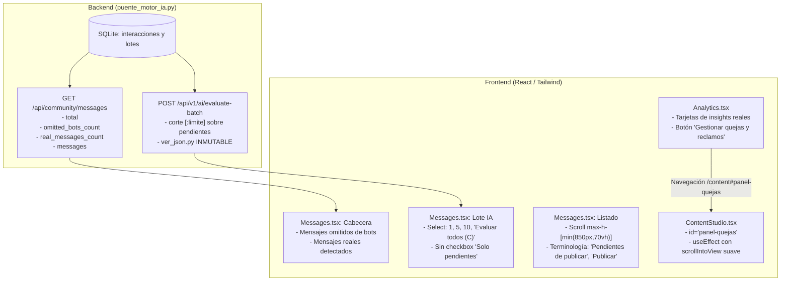

# Plan Técnico — Spec 017: Corrección Tipográfica Global, Terminología Intuitiva, Scroll de Mensajes, Telemetría Real de Bots y Navegación de Quejas

## 1. Arquitectura y Enfoque de Solución

La solución aborda de extremo a extremo las optimizaciones de experiencia de usuario, precisión semántica, ergonomía de navegación y telemetría de datos en la plataforma CloudEdTech, desacoplando limpiamente la lógica de servidor y de interfaz bajo el cumplimiento estricto de la Constitución y SDD.



---

## 2. Modificaciones en Backend (`puente_motor_ia.py`)

1. **Extensión del Contrato de `GET /api/community/messages`:**
   - Mantener el contrato 100% retrocompatible agregando dos nuevos campos a nivel raíz:
     ```python
     return {
         "total": len(mensajes),
         "omitted_bots_count": total_bots_omitidos,
         "real_messages_count": total_mensajes_reales,
         "messages": mensajes,
     }
     ```
   - **Cálculo de métricas en SQLite:**
     - Consultar todas las interacciones de `motor_bd.listar_interacciones(limite=None, incluir_bots=True)`.
     - Clasificar cada registro con la función canónica `_es_cuenta_bot(it)`:
       * `total_bots_omitidos`: sumatoria de registros donde `_es_cuenta_bot(it) == True`.
       * `total_mensajes_reales`: sumatoria de registros donde `_es_cuenta_bot(it) == False`.
     - Si la base local SQLite está vacía o en modo fallback, sincronizar preventivamente con Supabase respetando la caché TTL de 15 segundos.

2. **Blindaje de Lote en `POST /api/v1/ai/evaluate-batch` con Inmutabilidad de `ver_json.py`:**
   - `ver_json.py` (archivo protegido de la raíz) permanece **estrictamente inmutable**.
   - En `puente_motor_ia.py` (`evaluar_lote_con_ia`):
     - El endpoint recibe el parámetro `limite: int = 100` en el payload JSON.
     - Obtener las interacciones del universo fuente (`ver_json.py` o SQLite) con un límite holgado suficiente.
     - Filtrar estrictamente la lista de mensajes que se encuentran en estado pendiente de evaluación (`is_analyzed == False` o etapa en ingesta, excluyendo bots).
     - Aplicar el corte determinista `pendientes_evaluables[:limite]` sobre la lista filtrada antes de despachar el procesamiento a los cerebros de IA (Groq, Gemma 4 o Gemini).
     - Retornar en la respuesta la cantidad exacta de mensajes efectivamente evaluados.

---

## 3. Modificaciones en Frontend (`frontend/src/`)

1. **Saneamiento Tipográfico UTF-8 Global:**
   - Revisar y corregir en todos los archivos de frontend (`Messages.tsx`, `Analytics.tsx`, `ContentStudio.tsx`, `api/contentWorkflow.ts`, `api/messageCuration.ts`, `api/motorContent.ts`):
     * `curadur?a` $\rightarrow$ `curaduría`
     * `interacci?n` $\rightarrow$ `interacción`
     * `v?lida` $\rightarrow$ `válida`
     * `inv?lido` $\rightarrow$ `inválido`
     * `confirm?` $\rightarrow$ `confirmó`
     * `Atenci?n` $\rightarrow$ `Atención`
     * `cr?tico` $\rightarrow$ `crítico`
     * `Se?ales` $\rightarrow$ `Señales`
     * `revisi?n` $\rightarrow$ `revisión`
     * `aqu?` $\rightarrow$ `aquí`
     * `env?an` $\rightarrow$ `envían`
     * `telemetr?a` $\rightarrow$ `telemetría`
     * `sem?ntica` $\rightarrow$ `semántica`
   - **Preservación estricta del corpus:** Asegurar que los reemplazos apliquen exclusivamente a textos estáticos de la UI, comentarios, mensajes de alerta y clientes API; el contenido dinámico del usuario (`message.content`) debe mantenerse intacto con sus signos de interrogación legítimos.

2. **Ingesta de Mensajes (`frontend/src/pages/Messages.tsx`):**
   - **Terminología orientada a la publicación:**
     * En el panel de lote IA: cambiar `"pendientes de copy"` por `"Pendientes de publicar"`.
     * En el selector de filtro `"Estado del mensaje"`: sustituir `<option value="pending_copy">Pendientes de copy</option>` por `<option value="pending_copy">Pendientes de publicar</option>`.
     * En las tarjetas individuales: en el badge de etapa superior de cada tarjeta, cambiar `"Copy"` por `"Publicar"`.
     * En `StatusBadge`: cambiar `"Falta redacción de copy"` por `"Falta redacción de publicación"`.
   - **Scroll vertical delimitado y responsivo:**
     * En el contenedor principal de la lista de mensajes (`filteredMessages.map(...)`), reemplazar `<div className="space-y-4">` por:
       `<div className="space-y-4 max-h-[min(850px,70vh)] overflow-y-auto pr-2">`
     * Garantizar que las tarjetas mantengan espaciado adecuado y la barra de desplazamiento sea discreta y accesible en laptops (768p) y pantallas de alta resolución.
   - **Selector interactivo de lote de IA:**
     * Retirar el `<input type="checkbox" checked={onlyPending} ... />` y el texto `"Solo pendientes de evaluar"`.
     * Crear el estado `const [batchLimit, setBatchLimit] = useState<number>(5)`.
     * Renderizar un `<select>` estilizado con las opciones:
       - Fijas: `1`, `5`, `10`.
       - Dinámica: si el conteo de pendientes evaluables $C$ satisface $1 \le C \le 10$ y $C \notin \{1, 5, 10\}$, incluir `<option value={C}>Evaluar todos ({C})</option>`.
       - Si $C == 0$: mostrar `<option value={0} disabled>Sin pendientes</option>` y deshabilitar el selector junto al botón `"Evaluar mensajes con IA"`.
     * Enviar `limite: batchLimit` en la petición `POST /api/v1/ai/evaluate-batch`.
   - **Cabecera de Telemetría Real de Bots y Humanos:**
     * Actualizar la interfaz `MessagesApiResponse` con `omitted_bots_count?: number` y `real_messages_count?: number`.
     * En el bloque contiguo a `"Sincronizar Discord"`:
       - Cambiar `"Pendientes en Copy"` por `"Mensajes omitidos de bots"`, mostrando `apiData.omitted_bots_count ?? botsCalculados`.
       - Cambiar `"Incidentes prioritarios"` por `"Mensajes reales detectados"`, mostrando `apiData.real_messages_count ?? realesCalculados`.

3. **Análisis (`frontend/src/pages/Analytics.tsx`):**
   - **Tarjetas de insights con datos reales:**
     * Conectar las tarjetas `"Insight principal"`, `"Preguntas frecuentes"` y `"Atención requerida"` a las métricas reales provistas por el endpoint de analíticas y estadísticas de mensajes calculadas sobre interacciones.
   - **Botón hacia Panel de Quejas:**
     * En la tarjeta `"Atención requerida"`, incorporar un botón de acción interactivo con la etiqueta exacta `"Gestionar quejas y reclamos"`.
     * Al pulsar el botón, navegar mediante `navigate('/content#panel-quejas')`.

4. **Redacción de Contenidos (`frontend/src/pages/ContentStudio.tsx`):**
   - Asignar el atributo identificador `id="panel-quejas"` al contenedor `<section>` del `"Panel de Quejas, Reclamos y Soporte Crítico"`.
   - Implementar un hook `useEffect` que escuche `location.hash`:
     ```typescript
     useEffect(() => {
       if (location.hash === '#panel-quejas') {
         const timer = setTimeout(() => {
           const el = document.getElementById('panel-quejas')
           if (el) {
             el.scrollIntoView({ behavior: 'smooth', block: 'start' })
           }
         }, 150)
         return () => clearTimeout(timer)
       }
     }, [location.hash, complaintsLoading])
     ```
   - La inclusión de `complaintsLoading` y un retardo preventivo garantiza resiliencia ante el renderizado asíncrono.

---

## 4. Políticas de Despliegue, CI/CD y Commits

1. **Eliminación de directiva de exclusión:**
   - Queda formalmente prohibido incluir `[skip netlify]` en los mensajes de commit para asegurar que cada commit en ramas de trabajo o PR dispare automáticamente el build de verificación en Netlify.
2. **Documentación de credenciales:**
   - Al finalizar, documentar en un entregable claro las variables exactas requeridas para Enoc y el backend en Render (`GROQ_API_KEY`, `GEMINI_API_KEY`, `SUPABASE_DB_URL`, tokens de Discord) y para el frontend en Netlify (`VITE_API_URL`, `VITE_MOTOR_API_URL`).

---

## 5. Inviolabilidad Constitucional

- Cero modificaciones a los 17 archivos protegidos de la raíz (`ver_json.py`, `base_datos.py`, etc.), `backend/`, `motor-ia/` y `src/` canónico de Enoc.
- Toda adaptación de backend reside en `puente_motor_ia.py` y las mejoras de frontend en `frontend/src/`.
- Cumplimiento de la Regla 6 (Diseño Test-First / TDD): creación previa de pruebas unitarias en `tests/test_unificacion_motor_ia.py` antes de modificar `puente_motor_ia.py`.
