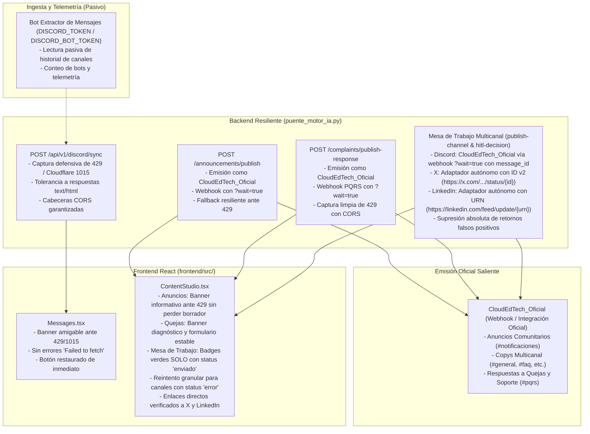

# Plan Técnico — Spec 018: Resiliencia de Publicaciones Multicanal, Diagnóstico de Despacho Real y Manejo de Rate-Limit Discord en la Nube

## 1. Arquitectura y Enfoque de Solución

La solución aborda integralmente la robustez en producción (Render/Netlify) frente a bloqueos de red de Cloudflare (Error 1015 / HTTP 429), la unificación de identidad institucional bajo `CloudEdTech_Oficial`, y la erradicación absoluta de falsos positivos en los tres canales sociales (`Discord`, `LinkedIn`, `X`).



---

## 2. Modificaciones en Backend (`puente_motor_ia.py`)

### 2.1. Captura Defensiva de Rate Limits y Tolerancia a Respuestas HTML (RF-001, RF-003, RF-008)
- **Función auxiliar defensiva `_formatear_respuesta_rate_limit(error_o_codigo, detalle_contextual)`:**
  * Inspeccionar si el error o código corresponde a `429`, o si el texto contiene `"1015"`, `"rate limit"`, `"banned your ip"` o proviene de Cloudflare.
  * Si la respuesta externa contiene cuerpo `text/html` (bloqueo típico de Cloudflare), leerlo como texto plano sin intentar `json.loads()` para prevenir excepciones fatales `json.decoder.JSONDecodeError`.
  * Retornar un `JSONResponse` con `status_code=429` e inyectar explícitamente cabeceras CORS:
    ```python
    headers = {
        "Access-Control-Allow-Origin": "*",
        "Access-Control-Allow-Methods": "*",
        "Access-Control-Allow-Headers": "*",
    }
    ```
  * Contenido estructurado:
    ```json
    {
      "exito": false,
      "codigo_error": "RATE_LIMIT_CLOUDFLARE_1015",
      "mensaje": "Discord o Cloudflare ha limitado temporalmente la IP del servidor en la nube (Error 1015 / Rate Limit). Sincroniza desde tu entorno local o intenta en unos minutos.",
      "detail": "Discord o Cloudflare ha limitado temporalmente la IP del servidor en la nube (Error 1015 / Rate Limit). Sincroniza desde tu entorno local o intenta en unos minutos."
    }
    ```
- **Blindaje en `POST /api/v1/discord/sync`:**
  * Envolver la invocación a `_ejecutar_sincronizacion_discord` en un bloque `try ... except Exception as exc` que intercepte excepciones de Discord (`discord.errors.HTTPException`, `discord.errors.DiscordException`, `aiohttp.ClientResponseError`, etc.).
  * Si el error corresponde a rate limit 429 o bloqueo Cloudflare 1015, retornar la respuesta formateada con status 429 y CORS garantizado.

### 2.2. Unificación del Emisor `CloudEdTech_Oficial` y Webhooks con `?wait=true` (RF-003, RF-008, RF-010)
- **Emisión en Anuncios Oficiales (`publish_announcement_v1`):**
  * Canalizar el despacho a través del webhook oficial de `CloudEdTech_Oficial` (`DISCORD_WEBHOOK_ANUNCIOS` o `DISCORD_WEBHOOK_OFICIAL`).
  * Anexar `?wait=true` a la URL del webhook si no está presente, forzando a Discord a devolver HTTP 200 con el objeto JSON del mensaje y su `id`.
  * Si se utiliza canal directo por Bot API y falla con 429 / Error 1015, conmutar de inmediato al webhook oficial. Si ambos fallan, retornar status 429 estructurado con CORS.
- **Emisión en Respuestas a Quejas (`publicar_respuesta_queja_v1`):**
  * Canalizar la respuesta a través del webhook correspondiente (`DISCORD_WEBHOOK_PQRS` con `?wait=true`) bajo la identidad de `CloudEdTech_Oficial`. Si falla por 429, capturar limpiamente con CORS y mensaje explicativo.
- **Separación de Responsabilidades:**
  * El token de bot (`DISCORD_BOT_TOKEN`) permanece asignado exclusivamente al cliente de lectura pasiva para `sync_discord_v1` y telemetría.

### 2.3. Erradicación de Falsos Positivos y Adaptadores Autónomos de X y LinkedIn (RF-005, RF-006, RF-009)
- **Despacho Discord en Cascada (`despachar_discord_con_cascada`):**
  * **Eliminar** la línea de retorno ciego incondicional `return {"ok": True, "detalle": f"Publicado en Discord #{c_norm} exitosamente", "estado_canal": "enviado"}`.
  * Enviar mediante webhook de `CloudEdTech_Oficial` (`DISCORD_WEBHOOK_GENERAL`, `DISCORD_WEBHOOK_FAQ`, etc.) anexando `?wait=true`.
  * Solo si el status HTTP es 200/201 y se obtiene `id` de mensaje válido en el JSON de respuesta, marcar `ok: True, estado_canal: "enviado"`.
  * Si el bot y los webhooks fallan o no están configurados, retornar deterministamente `ok: False, estado_canal: "error"` con la causa exacta.
- **Adaptador Autónomo de X (`despachar_x_resiliente`):**
  * Sin modificar `src/publishers.py`, instanciar directamente el cliente Tweepy con las credenciales del entorno.
  * Ejecutar `create_tweet(text=...)`, verificar la respuesta y extraer el identificador numérico `tweet_id = str(resp.data["id"])`.
  * Retornar `ok: True, estado_canal: "enviado"`, `detalle: f"Publicado en X exitosamente (ID: {tweet_id})"`, y `url: f"https://x.com/CloudEdTech_1/status/{tweet_id}"`.
  * Ante excepciones, retornar `ok: False, estado_canal: "error"`, `detalle: str(exc)`.
- **Adaptador Autónomo de LinkedIn (`despachar_linkedin_resiliente`):**
  * Sin modificar `src/publishers.py`, invocar `https://api.linkedin.com/v2/ugcPosts` con token de autorización.
  * Verificar status HTTP 201 y extraer el URN (`resp_json.get("id")`, ej. `urn:li:share:123456789`).
  * Retornar `ok: True, estado_canal: "enviado"`, `detalle: f"Publicado en LinkedIn exitosamente (URN: {urn})"`, y `url: f"https://www.linkedin.com/feed/update/{urn}"`.
  * Ante cualquier respuesta distinta de 201 o excepción, retornar `ok: False, estado_canal: "error"`, `detalle: str(exc_o_respuesta)`.
- **Persistencia en `publish-channel` y `hitl-decision`:**
  * Solo registrar en `contenidos_generados` y marcar en `interacciones` los canales cuyo despacho haya retornado estrictamente `ok: True` y `estado_canal: "enviado"`.
  * Retornar las URLs canónicas y detalles en el JSON de respuesta para el frontend.

---

## 3. Modificaciones en Frontend (`frontend/src/`)

### 3.1. Cliente API y Sincronización de Ingesta (`client.ts` y `Messages.tsx` - RF-001, RF-002)
- **`frontend/src/api/client.ts`:**
  * En caso de `!response.ok`, extraer prioritariamente `error.detail || error.mensaje || message` para no sobreescribir los mensajes estructurados devueltos por el backend ante HTTP 429.
- **`frontend/src/pages/Messages.tsx`:**
  * En `handleSyncDiscord`:
    * Detectar si el error incluye `"429"`, `"1015"`, `"Rate Limit"` o `"Cloudflare"`.
    * Desplegar un banner de alerta con el texto amigable: *"Discord o Cloudflare ha limitado temporalmente la IP del servidor en la nube (Error 1015 / Rate Limit). Sincroniza desde tu entorno local o intenta en unos minutos."*.
    * Desactivar el spinner de carga (`setIsSyncingDiscord(false)`) y mantener la lista de mensajes existente interactiva sin congelar la vista.

### 3.2. Redacción de Contenidos y Mesa de Trabajo Multicanal (`ContentStudio.tsx` - RF-004, RF-007, RF-008)
- **Panel de Anuncios Oficiales:**
  * Al recibir error 429 de Cloudflare, mostrar en el banner del panel la notificación: *"Discord ha bloqueado temporalmente el envío por límite de peticiones de Cloudflare (Error 1015). Intenta en unos minutos o realiza la publicación desde local"*.
  * Preservar íntegro el texto del anuncio en el editor sin reiniciarlo.
- **Panel de Quejas y Soporte:**
  * Capturar errores de rate limit de Discord y mostrar diagnóstico claro en el modal/banner de soporte, liberando el estado de envío sin corromper el formulario.
- **Mesa de Trabajo Multicanal:**
  * **Publicación Individual (`handlePublishChannelIndividual`):**
    * Evaluar estrictamente `res.ok && res.estado_canal === 'enviado'`.
    * Si es exitoso: marcar la tarjeta como `submitted: true`, mostrar badge verde `✓ Publicado en {Red}` e incluir el botón o enlace directo a la publicación (`res.url`).
    * Si falla (`estado_canal === 'error'` o `!res.ok`): NO marcar la tarjeta como publicada (`submitted: false`), mostrar banner de error rojo con el detalle técnico exacto devuelto por el servidor y mantener el botón habilitado como `Reintentar publicación en {Red}`.
  * **Publicación Global HITL (`handleSubmitHitlDecision`):**
    * Para cada canal en `resultados_canales`, asignar `submitted = (canal.estado_canal === 'enviado')`.
    * En caso de éxito parcial (ej. Discord enviado, X con error):
      * Discord se marca en verde como publicado.
      * X permanece activo, editable y con botón de reintento.
      * El banner superior desglosa claramente: *"✓ Publicado en: Discord. Error en X: [motivo de la falla]"*.
    * Excluir el mensaje de la *Bandeja de mensajes en Redacción* únicamente si al menos un canal fue confirmado con `estado_canal === "enviado"`.

---

## 4. Inviolabilidad Constitucional y Reglas de Dominio

1. **Inmutabilidad Absoluta:**
   - Los 17 archivos protegidos de la raíz (`armar_json_bot_python.py`, `anuncios_discord.py`, `base_datos.py`, etc.) NO serán modificados.
   - La carpeta `src/`, y en particular `src/publishers.py`, permanecerá **estrictamente inmutable**. Toda la lógica de captura de IDs/URNs y tolerancia a rate limits se implementará como adaptadores autónomos dentro de `puente_motor_ia.py`.
2. **Ubicación Exclusiva de Cambios:**
   - Todo el backend residirá en `puente_motor_ia.py`.
   - Todo el frontend residirá en `frontend/src/` (`client.ts`, `Messages.tsx`, `ContentStudio.tsx`).
   - Las pruebas automatizadas residirán en `tests/test_unificacion_motor_ia.py`.
