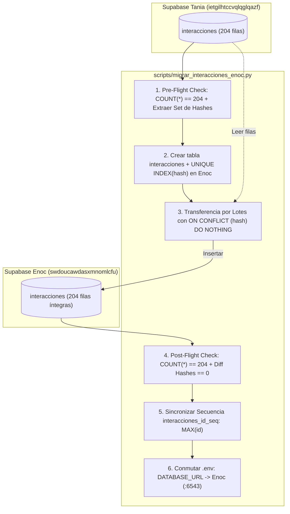
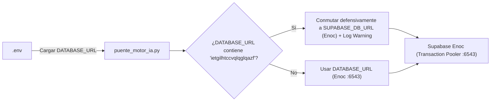

# Plan de Implementación — Spec 022: Migración de Interacciones a Supabase Enoc y Unificación de Conexiones

## 1. Resumen Arquitectónico y Diagnóstico Técnico

### 1.1 Contexto y Diagnóstico de Bases de Datos Reales
El proyecto opera actualmente con dos cuentas remotas de Supabase PostgreSQL y una base de datos local SQLite:
1. **Cuenta de Tania (`TANIA_DATABASE_URL` / `DATABASE_URL` preexistente):**
   - Host: `aws-0-us-east-1.pooler.supabase.com:6543/postgres` (Proyecto `ietgilhtccvqlqglqazf`, Transaction Pooler).
   - Almacena exclusivamente la tabla `public.interacciones` con **204 registros** históricos de la comunidad de Discord.
   - Esquema canónico de 11 columnas: `id` (SERIAL PK), `hash` (VARCHAR UNIQUE), `origen_comunidad`, `periodo_referencia`, `autor`, `canal`, `tipo`, `texto`, `enviado_en`, `estado`, `creado_en`.
2. **Cuenta de Enoc (`SUPABASE_DB_URL`):**
   - Host: `aws-0-us-east-1.pooler.supabase.com:6543/postgres` (Proyecto `swdoucawdasxmnomlcfu`).
   - Contiene tablas de LangGraph (`checkpoints`, `checkpoint_blobs`, `checkpoint_writes`, `checkpoint_migrations`), `lotes_ia_kpis` (13 evaluaciones de IA) e `historial_reportes_semanales` (0 filas, pausada hasta respuesta de Enoc).
   - **Ausencia:** Actualmente no posee la tabla `public.interacciones`.
3. **Base Local SQLite (`motor-ia/communitylab.db`):**
   - Espejo operacional local de ultra-alta velocidad que alimenta directamente las lecturas del dashboard y la ingesta (< 2 ms).

### 1.2 Justificación de Viabilidad y Alcance Acotado
- **Alcance Exclusivo:** Atendiendo la indicación directa del usuario ("Haz solo lo de la migracion de la tabla de interacciones, lo de oci esperare a respuesta de enoc"), se aísla por completo el flujo de reportes OCI de esta spec.
- **Unificación Arquitectónica:** Migrar `interacciones` y unificar `DATABASE_URL` hacia la cuenta de Enoc consolida la infraestructura en un solo clúster PostgreSQL en Supabase, reduciendo sockets WAN concurrentes y costos de mantenimiento.
- **Garantía Cero Pérdida de Datos:** Mecanismo de pre-flight (204 filas), transferencia por lotes con `ON CONFLICT (hash) DO NOTHING`, post-flight (204 filas y 0 diferencia de hashes) y ajuste de secuencia autoincremental `interacciones_id_seq`.

---

## 2. Diagramas de Arquitectura y Flujos de Datos

### 2.1 Flujo de Migración Idempotente de Interacciones (Tania ➔ Enoc)



### 2.2 Flujo de Conexión y Salvaguarda en Tiempo de Ejecución



---

## 3. Especificación Técnica de Componentes

### 3.1 Componente 1: Script de Migración (`scripts/migrar_interacciones_enoc.py`)
- **Aislamiento y Ubicación:** Reside estrictamente en `scripts/migrar_interacciones_enoc.py`, fuera de los 17 archivos protegidos de la raíz.
- **Consumo de Secretos (Regla 4):** Lee exclusivamente `os.environ.get("TANIA_DATABASE_URL")` (o fallback a `DATABASE_URL` histórico) y `os.environ.get("SUPABASE_DB_URL")`. Lanza excepción clara si alguna falta, prohibiendo credenciales en código duro.
- **Estructura DDL de Destino:**
  ```sql
  CREATE TABLE IF NOT EXISTS public.interacciones (
      id SERIAL PRIMARY KEY,
      hash VARCHAR(128) UNIQUE NOT NULL,
      origen_comunidad VARCHAR(100) NOT NULL,
      periodo_referencia VARCHAR(100) NOT NULL,
      autor VARCHAR(100) NOT NULL,
      canal VARCHAR(100) NOT NULL,
      tipo VARCHAR(50),
      texto TEXT NOT NULL,
      enviado_en VARCHAR(100),
      estado VARCHAR(50) NOT NULL DEFAULT 'pendiente',
      creado_en VARCHAR(100) NOT NULL
  );
  CREATE UNIQUE INDEX IF NOT EXISTS idx_interacciones_hash ON public.interacciones(hash);
  ```
- **Protocolo de Pre-Flight:**
  - Consulta `SELECT COUNT(*), array_agg(hash) FROM interacciones` en la base de Tania.
  - Verifica que el conteo sea estrictamente 204. Si no coincide, aborta inmediatamente.
- **Transferencia Idempotente:**
  - Lee las filas de Tania preservando `id`, `hash`, `origen_comunidad`, `periodo_referencia`, `autor`, `canal`, `tipo`, `texto`, `enviado_en`, `estado`, `creado_en`.
  - Inserta por lotes en Enoc con cláusula `ON CONFLICT (hash) DO NOTHING`.
- **Protocolo de Post-Flight:**
  - Consulta `SELECT COUNT(*), array_agg(hash) FROM interacciones` en Enoc.
  - Valida que el conteo sea exactamente 204 y que la diferencia de conjuntos entre los hashes de origen y destino sea vacía (`set(hashes_origen) == set(hashes_destino)`).
- **Sincronización de Secuencia Autoincremental:**
  - Ejecuta:
    ```sql
    SELECT setval('interacciones_id_seq', COALESCE((SELECT MAX(id) FROM interacciones), 1), (SELECT COUNT(*) > 0 FROM interacciones));
    ```
- **Conmutación Defensiva en `.env`:**
  - Actualiza `.env` configurando `DATABASE_URL` hacia la URL de Enoc en el Transaction Pooler (puerto 6543) y manteniendo `TANIA_DATABASE_URL` como respaldo histórico.

### 3.2 Componente 2: Salvaguarda de Inicialización (`puente_motor_ia.py`)
- **Detección Automática de Proyecto Tania:**
  - Durante la inicialización del backend en `puente_motor_ia.py`, inspecciona el valor de `DATABASE_URL`.
  - Si detecta el substring `ietgilhtccvqlqglqazf` (ID del proyecto de Tania), reasigna la cadena de conexión activa hacia `SUPABASE_DB_URL` (Enoc) y emite un `logger.warning("DATABASE_URL apuntaba a proyecto de Tania. Conmutado automáticamente a Supabase Enoc.")`.

### 3.3 Componente 3: Pruebas Automatizadas TDD (`tests/test_unificacion_motor_ia.py`)
- Suite de pruebas de regresión e integración cubriendo:
  1. `test_spec022_ddl_e_indice_interacciones_enoc`: Valida creación de DDL canónico de 11 columnas e índice UNIQUE sobre `hash`.
  2. `test_spec022_pre_post_flight_integridad_204`: Valida la lógica de conteo exacto de 204 filas, match de hashes y manejo ante discrepancias.
  3. `test_spec022_idempotencia_migracion_on_conflict`: Valida que transferencias repetidas no inserten duplicados ni rompan restricciones.
  4. `test_spec022_sincronizacion_secuencia_id_seq`: Valida la ejecución de `setval` con la fórmula defensiva `COALESCE(MAX(id), 1)`.
  5. `test_spec022_salvaguarda_database_url_tania_fallback_enoc`: Valida la conmutación transparente en runtime cuando `DATABASE_URL` contiene el host o ID de Tania.

---

## 4. Preservación Estricta de Alta Velocidad (Regla de Oro)

1. **Lectura Instantánea Local (< 2 ms):**
   - Todos los endpoints GET del backend consultan exclusivamente SQLite local (`communitylab.db`) y caché en memoria.
   - Terminantemente prohibido introducir llamadas WAN a Supabase en endpoints de lectura.
2. **Replicación Asíncrona en Background:**
   - La sincronización o mutación de mensajes hacia Supabase Enoc se ejecuta en segundo plano (`asyncio.create_task`), garantizando respuestas a la UI en < 50 ms.
3. **Resiliencia ante Degradación de Red:**
   - SQLite local actúa como búfer transaccional permanente; si la WAN a Supabase experimenta latencia o desconexión, la aplicación permanece 100% operativa.

---

## 5. Inviolabilidad Constitucional y Control de Cambios

- **17 Archivos Protegidos Intactos:** Se respeta la inmutabilidad de los 17 archivos de la raíz (`base_datos.py`, `reporte_semanal.py`, `procesamiento.py`, `api.py`), y de los directorios `backend/`, `motor-ia/` y `src/`.
- **Archivos Modificados o Creados:**
  - `specs/022-migracion-supabase-interacciones-enoc-y-reportes-oci/spec.md` (especificación acotada)
  - `specs/022-migracion-supabase-interacciones-enoc-y-reportes-oci/plan.md` (plan de implementación acotado)
  - `specs/022-migracion-supabase-interacciones-enoc-y-reportes-oci/tasks.md` (plan de tareas acotado)
  - `scripts/migrar_interacciones_enoc.py` (creación del script fuera de archivos protegidos)
  - `tests/test_unificacion_motor_ia.py` (pruebas TDD)
  - `puente_motor_ia.py` (salvaguarda de inicialización)
  - `.env` (unificación de cadenas de conexión)
