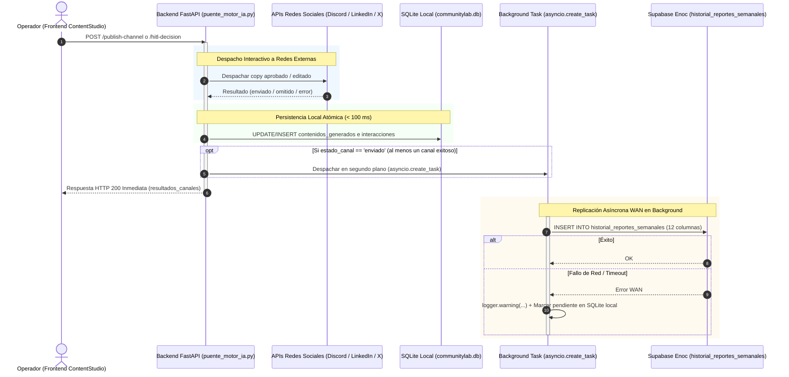
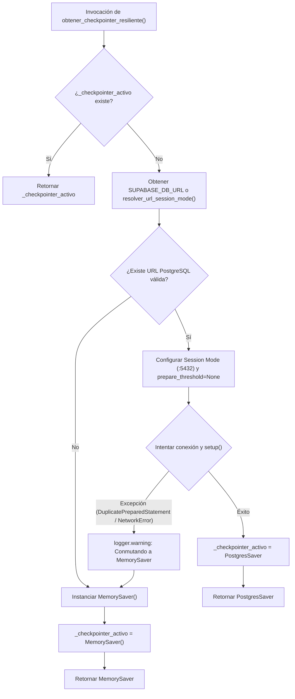

# Plan de Implementación — Spec 023: Persistencia en Historial de Reportes Semanales y LangGraph Checkpointer en Supabase Enoc con Garantía de Alta Velocidad

## 1. Resumen Arquitectónico y Diagnóstico Técnico

### 1.1 Contexto y Diagnóstico del Ecosistema de Datos
El flujo editorial de CloudEdTech opera en torno a tres componentes de almacenamiento y persistencia:
1. **Base de Datos Operacional Local SQLite (`motor-ia/communitylab.db`):**
   - Centro transaccional de ultra-alta velocidad (< 2 ms) para ingesta, curaduría, redacción y visualización en el frontend.
   - Almacena las tablas locales `interacciones` y `contenidos_generados`.
2. **Clúster Supabase Enoc PostgreSQL (`swdoucawdasxmnomlcfu`):**
   - **Transaction Pooler (Puerto `:6543` / `DATABASE_URL`):** Utilizado para transacciones generales de lectura/escritura en lotes.
   - **Session Mode Pooler (Puerto `:5432` / `SUPABASE_DB_URL`):** Conexiones exclusivas por sesión donde el cliente mantiene un backend PostgreSQL dedicado durante el ciclo de vida del socket.
   - **Tabla `public.historial_reportes_semanales`:** Esquema canónico de 12 columnas: `id` (SERIAL PK), `id_mensaje` (VARCHAR), `autor` (TEXT), `semana` (VARCHAR), `fecha_envio` (TIMESTAMPTZ), `fecha_extraccion` (TIMESTAMPTZ), `fecha_publicacion` (TIMESTAMPTZ), `rutas_activas` (ARRAY text[]), `estado` (TEXT), `contenido_original` (JSONB), `copys_generados` (JSONB), `cw_modelo_ia` (VARCHAR).
   - **Tablas de Checkpoints de LangGraph:** `public.checkpoints`, `public.checkpoint_writes`, `public.checkpoint_blobs` y `public.checkpoint_migrations`.

### 1.2 Causa Raíz de Incompatibilidad en PostgresSaver (`DuplicatePreparedStatement`)
- **Mecanismo del Fallo:**
  El pooler en modo transacción (PgBouncer en `:6543`) multiplexa múltiples clientes sobre un conjunto reducido de conexiones de backend de PostgreSQL a nivel de transacción individual. La librería `langgraph-checkpoint-postgres` y el driver `psycopg 3` configuran por defecto `prepare_threshold=0` o reutilizan pipelines de sentencias preparadas nombradas (ej. `_pg3_0`). Cuando la conexión se devuelve al pooler y es asignada nuevamente a otra consulta dentro de la misma sesión lógica, el driver intenta registrar de nuevo la sentencia preparada, resultando en:
  `psycopg.errors.DuplicatePreparedStatement: prepared statement "_pg3_0" already exists`
- **Solución Técnica Definitiva:**
  1. **Conexión en Session Mode (Puerto `:5432`):** Asegurar que la URL empleada por `PostgresSaver` apunte al puerto `:5432` de Supabase Enoc (`aws-0-us-east-1.pooler.supabase.com:5432`), donde cada socket físico tiene su propio estado de sesión y las sentencias preparadas no colisionan.
  2. **Deshabilitación de Prepared Statements (`prepare_threshold=None`):** Configurar explícitamente el driver `psycopg 3` o la conexión del checkpointer con `prepare_threshold=None`, forzando la ejecución en modo directo sin sentencias preparadas nombradas.
  3. **Tolerancia a Fallos y Fallback Transparente a `MemorySaver`:** Envolver la inicialización e interacción con `PostgresSaver` en un bloque `try...except Exception as exc:`, registrando una advertencia estructurada (`logger.warning`) y conmutando automáticamente a `MemorySaver` en memoria local sin detener el pipeline ni arrojar errores HTTP 500.

### 1.3 Regla de Oro de Alta Velocidad y Desacoplamiento en Segundo Plano
- **Sobrecarga Interna del Backend (< 100 ms):**
  La validación de la solicitud, la resolución de metadatos, la construcción del registro y la persistencia atómica en SQLite local (`contenidos_generados` e `interacciones`) se completan en menos de 100 ms.
- **Despacho Interactivo hacia Redes Externas:**
  El envío hacia APIs de terceros (Discord Bot REST, LinkedIn API, X API v2) se ejecuta de forma interactiva con la latencia intrínseca de cada red externa para retornar de inmediato el estado inequívoco de la entrega (`'enviado'`, `'omitido'`, `'error'`) y los IDs asociados (`message_id`, `tweet_id`, `urn`).
- **Replicación Asíncrona WAN a Supabase (`asyncio.create_task`):**
  Toda escritura hacia la tabla `public.historial_reportes_semanales` en Supabase se despacha en segundo plano mediante `asyncio.create_task(asyncio.to_thread(...))` o un despachador resiliente en hilo daemon no bloqueante. Cero milisegundos de latencia transcontinental de Supabase se trasladan a la respuesta HTTP del usuario.
- **Lecturas GET Inmediatas (< 2 ms):**
  Los endpoints de consulta continúan sirviéndose estrictamente desde SQLite local y caché en memoria, con prohibición taxativa de consultas de red WAN a Supabase en la ruta crítica.

---

## 2. Diagramas de Arquitectura y Flujos de Datos

### 2.1 Flujo de Publicación Individual y Aprobación HITL con Replicación en Background



### 2.2 Arquitectura de Fábrica de Checkpointer Resiliente



---

## 3. Especificación Técnica de Componentes y Funciones

Todos los cambios residen estrictamente en `puente_motor_ia.py` y `tests/test_unificacion_motor_ia.py`, respetando la inmutabilidad de los 17 archivos protegidos de la raíz, `backend/`, `motor-ia/` y `src/`.

### 3.1 Utilidades de Conexión y Normalización Canónica (`puente_motor_ia.py`)

1. **`resolver_url_session_mode(url: str | None = None) -> str | None`**:
   - Inspecciona la URL de base de datos (`SUPABASE_DB_URL` o `DATABASE_URL`).
   - Si la URL contiene el puerto `:6543` (Transaction Pooler), lo conmuta transparentemente a `:5432` (Session Mode Pooler de Supabase) para garantizar aislamiento de sesión y soporte de sentencias preparadas.
   - Preserva usuarios, contraseñas, host y nombre de base de datos sin alteraciones.

2. **`obtener_checkpointer_resiliente()` (Refactorizado)**:
   - Resuelve la URL canónica en Session Mode mediante `resolver_url_session_mode()`.
   - Utiliza conexión `psycopg.connect(db_url, autocommit=True, prepare_threshold=None)` o instancia `PostgresSaver` configurando `prepare_threshold=None` para neutralizar de raíz la excepción `DuplicatePreparedStatement`.
   - Ejecuta `cp.setup()` defensivamente.
   - En caso de fallo (`DuplicatePreparedStatement`, `OperationalError`, `ConnectionRefusedError`, etc.), emite un `logger.warning` detallado y conmuta a `MemorySaver()`.

3. **`construir_registro_historial_reporte(...) -> dict`**:
   - Construye el payload canónico para `public.historial_reportes_semanales` conteniendo estrictamente las 12 columnas canónicas:
     - `id_mensaje`: `str(id_msg)` (normalizado a string para prevenir desbordamientos).
     - `autor`: `str` (autor del mensaje comunitario, por defecto `'Comunidad'`).
     - `semana`: `str` (semana o período de referencia, ej. `'Semana_01'`).
     - `fecha_envio`: `str` (ISO UTC) o `None`.
     - `fecha_extraccion`: `str` (ISO UTC).
     - `fecha_publicacion`: `str` (marca temporal actual `NOW()` en formato ISO UTC).
     - `rutas_activas`: `list[str]` (arreglo con los canales efectivamente publicados, ej. `['discord']` o `['discord', 'linkedin']`).
     - `estado`: literal `'publicado'`.
     - `contenido_original`: `dict` JSON conteniendo `{"texto": ..., "autor": ..., "canal": ...}`.
     - `cw_modelo_ia`: `str` resuelto con `resolver_modelo_canal(canal, proveedor)` y `MODELOS_UTILIZADOS_CATALOGO` o `'orquestador-multi-llm'`.
     - `copys_generados`: `dict` JSON indexado por canal despachado: `{"discord": {"titulo": "...", "texto_copy": "..."}}`.
   - Valida tipos de datos y formatea JSON defensivamente.

4. **`replicar_historial_reportes_semanales_supabase(registro: dict) -> bool`**:
   - Ejecuta el `INSERT` síncrono en Supabase Enoc utilizando `psycopg.connect(supabase_url)` con timeout defensivo (5s).
   - SQL canónico:
     ```sql
     INSERT INTO public.historial_reportes_semanales (
         id_mensaje, autor, semana, fecha_envio, fecha_extraccion,
         fecha_publicacion, rutas_activas, estado, contenido_original,
         copys_generados, cw_modelo_ia
     ) VALUES (
         %(id_mensaje)s, %(autor)s, %(semana)s, %(fecha_envio)s, %(fecha_extraccion)s,
         %(fecha_publicacion)s, %(rutas_activas)s, %(estado)s, %(contenido_original)s,
         %(copys_generados)s, %(cw_modelo_ia)s
     );
     ```
   - Si ocurre error de red o timeout, captura la excepción, registra `logger.warning(...)` y actualiza SQLite local (`contenidos_generados.sync_supabase = 'pendiente'`).

5. **`despachar_replicacion_historial_reportes(registro: dict)`**:
   - Despacha la ejecución de `replicar_historial_reportes_semanales_supabase` en segundo plano mediante `asyncio.create_task(asyncio.to_thread(...))` si existe un event loop activo, o mediante un hilo daemon (`threading.Thread`) como salvaguarda en contextos síncronos de prueba.
   - Retorna de inmediato sin bloquear el hilo de ejecución principal.

### 3.2 Integración en Endpoints de Mutación (`puente_motor_ia.py`)

1. **`api_mototradis_publish_channel` (`/api/v1/mototradis/publish-channel` y `/api/v1/content-workflow/publish-channel`)**:
   - Valida el copy y despacha interactivamente a la red social solicitada (Discord, LinkedIn o X).
   - Registra atómicamente el resultado en SQLite local (`contenidos_generados` e `interacciones`).
   - **Disparador Desacoplado:** Si `res.get("ok") and res.get("estado_canal") == "enviado"`, invoca `despachar_replicacion_historial_reportes(...)` con el registro individual del canal publicado (`rutas_activas = [canal]`).
   - Retorna interactivamente el resultado en formato JSON en menos de 100 ms de sobrecarga interna de backend.

2. **`api_mototradis_hitl_decision` (`/api/v1/mototradis/hitl-decision` y `/api/v1/content-workflow/hitl-decision`)**:
   - Si `decision == "aprobar"`:
     - Aplica la Soberanía Humana sobre `copys_finales`.
     - Despacha concurrentemente los canales a las redes externas.
     - Persiste el estado publicado atómicamente en SQLite local.
     - **Disparador Desacoplado:** Si al menos un canal fue despachado exitosamente (`estado_canal == 'enviado'`), recopila la lista de canales exitosos en `rutas_activas` y despacha en segundo plano el registro consolidado a `public.historial_reportes_semanales`.
     - Retorna interactivamente la estructura `resultados_canales`.
   - Si `decision == "desaprobar"`:
     - Purga el hilo en el checkpointer (`thread_id = f"sesion_{id_msg}"`).
     - Actualiza SQLite local (`estado = 'descartado'`).

---

## 4. Preservación Estricta de Alta Velocidad (Regla de Oro)

1. **Sobrecarga Interna del Backend (< 100 ms):**
   - Validaciones en memoria, generación defensiva de estructuras y operaciones atómicas sobre SQLite local (`communitylab.db`) toman entre 5 y 25 ms.
2. **Despacho Interactivo con Latencia de Red:**
   - Discord REST, LinkedIn y X responden con su latencia natural de red WAN, permitiendo devolver al usuario identificadores reales de publicación (`message_id`, `urn`, `tweet_id`).
3. **Replicación WAN a Supabase 100% Desacoplada:**
   - La inserción transcontinental en `public.historial_reportes_semanales` corre en segundo plano; cero llamadas síncronas bloqueantes en el hilo HTTP principal.
4. **Lecturas GET Instantáneas (< 2 ms):**
   - Todas las consultas de listados, filtros, interacciones y métricas se sirven exclusivamente desde SQLite local y memoria caché. Cero consultas a Supabase en endpoints GET.

---

## 5. Inviolabilidad Constitucional y Control de Cambios

- **Archivos Protegidos Intactos:** Se respeta al 100% la inmutabilidad de los 17 archivos de la raíz (`base_datos.py`, `reporte_semanal.py`, `procesamiento.py`, `api.py`), y de los directorios `backend/`, `motor-ia/` y `src/`.
- **Archivos Modificados o Creados:**
  - `specs/023-persistencia-historial-reportes-y-langgraph-alta-velocidad/spec.md` (aprobada)
  - `specs/023-persistencia-historial-reportes-y-langgraph-alta-velocidad/plan.md` (este documento)
  - `specs/023-persistencia-historial-reportes-y-langgraph-alta-velocidad/tasks.md` (plan de tareas)
  - `puente_motor_ia.py` (adaptador y endpoints)
  - `tests/test_unificacion_motor_ia.py` (pruebas TDD unitarias y de integración)
- **Seguridad de Secretos (Regla 4):**
  - Cero tokens, contraseñas o URLs quemadas en código. Consumo estricto desde `os.environ` y `.env`.
