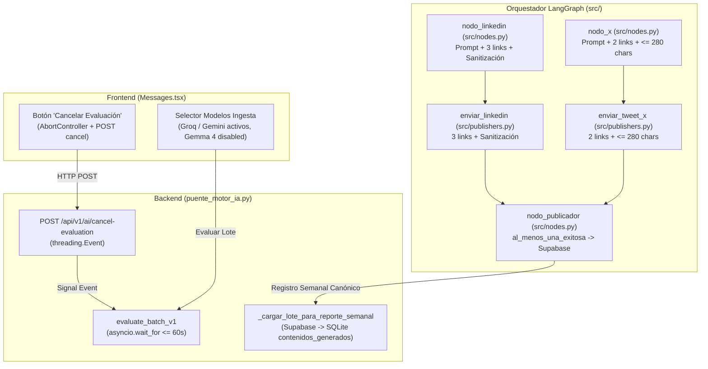

# Plan Técnico 027: Resolución de Bloqueos en Gemma 4, Inclusión Automática de Links y Sincronización de Reportes OCI

## 1. Arquitectura General y Regla de Oro de Alta Velocidad

El diseño técnico de la Spec 027 se estructura sobre tres directrices arquitectónicas inquebrantables:

1. **Aislamiento Constitucional Estricto y Ámbito de Archivos Autorizados (RNF-01):**
   - **Prohibido categóricamente modificar:** Los archivos preexistentes en la raíz del repositorio (`reporte_semanal.py`, `cerebro_ia.py`, `cerebro_ia_gemma_4.py`, `base_datos.py`, `modelos.py`, `procesamiento.py`, `limpieza.py`, `evaluador_lotes.py`, `app.py`, `api.py`), así como los directorios `backend/` y `motor-ia/`.
   - **Superficie de cambio autorizada exclusivamente:**
     * `src/nodes.py` (nodos de LinkedIn, X, publicador y orquestador).
     * `src/publishers.py` (despachos a LinkedIn y X con inyección de links y sanitización).
     * `src/schemas.py` (esquemas de estado y contratos canónicos de LangGraph).
     * `puente_motor_ia.py` (endpoints, normalización de semanas, endpoint de cancelación y extracción de copys).
     * `frontend/src/pages/Messages.tsx` (deshabilitación de Gemma 4 y botón de cancelación).
     * Suite de pruebas automatizadas en `tests/test_unificacion_motor_ia.py`.

2. **Preservación Absoluta de la Regla de Oro de Alta Velocidad (`< 2 ms` en Lecturas — RNF-02):**
   - **Lecturas GET instantáneas:** `GET /api/community/messages`, `GET /api/community/analytics` y `GET /api/v1/oci-storage/reports` continúan respondiendo en `< 2 ms` desde memoria o SQLite local. Cero llamadas WAN externas bloqueantes en el hilo principal de FastAPI.
   - **Cancelación no bloqueante y cooperativa:** El endpoint `POST /api/v1/ai/cancel-evaluation` responde de inmediato (< 5 ms) activando un evento en memoria (`threading.Event`), permitiendo que el hilo de trabajo en segundo plano aborte la iteración sin congelar el servidor ni generar condiciones de carrera.

3. **Compatibilidad Estricta de Esquemas y Calidad de Datos (RNF-03 y RNF-04):**
   - Toda generación de reportes hacia OCI Storage y disco (`reportes/2026-semana-42.json`) preserva al 100% el esquema canónico de la Spec 024 (`metadata`, `resumen_metricas`, `activos_copywriting`), garantizando que no exista ningún registro ficticio (`id_mensaje: "999"` / `fallback_user`).
   - Desarrollo guiado por pruebas (TDD): Cada requerimiento cuenta con pruebas automatizadas en `tests/` antes de su integración final.

---

## 2. Diseño Técnico Detallado por Requisito Funcional



### 2.1. RF-01: Descarte de Gemma 4 en Ingesta y Blindaje de Motores Estables (Opción B)
- **En `frontend/src/pages/Messages.tsx`:**
  * En `DEFAULT_AI_MODELS`, deshabilitar la opción de Gemma 4 para la etapa de Ingesta (`disabled: true`), manteniendo disponibles únicamente Groq (Llama 3.3) y Google Gemini Flash Lite.
  * Añadir un tooltip o badge descriptivo: *"Reservado para copywriting masivo (<35%). En Ingesta usa Groq o Gemini Flash Lite"*.
  * Si el usuario tenía previamente seleccionado Gemma 4 en su almacenamiento local, autoseleccionar Groq (Llama 3.3) por defecto.
- **En `puente_motor_ia.py`:**
  * En `evaluate_batch_v1` y `evaluate_single_message_v1`, validar el parámetro `proveedor`. Si se solicita `"cerebro_ia_gemma_4"` o `"Google Gemma 4"`, responder inmediatamente con `HTTP 400 Bad Request` indicando que Gemma 4 está reservado para la cola de copywriting masivo, o conmutar de forma transparente a Groq (Llama 3.3) / Gemini Flash Lite.
  * En `src/nodes.py`, preservar a Google Gemma 4 como el motor especializado y de alto rendimiento en `nodo_gemma_automatico` para la cola masiva `< 35%`.

### 2.2. RF-02: Mecanismo de Cancelación Activa y Timeout en Ingesta
- **En `puente_motor_ia.py`:**
  * Definir un objeto global de señalización cooperativa: `_evento_cancelacion_evaluacion = threading.Event()`.
  * Implementar el endpoint formal:
    ```python
    @app.post("/api/v1/ai/cancel-evaluation")
    @app.post("/api/v1/ai/cancel-evaluation/")
    async def cancel_evaluation_v1(payload: dict = Body(default={})):
        _evento_cancelacion_evaluacion.set()
        return {"status": "cancelled", "message": "Evaluación cancelada exitosamente"}
    ```
  * En el bucle de procesamiento de lotes en el hilo secundario:
    - Antes de iniciar el lote: `_evento_cancelacion_evaluacion.clear()`.
    - En cada iteración de mensaje: verificar `if _evento_cancelacion_evaluacion.is_set(): break`.
    - Al interrumpirse, consolidar y persistir en SQLite local los mensajes que ya fueron analizados hasta ese instante.
  * Envolver la ejecución del hilo en `await asyncio.wait_for(asyncio.to_thread(...), timeout=60.0)` para garantizar que peticiones degradadas de la API externa aborten limpiamente sin colgar el servidor.
- **En `frontend/src/pages/Messages.tsx`:**
  * Declarar una referencia `abortControllerRef = useRef<AbortController | null>(null)`.
  * En `handleEvaluateBatch`:
    - Inicializar `abortControllerRef.current = new AbortController()`.
    - Pasar `{ signal: abortControllerRef.current.signal }` en el `fetch` a `/api/v1/ai/evaluate-batch`.
  * Renderizar en la UI el botón interactivo **"Cancelar Evaluación"** visible cuando `isEvaluatingBatch === true`.
  * Al pulsar "Cancelar":
    - Invocar `abortControllerRef.current?.abort()`.
    - Ejecutar `fetch('/api/v1/ai/cancel-evaluation', { method: 'POST' })`.
    - Restablecer `setIsEvaluatingBatch(false)`.
    - Ejecutar `await loadMessages()` para refrescar la lista con las evaluaciones consolidadas.
    - Mostrar notificación de advertencia informativa: *"Evaluación cancelada por el usuario. Los mensajes procesados hasta el momento fueron conservados"*.

### 2.3. RF-03: Automatización de Links y Sanitización en LinkedIn (Ampliación Spec 026)
- **En `src/nodes.py` (`nodo_linkedin`):**
  * Actualizar `<system_prompt>` incorporando en los principios obligatorios y en los ejemplos Few-Shot la exigencia de terminar el post (`texto_copy`) con el bloque canónico:
    ```text
    Más Información:
    https://lnkd.in/gX2m2Rhq
    https://lnkd.in/gvbqJiF4
    https://lnkd.in/gU7h7xyG
    ```
  * Post-procesamiento defensivo e idempotente tras la invocación del LLM:
    - Verificar la presencia de los 3 links. Si faltan, anexar el bloque al final del texto.
    - Aplicar `_sanitizar_marca_texto_red` para reemplazar `"Alura"` / `"Alura Latam"` / `"#Alura"` por `"CloudEDTech"`.
- **En `src/publishers.py` (`enviar_linkedin`):**
  * Antes de estructurar el payload para `https://api.linkedin.com/v2/ugcPosts`, aplicar de forma idempotente la verificación de los 3 links y la sanitización de marca sobre `titulo` y `texto_copy`.
- **En `puente_motor_ia.py`:**
  * En `_formatear_borradores_ui` y en los endpoints `generate-channel` y `execute-pipeline`, asegurar que el borrador para LinkedIn contenga automáticamente los links y la sanitización para que la UI los visualice de inmediato sin requerir clics manuales.

### 2.4. RF-04: Automatización de Links y Límite de 280 Caracteres en X (Ampliación Spec 026)
- **En `src/nodes.py` (`nodo_x`):**
  * Actualizar `<system_prompt>` instruyendo la inclusión obligatoria de los 2 links de No Country y GitHub (`https://lnkd.in/gvbqJiF4` y `https://lnkd.in/gU7h7xyG`).
  * Post-procesamiento defensivo e idempotente:
    - Verificar e inyectar los 2 links al final.
    - Si la longitud total (`titulo` + `texto_copy` + links) excede 280 caracteres, recortar de forma inteligente el cuerpo del texto en el límite de la última palabra completa añadiendo `...`, asegurando que los dos enlaces permanezcan 100% íntegros y al final del tweet.
    - Sanitizar menciones a "Alura" -> "CloudEDTech".
- **En `src/publishers.py` (`enviar_tweet_x`):**
  * Revalidar antes de publicar que el tweet total no supere 280 caracteres, que contenga los 2 enlaces y que no contenga referencias a "Alura".
- **En `puente_motor_ia.py`:**
  * Reflejar los 2 links en `_formatear_borradores_ui` para X de forma automática.

### 2.5. RF-05: Persistencia de Publicaciones Parciales en `nodo_publicador`
- **En `src/nodes.py` (`nodo_publicador`):**
  * Modificar la lógica de evaluación de éxito:
    ```python
    canales_exitosos = []
    # evaluar discord, x, linkedin, reclamos...
    al_menos_una_exitosa = len(canales_exitosos) > 0

    if al_menos_una_exitosa:
        # Persistir en public.historial_reportes_semanales
        # rutas_activas = canales_exitosos
        # estado = "publicado"
        # estado_publicacion = json.dumps({"exitosos": canales_exitosos, "fallidos": canales_fallidos})
    ```
  * Garantizar que si un canal falla por falta de credenciales locales (ej. X API no configurada en `.env`), pero Discord publicó con éxito, la interacción se guarde en `public.historial_reportes_semanales` y se marque como `"aprobado"` / `"publicado"` en el lote.

### 2.6. RF-06: Normalización Canónica de Semana (`YYYY-semana-WW`) sin Modificar Archivos Raíz
- **En `puente_motor_ia.py`, `src/nodes.py` y `src/schemas.py`:**
  * Crear la función canónica de normalización:
    ```python
    def _normalizar_semana_canonico(semana_raw: str | None, fecha_ref: str | None = None) -> str:
        # Detecta formatos AAAA-semana-NN, Semana_NN o extrae semana ISO desde fecha_ref
        # Retorna siempre formato canónico 'YYYY-semana-WW' (ej. '2026-semana-42')
    ```
  * En `nodo_publicador`, guardar `semana = _normalizar_semana_canonico(semana, fecha_envio)`.
  * En `_extraer_historial_reportes_semanales_supabase`, normalizar la consulta SQL para emparejar tanto la etiqueta canónica como posibles variantes históricas (`semana = %s OR semana ILIKE %s`).
  * **INVIOLABILIDAD ABSOLUTA:** Cero modificaciones a `reporte_semanal.py`. El adaptador en `puente_motor_ia.py` alimenta las funciones de `reporte_semanal` ya con la semana canónica.

### 2.7. RF-07: Reconstrucción de Reportes OCI desde SQLite y Erradicación Total de Mocks
- **En `puente_motor_ia.py` (`_cargar_lote_para_reporte_semanal`):**
  * Consultar primero `public.historial_reportes_semanales` en Supabase.
  * Si Supabase está vacío o inaccesible, consultar SQLite local:
    ```sql
    SELECT c.plataforma, c.titulo, c.contenido, i.*
    FROM contenidos_generados c
    JOIN interacciones i ON c.interaccion_id = i.id
    WHERE (c.estado_publicacion = 'publicado' OR c.estado = 'publicado' OR i.etapa_flujo = 'publicado')
    ```
  * Construir los items del reporte con los copys reales generados y KPIs asociados.
  * Eliminar categóricamente el diccionario mock de `id_mensaje: "999"` y `fallback_user`. Si no hay mensajes, retornar `{"aprobados": [], "descartados": []}`, permitiendo que el endpoint responda `HTTP 400` controlado (*"No hay mensajes analizados para el período indicado"*).
  * Regenerar físicamente `reportes/2026-semana-42.json` con los mensajes reales de la comunidad y sincronizar al bucket OCI.

---

## 3. Matriz de Dependencias e Impacto

| Archivo | Rol en la Solución | Tipo de Cambio |
| :--- | :--- | :--- |
| `src/nodes.py` | Prompts automáticos de LinkedIn y X, `al_menos_una_exitosa` en `nodo_publicador`, normalización de semana | Modificación controlada |
| `src/publishers.py` | Idempotencia de 3 links en LinkedIn, 2 links en X (<=280 chars) y sanitización | Modificación controlada |
| `src/schemas.py` | Valores por defecto canónicos de semana (`YYYY-semana-WW`) | Modificación controlada |
| `puente_motor_ia.py` | Endpoint de cancelación, descarte de Gemma en Ingesta, extracción de copys SQLite para OCI, normalización | Modificación controlada |
| `frontend/src/pages/Messages.tsx` | Selector con Gemma disabled y botón "Cancelar Evaluación" con `AbortController` | Modificación controlada |
| `tests/test_unificacion_motor_ia.py` | Pruebas TDD exhaustivas de los 7 requerimientos funcionales | Nuevas pruebas TDD |
| `reporte_semanal.py` | Generador raíz de reportes OCI | **INVIOLABLE (0 cambios)** |

---

## 4. Estrategia de Pruebas TDD y Criterios de Validación

1. **Fase Red (Test-First):** Escribir pruebas unitarias que fallen antes de implementar:
   - Cancelación cooperativa de evaluación por lote.
   - Rechazo / fallback de Gemma 4 en Ingesta.
   - Inyección automática de los 3 links en LinkedIn y 2 links en X (límite 280 chars).
   - Inserción en historial ante éxitos parciales en `nodo_publicador`.
   - Normalización de semana a `YYYY-semana-WW`.
   - Reconstrucción de reportes desde SQLite sin rastro de `fallback_user`.
2. **Fase Green (Implementación Mínima):** Implementar el código en los archivos autorizados hasta que todas las pruebas pasen.
3. **Fase Refactor y Validación:**
   - Ejecutar `pytest` sobre la suite completa asegurando 100% de tests en verde.
   - Ejecutar `npm run build` en el frontend verificando código de salida 0.
   - Validar que los 17 archivos protegidos de la raíz permanecen intactos mediante `git status`.
